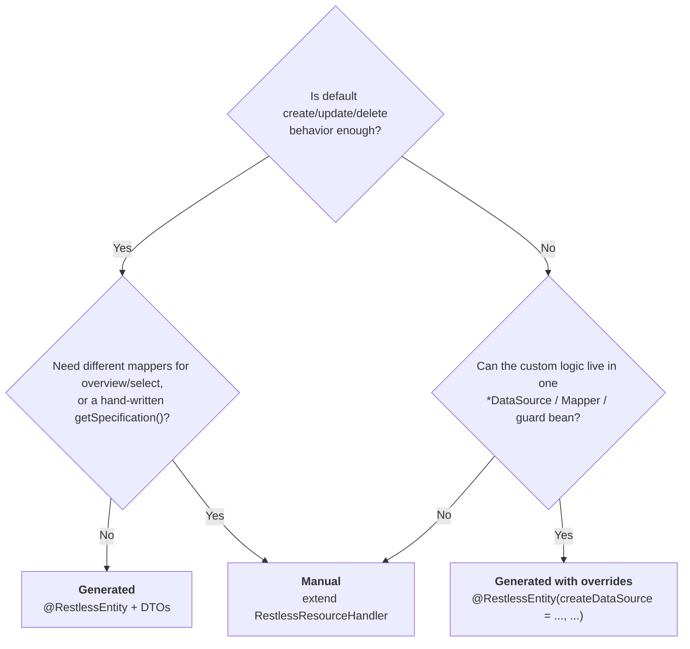

# spring-boot-restless

**Annotation-driven REST CRUD for Spring Boot. The library generates the controller, repository and
mapper plumbing; you write the entity, its DTOs and the authorization rules.**

[](https://github.com/cristivoicu/springboot_restless/actions/workflows/ci.yml)
[](https://central.sonatype.com/)
[](LICENSE)
[](https://openjdk.org/)
[](https://spring.io/projects/spring-boot)

> **Status:** pre-1.0 (`0.0.1`), not yet published to Maven Central. Build and install it locally
> (see [Installation](#installation)). See [Versioning and API stability](#versioning-and-api-stability)
> for what that means for compatibility.

This README documents every public component: each annotation and its attributes, each interface and
its methods, each base class, configuration property and HTTP route, with an example of when and how
to use it. Further reading:

- [`docs/DEEP_DIVE.md`](docs/DEEP_DIVE.md): long-form tutorials with sequence diagrams.
- [`example/README.md`](example/README.md): a runnable demo app that uses every feature, including
  a Cerbos + Keycloak setup.
- [`CHANGELOG.md`](CHANGELOG.md): release history.
- [`.claude/skills/spring-boot-restless/`](.claude/skills/spring-boot-restless/): an Agent Skill for
  [Claude Code](https://claude.com/claude-code) that knows these conventions. Copy it into a consumer
  project's `.claude/skills/` to use it there.

All types live under the `ro.cristivoicu.springbootrestless` package. Package names in this document
are relative to it, so `annotation.RestlessEntity` means
`ro.cristivoicu.springbootrestless.annotation.RestlessEntity`.

---

## Table of contents

**Getting started**

1. [Overview](#overview)
2. [Modules and artifacts](#modules-and-artifacts)
3. [Requirements](#requirements)
4. [Installation](#installation)
5. [Quick start](#quick-start)
6. [Choosing a tier](#choosing-a-tier)
7. [How a request is processed](#how-a-request-is-processed)

**Reference**

8. [HTTP API reference](#http-api-reference)
9. [Annotations](#annotations)
10. [Enums](#enums)
11. [Models and DTO contracts](#models-and-dto-contracts)
12. [Repositories and data sources](#repositories-and-data-sources)
13. [Mapping](#mapping)
14. [`RestlessResourceHandler`: the manual tier](#restlessresourcehandler-the-manual-tier)
15. [Filtering](#filtering)
16. [Authorization](#authorization)
17. [`RestlessContext`](#restlesscontext)
18. [Actions, views, files and hooks](#actions-views-files-and-hooks)
19. [Bulk operations](#bulk-operations)
20. [Nested resources](#nested-resources)
21. [Embedding related resources](#embedding-related-resources)
22. [Concurrency, soft delete, auditing and versioning](#concurrency-soft-delete-auditing-and-versioning)
23. [Errors](#errors)
24. [Configuration properties](#configuration-properties)
25. [Auto-configured beans](#auto-configured-beans)
26. [OpenAPI and observability](#openapi-and-observability)
27. [Cerbos module](#cerbos-module)
28. [Test module](#test-module)
29. [Hand-subclassed controllers (legacy tier)](#hand-subclassed-controllers-legacy-tier)
30. [Internal types](#internal-types)

**Guides and project**

31. [Cookbook: "I want to..."](#cookbook-i-want-to)
32. [Design rationale](#design-rationale)
33. [Roadmap](#roadmap)
34. [Versioning and API stability](#versioning-and-api-stability)
35. [Contributing](#contributing)
36. [Code of Conduct](#code-of-conduct)
37. [Security policy](#security-policy)
38. [License](#license)

---

## Overview

Most Spring Boot services with a relational model repeat the same code for every entity: a
`@RestController`, a `JpaRepository`, a mapper, and the CRUD glue between them. That code isn't
where the application's value is. The value is in the rules about who may do what to which row, and
which fields they may see.

spring-boot-restless removes the repetitive part. You annotate an entity and write its DTOs, and the
library registers a full REST resource at startup: create, read (one, list, page), update, patch,
delete, bulk variants, filtering, sorting, validation, ETags and RFC 9457 errors.

Two things stay hand-written on purpose:

- **Response shape.** You always write the DTO class. The library can generate the code that copies
  fields onto it, but it never invents a DTO from the entity, so it can't leak fields by accident.
- **Authorization.** Every route goes through an `AuthorizationGuard<E>` that you provide (or a
  declarative ownership rule, or Cerbos policies). A resource with no guard fails startup unless you
  opt out explicitly with `allowAll = true`.

When an entity needs custom logic, you override one piece (a data source, a guard, a mapper) or
hand-write the whole resource class. The library doesn't force the same level of control on every
entity.

---

## Modules and artifacts

| Artifact | Maven scope | Contents | When you need it |
|---|---|---|---|
| `spring-boot-restless` | `compile` | The runtime: `RestlessResourceHandler`, data sources, guards, registrar, error handling, OpenAPI, auto-configuration. | Always. |
| `spring-boot-restless-processor` | `provided` / `annotationProcessor` | The `@RestlessEntity` annotation processor and its compile-time annotations (`@RestlessEntity`, `@RestlessOwnedBy`, `@RestlessMapperExclude`, ...). | When you use the generated tier (`@RestlessEntity`). Not needed at runtime. |
| `spring-boot-restless-cerbos` | `compile` | `CerbosAuthorizationGuard`, field masking (`@CerbosHiddenField`), Cerbos client auto-configuration and health indicator. | When authorization rules live in Cerbos policies. |
| `spring-boot-restless-test` | `test` | `RestlessErrorAssertions`, `RestlessPageAssertions`, `RestlessOwnershipContract` for MockMvc tests. | Optional, for tests. |
| `spring-boot-restless-dependencies` | `import` (BOM) | Version alignment for all of the above. | Optional; lets you omit versions. |

In this repository the runtime artifact is built by the `app` module. `example` is a demo application
that is never published.

---

## Requirements

| Component | Version |
|---|---|
| Java, for the published library (`app`, `processor`, `cerbos`, `spring-boot-restless-test`) | 17+ |
| Java, for building the whole reactor (the `example` module targets Java 25) | 25+ |
| Spring Boot | 4.1.x |
| Build tool | Maven 3.9+ (`./mvnw` is included) or Gradle |
| Persistence | Spring Data JPA with a relational database |
| Optional: authorization backend | A [Cerbos](https://www.cerbos.dev/) PDP, for `spring-boot-restless-cerbos` |
| Optional: Spring Security | Needed for `RestlessContext.authentication()`, the default principal resolver and the Cerbos principal resolver. The core library does not require it. |

---

## Installation

The library isn't on Maven Central yet. Build and install it into your local Maven repository first:

```bash
git clone https://github.com/cristivoicu/springboot_restless.git
cd springboot_restless
./mvnw install
```

### Maven

```xml
<dependency>
    <groupId>io.github.cristivoicu</groupId>
    <artifactId>spring-boot-restless</artifactId>
    <version>0.0.1</version>
</dependency>

<!-- Optional: compile-time code generation from @RestlessEntity -->
<dependency>
    <groupId>io.github.cristivoicu</groupId>
    <artifactId>spring-boot-restless-processor</artifactId>
    <version>0.0.1</version>
    <scope>provided</scope>
</dependency>

<!-- Optional: Cerbos-backed authorization and field masking -->
<dependency>
    <groupId>io.github.cristivoicu</groupId>
    <artifactId>spring-boot-restless-cerbos</artifactId>
    <version>0.0.1</version>
</dependency>

<!-- Optional: test helpers -->
<dependency>
    <groupId>io.github.cristivoicu</groupId>
    <artifactId>spring-boot-restless-test</artifactId>
    <version>0.0.1</version>
    <scope>test</scope>
</dependency>
```

To manage all versions in one place, import the BOM and drop `<version>` from each dependency:

```xml
<dependencyManagement>
    <dependencies>
        <dependency>
            <groupId>io.github.cristivoicu</groupId>
            <artifactId>spring-boot-restless-dependencies</artifactId>
            <version>0.0.1</version>
            <type>pom</type>
            <scope>import</scope>
        </dependency>
    </dependencies>
</dependencyManagement>
```

### Gradle (Kotlin DSL)

```kotlin
dependencies {
    implementation("io.github.cristivoicu:spring-boot-restless:0.0.1")
    annotationProcessor("io.github.cristivoicu:spring-boot-restless-processor:0.0.1") // optional
    compileOnly("io.github.cristivoicu:spring-boot-restless-processor:0.0.1")         // for the annotations

    implementation("io.github.cristivoicu:spring-boot-restless-cerbos:0.0.1")        // optional
    testImplementation("io.github.cristivoicu:spring-boot-restless-test:0.0.1")      // optional
}
```

### Gradle (Groovy DSL)

```groovy
dependencies {
    implementation 'io.github.cristivoicu:spring-boot-restless:0.0.1'
    annotationProcessor 'io.github.cristivoicu:spring-boot-restless-processor:0.0.1' // optional
    compileOnly 'io.github.cristivoicu:spring-boot-restless-processor:0.0.1'         // for the annotations

    implementation 'io.github.cristivoicu:spring-boot-restless-cerbos:0.0.1'        // optional
    testImplementation 'io.github.cristivoicu:spring-boot-restless-test:0.0.1'      // optional
}
```

No `@ComponentScan` or `@Import` is needed. Every infrastructure bean is registered through Spring
Boot auto-configuration as soon as the jar is on the classpath (see
[Auto-configured beans](#auto-configured-beans)).

---

## Quick start

This builds a complete `/skills` resource with no hand-written controller, repository or mapper.

**1. Annotate the entity.**

```java
@Entity
@Getter @Setter @NoArgsConstructor
@RestlessEntity(basePath = "/skills", allowAll = true) // allowAll: no guard yet, see Authorization
public class Skill {

    @Id
    @GeneratedValue(strategy = GenerationType.IDENTITY)
    private Long id;

    private String name;
}
```

**2. Write four DTOs in the same package, following the naming convention.**

```java
@Getter @Setter
public class SkillCreateModel implements CreateModel {
    @NotBlank private String name;
}

@Getter @Setter
public class SkillUpdateModel implements UpdateModel {
    @NotBlank private String name;
}

@Getter @Setter
public class SkillSearchDto extends AbstractSearchDto {
    private String name;          // ?name=Java          -> name = 'Java'
    private String nameILike;     // ?nameILike=jav      -> lower(name) like '%jav%'
}

@Getter @Setter @NoArgsConstructor
public class SkillDto implements EntityDto {
    private Long id;
    private String name;
}
```

**3. Build and run.** At compile time `RestlessEntityProcessor` generates `SkillRepository` (if you
don't have one), `SkillMapper` (if you don't have one) and `SkillRestlessResource`. At startup
`RestlessRegistrar` registers these routes:

| Method | Path | Result |
|---|---|---|
| `POST` | `/skills` | Create one. `201 Created` with `Location`. |
| `POST` | `/skills/bulk` | Create many in one transaction. |
| `GET` | `/skills/{id}` | Read one. |
| `GET` | `/skills?page=0&size=20&sort=name,asc` | Read a page. |
| `GET` | `/skills/list` | Read every row (capped by `restless.list.max-size`). |
| `GET` | `/skills/overview` | Page through the overview mapper. |
| `GET` | `/skills/select/async` | Page through the select mapper. |
| `PUT` | `/skills/{id}` | Full update. |
| `PUT` | `/skills/bulk` | Update many, keyed by id. |
| `DELETE` | `/skills/{id}` | Delete one. `204 No Content`. |
| `POST` | `/skills/bulk-delete` | Delete many. `204 No Content`. |

```bash
curl -X POST localhost:8080/skills -H 'Content-Type: application/json' -d '{"name":"Java"}'
curl 'localhost:8080/skills?nameILike=jav&sort=-name'
```

Before you ship it, replace `allowAll = true` with a real guard. See [Authorization](#authorization).

---

## Choosing a tier

You choose per entity how much to hand-write. All three tiers produce the same routes and behavior.

| Tier | What you write | Use it when |
|---|---|---|
| **Generated** | Entity with `@RestlessEntity` + DTOs. | Default CRUD is enough. Authorization, ownership, actions, views, hooks, bulk modes and PATCH can all be declared on the annotation. |
| **Generated with overrides** | Same, plus one or more hand-written beans referenced from the annotation (`createDataSource`, `mapper`, `authorizationGuard`, ...). | One verb needs custom logic, for example looking up a related entity on create. |
| **Manual** | A `@Component @RestlessResource` class extending `RestlessResourceHandler<E, K>`. | You don't want the annotation processor, you need different mappers per projection (entity/overview/select), you need a custom `getSpecification`, or you want full control in Java. |



---

## How a request is processed

Every route is a method on `RestlessResourceHandler`. For a single-row write (`PUT /{id}`), the order
is:

1. Build a [`RestlessContext`](#restlesscontext) (path variables, principal, action) and make it
   available through `RestlessContext.current()`.
2. `AuthorizationGuard.preCheck(...)`: may this caller attempt this action at all? Denied means
   `403`/`404` (see [`RestlessDenial`](#restlessdenial)) before any database access.
3. Read and validate the body (Bean Validation, with [validation groups](#restlessvalidationgroups)).
4. Open a transaction. Load the row; a missing row, a soft-deleted row or a row under another parent
   is `404`.
5. `AuthorizationGuard.canAccess(...)` on the loaded row, then the `If-Match` check (`412` on
   mismatch).
6. `@RestlessImmutable(onUpdate = REJECT)` check, lifecycle hooks `beforeUpdate`, then the update
   data source.
7. Server-managed fields are restored: the [parent field](#nested-resources),
   [`@RestlessFromPrincipal`](#restlessfromprincipal) and [`@RestlessImmutable`](#restlessimmutable)
   fields.
8. `AuthorizationGuard.canAccessAfterWrite(...)` on the changed row, so a caller can't move a row
   somewhere they aren't allowed.
9. Lifecycle hooks `afterUpdate`, flush, map to the DTO, `postProcessResponse(...)` (for example
   Cerbos field masking), set `ETag`, commit.

Any exception rolls the transaction back and becomes an RFC 9457 error response (see
[Errors](#errors)). Reads follow the same idea: `preCheck`, then `scope(...)` is ANDed into the query
so lists only contain rows the caller may see.

---

## HTTP API reference

### Routes

`{basePath}` is the resource's `basePath`. A route exists only if the corresponding operation is
enabled (see [`RestlessOperation`](#restlessoperation) and `getEnabledOperations()`).

| Method | Path | Handler | Guard action | Success response |
|---|---|---|---|---|
| `POST` | `{basePath}` | `create` | `CREATE` | `201` + `Location` + `ETag`, body: entity DTO |
| `POST` | `{basePath}/bulk` | `createBulk` | `CREATE` | `200`, body: array of DTOs, or `RestlessBulkResult` in `PARTIAL` mode |
| `GET` | `{basePath}/{id}` | `findOne` | `READ_ONE` | `200` + `ETag` (or `304`), body: entity DTO |
| `GET` | `{basePath}` | `findPage` | `READ_PAGE` | `200`, body: `PageableResponse` of entity DTOs |
| `GET` | `{basePath}/list` | `findList` | `READ_LIST` | `200`, body: array of overview DTOs |
| `GET` | `{basePath}/overview` | `findPageOverview` | `READ_PAGE_OVERVIEW` | `200`, body: `PageableResponse` of overview DTOs |
| `GET` | `{basePath}/select/async` | `findPageSelect` | `READ_PAGE_SELECT` | `200`, body: `PageableResponse` of select DTOs |
| `PUT` | `{basePath}/{id}` | `update` | `UPDATE` | `200` + `ETag`, body: entity DTO |
| `PUT` | `{basePath}/bulk` | `updateBulk` | `UPDATE` | `200`, body: array of DTOs |
| `PATCH` | `{basePath}/{id}` | `patch` | `PATCH` | `200` + `ETag`. Only if a patch data source is configured. |
| `DELETE` | `{basePath}/{id}` | `deleteById` | `DELETE_ONE` | `204` |
| `POST` | `{basePath}/bulk-delete` | `deleteAll` | `DELETE_ALL` | `204` |
| `GET` | `{basePath}/actions/{name}` | `customRead` | `CUSTOM_READ` | `200`, body: `PageableResponse` (a [`ReadAction`](#readactione-r)) |
| `GET` | `{basePath}/actions/{name}` | `collectionAction` | `CUSTOM_READ` | `200`, any JSON or a binary (a [`CollectionAction`](#collectionactione)) |
| `GET` | `{basePath}/{id}/{name}` | `namedView` | `NAMED_VIEW` | `200`, a view's DTO or binary (a [named view](#named-views)) |
| `POST` | `{basePath}/{id}/actions/{name}` | `writeAction` | `WRITE_ACTION` | `200`, the action's response (a [`WriteAction`](#writeactione-req-resp)) |

With `collectionGet = LIST`, `GET {basePath}` returns the plain array, the page moves to
`GET {basePath}/page`, and `/list` keeps working.

Bulk-delete uses `POST` rather than `DELETE` with a body, because proxies and clients may drop a
`DELETE` body.

### Request bodies

| Route | Body |
|---|---|
| `POST {basePath}` | One create model as JSON. With `multipartCreate`, also `multipart/form-data`. |
| `POST {basePath}/bulk` | JSON array of create models. |
| `PUT {basePath}/{id}` | One update model. |
| `PUT {basePath}/bulk` | JSON object keyed by id: `{"1": {...}, "2": {...}}`. |
| `PATCH {basePath}/{id}` | One patch model; `null`/missing fields are left alone. |
| `POST {basePath}/bulk-delete` | A delete model, by default `{"ids": ["1", "2"]}`. |
| `POST {basePath}/{id}/actions/{name}` | The write action's request type. |

### Query parameters

| Parameter | Routes | Meaning |
|---|---|---|
| `page` | paged reads, read actions | Zero-based page index. Default `0`. |
| `size` | paged reads, read actions | Page size. Default `20`. Above `restless.page.max-size` is `400`. |
| `sort` | every collection read | Repeatable. `name`, `name,desc` or `-name`. Default `id,asc`. Unknown properties are `400`. |
| any `SearchDto` field | collection reads | Filter. See [Filtering](#filtering). |
| `expand` | `GET /{id}`, named views | Comma-separated names of [`@RestlessEmbed`](#restlessembed) fields to populate. |
| `dedupe` | `POST /bulk` in `PARTIAL` mode | `false` turns off duplicate skipping for this request. |

### Headers

| Header | Direction | Meaning |
|---|---|---|
| `ETag` | response | `"<version>"` on single-row responses, when the entity has a `@Version` field. |
| `If-None-Match` | request | On `GET /{id}`: `304 Not Modified` when it matches the current ETag. |
| `If-Match` | request | On `PUT`/`PATCH`/`DELETE` of one row and on write actions: `412` when it doesn't match. |
| `Location` | response | On `201` from create: the URL of the new row. |
| `X-Restless-List-Truncated` | response | `true` when `GET /list` hit `restless.list.max-size`. |
| `Content-Disposition` | response | Set on [`RestlessBinary`](#restlessbinary) responses. |

### Status codes

| Status | When |
|---|---|
| `200` / `201` / `204` | Success, see the route table. |
| `304` | `If-None-Match` matched. |
| `400` | Validation failed, malformed JSON, an id or path variable that doesn't convert, unknown sort property, page/bulk size over the cap, `@RestlessImmutable(onUpdate = REJECT)` field changed. |
| `401` | A create needs a principal (`@RestlessFromPrincipal`) and there is none. |
| `403` | Denied by the guard, with `denyAs = FORBIDDEN` (the default). |
| `404` | Missing row, soft-deleted row on a write, row under another parent, or denied with `denyAs = NOT_FOUND`. |
| `409` | Optimistic-lock conflict on save, or a database constraint violation. |
| `412` | `If-Match` didn't match. |
| `415` | Multipart body sent to a resource without `multipartCreate`. |
| `500` | Unexpected error or a misconfiguration (details are logged, not returned). |

---

## Annotations

Annotations come from two artifacts:

- **Compile-time** (`spring-boot-restless-processor`, `SOURCE` retention): `@RestlessEntity`,
  `@RestlessOwnedBy`, `@RestlessMapperExclude`, and the compile-time copies of `@RestlessParent` and
  the enums. They are gone after compilation; the processor turns them into generated code.
- **Runtime** (`spring-boot-restless`, `RUNTIME` retention): `@RestlessResource`, `@RestlessParent`,
  `@RestlessFromPrincipal`, `@RestlessImmutable`, `@RestlessSubtype`, `@RestlessActionName`,
  `@RestlessEmbed`. `@CerbosHiddenField` comes from the Cerbos module.

Some annotations and enums (`RestlessParent`, `RestlessDenial`, `RestlessBulkMode`,
`RestlessCollectionGet`) exist in both artifacts with identical shape, because the processor can't
depend on the runtime module. You use the same import either way; the processor copies the
compile-time values onto the generated `@RestlessResource`.

### `@RestlessEntity`

**Artifact:** processor. **Target:** the JPA entity class.

Generates a `{Entity}RestlessResource` bean for the entity at compile time. Use it for any entity
whose resource can be described declaratively, which is most of them.

**Naming convention.** Unless overridden by an attribute, the processor looks for these classes in
the entity's package:

| Class | Required | Notes |
|---|---|---|
| `{Entity}CreateModel` | Yes | Implements `CreateModel`. |
| `{Entity}UpdateModel` | Yes | Implements `UpdateModel`. Still required when `UPDATE` is excluded from `operations`. |
| `{Entity}SearchDto` | Yes | Implements `SearchDto`, usually extends `AbstractSearchDto`. |
| `{Entity}Dto` | Yes, unless you write `{Entity}Mapper` | The response DTO. |
| `{Entity}Mapper` | No | If missing, generated: one `dto.setX(entity.getX())` per field with the same name and type. |
| `{Entity}Repository` | No | If missing, generated as `SpecificationRepository<Entity, Id>`. |

**Attributes**

| Attribute | Type | Default | Meaning |
|---|---|---|---|
| `basePath` | `String` | required | URL path, for example `"/employees"` or `"/projects/{projectId}/tasks"`. Must be unique across resources. |
| `createModel` | `Class<?>` | `{Entity}CreateModel` | Create model class, when it doesn't follow the convention. |
| `updateModel` | `Class<?>` | `{Entity}UpdateModel` | Update model class. Can be the same class as `createModel`. |
| `searchDto` | `Class<?>` | `{Entity}SearchDto` | Search DTO class. |
| `dto` | `Class<?>` | `{Entity}Dto` | Response DTO used by the generated mapper. |
| `mapper` | `Class<?>` | `{Entity}Mapper` or generated | A hand-written `Mapper<Entity, ?>` `@Component`. |
| `repository` | `Class<?>` | `{Entity}Repository` or generated | A repository elsewhere. Must extend `SpecificationRepository<Entity, Id>`. |
| `createDataSource` | `Class<?>` | `DefaultCreateDataSource` | A hand-written `CreateDataSource` `@Component`. |
| `readDataSource` | `Class<?>` | `DefaultReadDataSource` | A hand-written `ReadDataSource` `@Component`. |
| `updateDataSource` | `Class<?>` | `DefaultUpdateDataSource` | A hand-written `UpdateDataSource` `@Component`. |
| `deleteDataSource` | `Class<?>` | `DefaultDeleteDataSource` | A hand-written `DeleteDataSource` `@Component`, or `DefaultSoftDeleteDataSource` subclass. |
| `patchDataSource` | `Class<?>` | none (no `PATCH` route) | A `PatchDataSource` `@Component`. Setting it adds `PATCH {basePath}/{id}`. |
| `authorizationGuard` | `Class<?>` | none | An `AuthorizationGuard<Entity>` `@Component`. Can't be combined with `@RestlessOwnedBy`. |
| `allowAll` | `boolean` | `false` | `true` lets the resource start without a guard. Without a guard and without this, startup fails. |
| `operations` | `RestlessOperation[]` | all nine | Which fixed routes to register. |
| `version` | `String` | `""` | API version for every route, as in `@RequestMapping(version = ...)`. |
| `parent` | `@RestlessParent` | not nested | Makes the resource nested under a parent path variable. |
| `denyAs` | `RestlessDenial` | `DEFAULT` | `403` or `404` for denied callers. |
| `readActions` | `Class<?>[]` | `{}` | `ReadAction` beans, each at `GET {basePath}/actions/{name}`. |
| `collectionActions` | `Class<?>[]` | `{}` | `CollectionAction` beans, each at `GET {basePath}/actions/{name}`. |
| `writeActions` | `Class<?>[]` | `{}` | `WriteAction` beans, each at `POST {basePath}/{id}/actions/{name}`. |
| `views` | `Class<?>[]` | `{}` | `Mapper<Entity, ?>` beans, each at `GET {basePath}/{id}/{name}`. |
| `hooks` | `Class<?>[]` | `{}` | `RestlessLifecycleHook<Entity>` beans, run in this order. |
| `multipartCreate` | `boolean` | `false` | `POST {basePath}` also accepts `multipart/form-data`. |
| `bulkMode` | `RestlessBulkMode` | `DEFAULT` (all-or-nothing) | How bulk create treats bad rows. |
| `bulkDedupe` | `Class<?>` | none | A `RestlessDedupeKey<Entity, CreateModel>` bean for `PARTIAL` bulk create. |
| `collectionGet` | `RestlessCollectionGet` | `DEFAULT` (page) | Whether `GET {basePath}` returns a page or a plain array. |

Every bean referenced from an attribute (data sources, guard, actions, views, hooks, dedupe key) must
be a Spring bean (`@Component`). The generated resource receives it through constructor injection.
Each action and view bean needs [`@RestlessActionName`](#restlessactionname).

`Class<?>` attributes can't name a parameterized type. To use a generic class such as
`DefaultPatchDataSource<E, K, P>`, make a small named subclass:

```java
@Component
class DepartmentPatchDataSource extends DefaultPatchDataSource<Department, Long, DepartmentPatchModel> {
    DepartmentPatchDataSource(DepartmentRepository repository) {
        super(repository, DepartmentPatchModel.class);
    }
}
```

**Compile-time checks.** The processor fails the build when:

- the entity has no `@Id` field, or a convention class is missing;
- `parent` sets only one of `variable`/`field`, the variable isn't in `basePath`, or the field doesn't
  exist or can't be converted from a path variable;
- a create, update or patch model declares a field named like a protected entity field (`@Id`,
  `@Version`, `@CreatedDate`, `@LastModifiedDate`, `deleted` on a `SoftDeletable`) or a
  `@RestlessFromPrincipal` field;
- a patch model has a primitive field (it can't represent "not sent");
- `@RestlessOwnedBy` is combined with `authorizationGuard`, or names a property that doesn't exist.

**Example: generated with overrides**

```java
@Entity
@RestlessEntity(basePath = "/projects",
        createDataSource = ProjectCreateDataSource.class,      // custom create logic
        authorizationGuard = ProjectAuthorizationGuardBean.class,
        version = "1.0")
public class Project extends AbstractAuditableEntity { ... }
```

**Example: read-only resource**

```java
@RestlessEntity(basePath = "/countries", allowAll = true,
        operations = {RestlessOperation.READ_ONE, RestlessOperation.READ_LIST, RestlessOperation.READ_PAGE})
public class Country { ... }
```

### `@RestlessResource`

**Artifact:** runtime. **Target:** a class extending `RestlessResourceHandler`.

Marks a resource bean for route registration. You write it yourself on the manual tier; on the
generated tier the processor puts it on the generated class. Never put it on the entity.

| Attribute | Type | Default | Meaning |
|---|---|---|---|
| `basePath` | `String` | required | URL path. |
| `version` | `String` | `""` | API version for every route. See [API versioning](#api-versioning). |
| `allowAll` | `boolean` | `false` | Allow startup without an `AuthorizationGuard` override. |
| `parent` | `@RestlessParent` | not nested | See [Nested resources](#nested-resources). |
| `denyAs` | `RestlessDenial` | `DEFAULT` | `403` or `404` for denied callers. |
| `bulkMode` | `RestlessBulkMode` | `DEFAULT` | How bulk create treats bad rows. |
| `collectionGet` | `RestlessCollectionGet` | `DEFAULT` | Page or plain array on `GET {basePath}`. |

Things that `@RestlessEntity` declares as attributes (actions, views, hooks, PATCH, multipart, dedupe,
operations) are declared on the manual tier by overriding methods of `RestlessResourceHandler`.

```java
@Component
@RestlessResource(basePath = "/departments", denyAs = RestlessDenial.NOT_FOUND)
public class DepartmentRestlessResource extends RestlessResourceHandler<Department, Long> { ... }
```

### `@RestlessParent`

**Artifact:** both. **Target:** used only as the `parent` attribute of `@RestlessEntity` or
`@RestlessResource`.

Nests a resource under a parent, for example `/projects/{projectId}/tasks`. Every operation is then
limited to the parent named in the URL. See [Nested resources](#nested-resources) for the full
behavior.

| Attribute | Type | Default | Meaning |
|---|---|---|---|
| `variable` | `String` | `""` | Path variable in `basePath` that holds the parent id. |
| `field` | `String` | `""` | Entity property holding the parent id: a plain column (`"notebookId"`) or one association hop to its id (`"project.id"`). |

Both empty means not nested. Use it when the child only makes sense inside its parent and URLs should
say so.

```java
// Plain foreign-key column
@RestlessEntity(basePath = "/notebooks/{notebookId}/notes",
        parent = @RestlessParent(variable = "notebookId", field = "notebookId"))
public class Note { @Column(nullable = false) private Long notebookId; ... }

// @ManyToOne association
@RestlessEntity(basePath = "/projects/{projectId}/tasks",
        parent = @RestlessParent(variable = "projectId", field = "project.id"))
public class Task { @ManyToOne(optional = false) private Project project; ... }
```

`@RestlessParent` only limits rows to the parent in the URL. It does not check that the caller may
access that parent; use a guard or `@RestlessOwnedBy(path = ..., via = ...)` for that.

### `@RestlessOwnedBy`

**Artifact:** processor. **Target:** an entity that also has `@RestlessEntity`.

Declares "a user manages only what they own" and makes the generated resource use an
[`OwnershipAuthorizationGuard`](#restlessownershipguards-and-ownershipauthorizationguard). Lists are
filtered in SQL, every single row is checked, and a create pointing at someone else's parent is
rolled back.

Set **either** `field` (direct ownership) **or** `path` + `via` + `ownerField` (ownership through a
parent):

| Attribute | Type | Meaning |
|---|---|---|
| `field` | `String` | Direct: the owner property on this entity, e.g. `"ownerId"` or `"owner.id"`. |
| `path` | `String` | Via a parent: the property on this entity holding the parent's id, e.g. `"notebookId"`. |
| `via` | `Class<?>` | Via a parent: the parent entity class. |
| `ownerField` | `String` | Via a parent: the owner property on the parent. |

The owner value is compared with the caller's id from the
[`RestlessPrincipalIdResolver`](#restlessprincipalidresolver) bean, converted to the owner field's
type. No principal means no access.

```java
// The row stores its owner
@RestlessEntity(basePath = "/notebooks", denyAs = RestlessDenial.NOT_FOUND)
@RestlessOwnedBy(field = "ownerUsername")
public class Notebook {
    @RestlessFromPrincipal @Column(nullable = false) private String ownerUsername;
    ...
}

// The row belongs to a parent that stores the owner
@RestlessEntity(basePath = "/notebooks/{notebookId}/notes",
        parent = @RestlessParent(variable = "notebookId", field = "notebookId"),
        denyAs = RestlessDenial.NOT_FOUND)
@RestlessOwnedBy(path = "notebookId", via = Notebook.class, ownerField = "ownerUsername")
public class Note { ... }
```

Pair it with `@RestlessFromPrincipal` on the owner column so the owner comes from the token, and with
`denyAs = NOT_FOUND` so other people's ids can't be probed. On the manual tier, use
`RestlessOwnershipGuards` directly.

### `@RestlessFromPrincipal`

**Artifact:** runtime. **Target:** an entity field.

A field the server fills from the caller on create and never lets change afterwards. Typical use: the
owner column (`ownerId`, `createdBy`).

- On create, it's set to `RestlessContext.principalId()` converted to the field type. No principal
  means `401`; a row is never created with a `null` owner.
- On update and patch, the stored value is restored, whatever the data source did.
- A create, update or patch model may not declare a field with the same name (compile error on the
  generated tier).

```java
@RestlessFromPrincipal
@Column(nullable = false)
private String ownerUsername;
```

### `@RestlessImmutable`

**Artifact:** runtime. **Target:** an entity field.

A field set on create that never changes: a contract number, a slug, the kind of a polymorphic row.

| Attribute | Type | Default | Meaning |
|---|---|---|---|
| `onUpdate` | `RestlessImmutable.OnChange` | `DEFAULT` | What happens when an update or patch tries to change the value. |

`OnChange` values: `IGNORE` (keep the stored value, no error), `REJECT` (`400` naming the field,
nothing written), `DEFAULT` (use `restless.immutable.on-update`, which defaults to `ignore`).

"Tries to change" means the body has a same-named property with a non-null value different from the
stored one. `null` counts as not sent, so resending the same value or omitting it is always fine.

```java
@RestlessImmutable(onUpdate = RestlessImmutable.OnChange.REJECT)
private String code;
```

### `@RestlessSubtype`

**Artifact:** runtime. **Target:** a create model class.

For a polymorphic entity hierarchy: tells `DefaultCreateDataSource` which entity subclass to
instantiate for this create model subtype. Without it, the default data source instantiates the
resource's entity type, which fails if that type is abstract.

| Attribute | Type | Meaning |
|---|---|---|
| `value` | `Class<?>` | The entity subclass. Must extend the resource's entity type. |

```java
@JsonTypeInfo(use = JsonTypeInfo.Id.NAME, property = "kind")
@JsonSubTypes({
        @JsonSubTypes.Type(value = CircleModel.class, name = "circle"),
        @JsonSubTypes.Type(value = SquareModel.class, name = "square")})
public abstract class ShapeModel implements CreateModel, UpdateModel {
    @NotBlank(groups = RestlessValidationGroups.OnCreate.class) private String name;
}

@RestlessSubtype(Circle.class)
public class CircleModel extends ShapeModel { private Double radius; }
```

### `@RestlessActionName`

**Artifact:** runtime. **Target:** a read action, collection action, write action or named view bean.

The last path segment the bean is served at. Required on every such bean; a missing or duplicate name
fails startup.

| Attribute | Type | Meaning |
|---|---|---|
| `value` | `String` | The route name, e.g. `"stats"` gives `GET {basePath}/actions/stats`. |

```java
@Component
@RestlessActionName("stats")
public class NotebookStatsAction implements CollectionAction<Notebook> { ... }
```

### `@RestlessEmbed`

**Artifact:** runtime. **Target:** a response DTO field.

Fills the field from another resource when the client asks with `?expand=<name>`. The other resource's
own guard and scope apply, so the embed never shows rows the caller couldn't read directly. A denied
embed leaves the field empty instead of failing the request. See
[Embedding related resources](#embedding-related-resources).

| Attribute | Type | Default | Meaning |
|---|---|---|---|
| `resource` | `Class<? extends RestlessResourceHandler>` | required | The target resource bean class, e.g. `DepartmentRestlessResource.class`. |
| `sourceField` | `String` | required | Property on **this** entity holding the join value. One association hop allowed (`"employee.id"`). |
| `targetField` | `String` | required | Property on the target entity to match against. One association hop allowed. |
| `many` | `boolean` | `false` | `false`: one DTO. `true`: a `List` of DTOs, unpaged. Only for small, bounded relations. |
| `name` | `String` | field name | The `expand=` key. |

```java
public class EmployeeDto implements EntityDto {
    private String departmentCode;

    @RestlessEmbed(resource = DepartmentRestlessResource.class,
            sourceField = "departmentCode", targetField = "code")
    private DepartmentDto department;   // filled on GET /employees/7?expand=department
}
```

### `@RestlessMapperExclude`

**Artifact:** processor. **Target:** a response DTO field.

Leaves the field out of the generated mapper, so it stays at its Java default (usually `null`). Use it
for a DTO field that some other code fills, or that has a same-named entity field you don't want
copied. It has no effect when you write `{Entity}Mapper` yourself.

```java
public class EmployeeDto implements EntityDto {
    @RestlessMapperExclude
    private String initials;   // computed elsewhere, never copied from the entity
}
```

This is not access control: it applies to every caller. For per-caller hiding use
[`@CerbosHiddenField`](#cerboshiddenfield-and-cerbosfieldmasker).

### `@CerbosHiddenField`

**Artifact:** cerbos. **Target:** a response DTO field (reference type only).

Marks a field that a Cerbos policy can hide per caller. Documented in the
[Cerbos module](#cerboshiddenfield-and-cerbosfieldmasker) section.

---

## Enums

### `RestlessOperation`

**Artifact:** processor. The fixed routes you can enable in `@RestlessEntity(operations = ...)`.

| Value | Routes |
|---|---|
| `CREATE` | `POST {basePath}`, `POST {basePath}/bulk` |
| `READ_ONE` | `GET {basePath}/{id}` |
| `READ_LIST` | `GET {basePath}/list` |
| `READ_PAGE` | `GET {basePath}` |
| `READ_PAGE_OVERVIEW` | `GET {basePath}/overview` |
| `READ_PAGE_SELECT` | `GET {basePath}/select/async` |
| `UPDATE` | `PUT {basePath}/{id}`, `PUT {basePath}/bulk` |
| `DELETE_ONE` | `DELETE {basePath}/{id}` |
| `DELETE_ALL` | `POST {basePath}/bulk-delete` |

`PATCH`, actions and views aren't in this list; they exist when you configure them. On the manual
tier, override `getEnabledOperations()` with the equivalent `AuthorizationGuard.Action` values.

### `RestlessDenial`

What a caller gets when the guard denies them.

| Value | Response |
|---|---|
| `DEFAULT` | Use `restless.authorization.deny-as` (default `forbidden`). |
| `FORBIDDEN` | `403`. Says the row exists. Fine for internal tools. |
| `NOT_FOUND` | `404`, identical to a missing id. Use it for user data, so ids can't be probed. |

### `RestlessBulkMode`

How `POST {basePath}/bulk` treats bad rows. See [Bulk operations](#bulk-operations).

| Value | Behavior |
|---|---|
| `DEFAULT` | Same as `ALL_OR_NOTHING`. |
| `ALL_OR_NOTHING` | One invalid or denied row fails the request; nothing is written. |
| `PARTIAL` | Valid rows are created; invalid, rejected and duplicate rows are reported. Response is a `RestlessBulkResult`. An authorization denial or database failure still aborts everything. |

### `RestlessCollectionGet`

What a plain `GET {basePath}` returns.

| Value | Behavior |
|---|---|
| `DEFAULT` | Use `restless.collection-get` (default `page`). |
| `PAGE` | `GET {basePath}` is the page; the array is at `/list`. |
| `LIST` | `GET {basePath}` is the array (capped); the page moves to `/page`; `/list` still works. |

### `AuthorizationGuard.Action`

The action passed to every guard hook. Use it in a guard to decide per operation.

| Value | Route(s) |
|---|---|
| `CREATE` | create, bulk create |
| `READ_ONE` | `GET /{id}` |
| `READ_LIST` | `GET /list` |
| `READ_PAGE` | `GET {basePath}` (or `/page`) |
| `READ_PAGE_OVERVIEW` | `GET /overview` |
| `READ_PAGE_SELECT` | `GET /select/async` |
| `UPDATE` | `PUT /{id}`, `PUT /bulk` |
| `PATCH` | `PATCH /{id}`. Not implied by `UPDATE`. |
| `DELETE_ONE` | `DELETE /{id}` |
| `DELETE_ALL` | `POST /bulk-delete` |
| `CUSTOM_READ` | read actions and collection actions; the name is passed as `customActionName` |
| `NAMED_VIEW` | named views; the name is passed as `customActionName`. Not implied by `READ_ONE`. |
| `WRITE_ACTION` | write actions; the name is passed as `customActionName`. Not implied by `UPDATE`. |

`RestlessResourceHandler.ALL_OPERATIONS` contains the nine fixed-route values (everything except
`PATCH`, `CUSTOM_READ`, `NAMED_VIEW` and `WRITE_ACTION`).

### `RestlessImmutable.OnChange`

See [`@RestlessImmutable`](#restlessimmutable): `DEFAULT`, `IGNORE`, `REJECT`.

---

## Models and DTO contracts

These are marker interfaces and base classes for the classes you write per entity. Package: `models`.

| Type | Kind | You write | Used for |
|---|---|---|---|
| `CreateModel` | marker interface | `{Entity}CreateModel implements CreateModel` | Body of `POST {basePath}` and each item of `POST /bulk`. |
| `UpdateModel` | marker interface | `{Entity}UpdateModel implements UpdateModel` | Body of `PUT /{id}` and each value of `PUT /bulk`. |
| `PatchModel` | marker interface | `{Entity}PatchModel implements PatchModel` | Body of `PATCH /{id}`. |
| `DeleteModel` | interface: `List<String> getIds()` | Rarely; use `DefaultDeleteModel` | Body of `POST /bulk-delete`. |
| `DefaultDeleteModel` | class, `@NotEmpty List<String> ids` | Nothing | The default bulk-delete body: `{"ids": ["1","2"]}`. |
| `SearchDto` | interface: `Pageable getPageable()` | `{Entity}SearchDto extends AbstractSearchDto` | Query parameters of collection reads. |
| `AbstractSearchDto` | abstract class | Extend it | Adds `page`, `size`, `sort` and builds the `Pageable`. |
| `EntityDto` | marker interface | `{Entity}Dto implements EntityDto` | The response DTO (optional marker; any class works). |
| `WriteActionRequest` | marker interface | The request class of a write action | Body of `POST /{id}/actions/{name}`. |
| `RestlessValidationGroups` | holder of `OnCreate`, `OnUpdate`, `OnPatch` | Use in constraint `groups` | Share one model between verbs. |
| `PageableResponse<B>` | class | Nothing | Envelope of paged responses. |
| `AbstractAuditableEntity` | `@MappedSuperclass` | Extend it | `createdDate` / `lastModifiedDate` auditing. |

### `CreateModel`, `UpdateModel`, `PatchModel`

The request body types. Fields are copied by name onto the entity by the default data sources
(`BeanUtils.copyProperties`). Validation annotations (`@NotBlank`, `@Size`, ...) are checked before
anything is written; a failure is `400` with the field errors.

Protected entity fields are never copied from a body, even if a model happens to declare a same-named
field: `@Id`, `@Version`, `@CreatedDate`, `@LastModifiedDate`, `@RestlessFromPrincipal` fields and
`deleted` on a `SoftDeletable`. This prevents a client from overwriting an id or a version.

Patch model fields must be reference types: `null` means "not sent, leave unchanged". To set a field to
`null`, use `PUT`.

```java
@Getter @Setter
public class DepartmentPatchModel implements PatchModel {
    private String name;      // null = leave as is
    private Integer budget;   // Integer, not int
}
```

A create model can carry a `MultipartFile` field when the resource accepts multipart (see
[Files](#binary-responses-and-file-upload)).

### `RestlessValidationGroups`

Bean Validation groups for a model shared between verbs. Create bodies are validated with
`Default` + `OnCreate`, update bodies with `Default` + `OnUpdate`, patch bodies with `Default` +
`OnPatch`. A constraint with no `groups` applies everywhere.

Use it when create and update bodies are the same class but differ in what's required:

```java
public class ShapeModel implements CreateModel, UpdateModel {
    @NotBlank(groups = RestlessValidationGroups.OnCreate.class)  // required to create, optional to update
    private String name;
}
```

### `SearchDto` and `AbstractSearchDto`

`AbstractSearchDto` gives every search DTO these query parameters:

| Field | Default | Meaning |
|---|---|---|
| `page` | `0` | Zero-based page index. |
| `size` | `20` | Page size, capped by `restless.page.max-size`. |
| `sort` | `[]` → `id,asc` | Repeatable: `name`, `name,desc`, or `-name` for descending. |

Every other field you declare becomes a filter. See [Filtering](#filtering).

```java
@Getter @Setter
public class EmployeeSearchDto extends AbstractSearchDto {
    private String lastName;          // ?lastName=Hopper
    private BigDecimal salaryGte;     // ?salaryGte=100000
    private List<JobTitle> titleIn;   // ?titleIn=ENGINEER&titleIn=MANAGER
}
```

Implement `SearchDto` directly only if you need a different paging scheme; you then return your own
`Pageable` from `getPageable()`.

### `PageableResponse<B>`

The body of every paged route:

```json
{ "totalPages": 5, "totalElements": 93, "pageSize": 20, "body": [ { "id": 1, "name": "..." } ] }
```

| Field | Type | Meaning |
|---|---|---|
| `totalPages` | `int` | Number of pages for this size. |
| `totalElements` | `long` | Number of matching rows. |
| `pageSize` | `int` | The page size used. |
| `body` | `B` (a `List` of DTOs) | The rows on this page. |

### `AbstractAuditableEntity`

A `@MappedSuperclass` with `Instant createdDate` (`@CreatedDate`) and `Instant lastModifiedDate`
(`@LastModifiedDate`), filled by Spring Data JPA auditing. You must also put `@EnableJpaAuditing` on a
configuration class; the library doesn't enable it for you. Both fields are protected from request
bodies.

```java
@Entity
public class Project extends AbstractAuditableEntity { ... }

@SpringBootApplication
@EnableJpaAuditing
public class App { ... }
```

For `createdBy`/`lastModifiedBy`, add your own `AuditorAware` bean and fields, or use
[`@RestlessFromPrincipal`](#restlessfromprincipal).

### `SoftDeletable`

Package `datasource`. Implement it on an entity that should be flagged instead of removed on delete:

```java
public interface SoftDeletable {
    boolean isDeleted();
    void setDeleted(boolean deleted);
}
```

The entity needs a real persistent field named exactly `deleted`. See
[Soft delete](#soft-delete) for the full behavior.

---

## Repositories and data sources

### `SpecificationRepository<E, K>`

Package `repository`. Your repository interface extends it:

```java
public interface DepartmentRepository extends SpecificationRepository<Department, Long> {
    Optional<Department> findByCode(String code);
}
```

It extends `JpaRepository<E, K>` and `JpaSpecificationExecutor<E>` and is annotated `@NoRepositoryBean`.
On the generated tier the processor creates `{Entity}Repository` for you if it doesn't exist.

### Data source classes

A data source does the persistence work for one verb. The handler calls it inside its transaction,
after authorization. Every data source extends `DataSource<E, K>`, which holds the
`specificationRepository` and has a `flush()` method the handler calls before mapping.

Each verb has two method variants: a plain one and one that also receives the
[`RestlessContext`](#restlesscontext). The handler always calls the context variant, whose default
delegates to the plain one. Override the plain one for simple logic; override the context variant
when you need path variables or the principal.

| Base class | Package | Abstract methods | Overridable defaults |
|---|---|---|---|
| `CreateDataSource<E, K, C extends CreateModel>` | `controller.create` | `E create(C)` | `create(C, ctx)`, `createAll(List<C>)`, `createAll(List<C>, ctx)` |
| `ReadDataSource<E, K, R extends SearchDto>` | `controller.read` | `findAll(Specification, Pageable)`, `findAll(Specification)`, `findOne(Specification, K)`, `findOne(K)` | `findAllById(Collection<K>)` and the `ctx` variants of all |
| `UpdateDataSource<E, K, U extends UpdateModel>` | `controller.update` | `E update(K, U)` | `update(K, U, ctx)`, `updateAll(Map<K, U>)`, `updateAll(Map<K, U>, ctx)` |
| `PatchDataSource<E, K, P extends PatchModel>` | `controller.patch` | `E patch(K, P)` | `patch(K, P, ctx)` |
| `DeleteDataSource<E, K, D extends DeleteModel>` | `controller.delete` | `deleteById(K)`, `deleteAll(D)` | `deleteById(K, ctx)`, `deleteAll(D, ctx)` |

The bulk methods (`createAll`, `updateAll`, `findAllById`) loop the single-item method by default, so
you get bulk support for free. Override them only for a different strategy, such as one batched
`saveAll`.

Return the saved entity from `create`, `update` and `patch`. Throw
`ResponseStatusException(HttpStatus.NOT_FOUND, ...)` for a missing row, or any other
`ResponseStatusException` for a domain error.

### Default implementations

Package `datasource.defaults`. These cover the "no custom logic" case and are what the generated tier
uses unless you override a verb.

| Class | Constructor | Behavior |
|---|---|---|
| `DefaultCreateDataSource<E, K, C>` | `(repository, Class<E> entityType, Class<C> modelType)` | Instantiates the entity (or the [`@RestlessSubtype`](#restlesssubtype)), copies matching properties from the model, writes server fields (parent, principal), saves. |
| `DefaultReadDataSource<E, K, R>` | `(repository, Class<R> searchDtoType)` | Delegates to the repository. `findAllById` is one query. |
| `DefaultUpdateDataSource<E, K, U>` | `(repository, Class<U> modelType)` | Loads by id (`404` if missing), copies matching properties, saves. |
| `DefaultPatchDataSource<E, K, P>` | `(repository, Class<P> modelType)` | Like update, but skips properties that are `null` on the patch model. |
| `DefaultDeleteDataSource<E, K>` | `(repository, Class<K> idType)` or `(repository, idType, ConversionService)` | Deletes by id; bulk-deletes each id from `DefaultDeleteModel`. |
| `DefaultSoftDeleteDataSource<E extends SoftDeletable, K>` | same as `DefaultDeleteDataSource` | Sets `deleted = true` and saves instead of deleting. |

Pass the application's `ConversionService` to the three-argument delete constructors if your id type
needs a custom `Converter`; the two-argument form uses Spring's default conversions only.

All defaults implement `TypedDataSource<D>` (`Class<D> getDtoType()`), which tells the handler the
model type, since generic types of directly-constructed objects can't be read by reflection. A
hand-written subclass with concrete type arguments doesn't need it.

### Writing your own data source

Use one when a verb needs more than a field copy: computing a value, looking up a related entity,
calling another service.

```java
@Component
public class ProjectCreateDataSource extends CreateDataSource<Project, Long, ProjectCreateModel> {

    private final EmployeeRepository employees;

    public ProjectCreateDataSource(ProjectRepository repository, EmployeeRepository employees) {
        super(repository);
        this.employees = employees;
    }

    @Override
    public Project create(ProjectCreateModel model) {
        throw new UnsupportedOperationException("the context variant is used");
    }

    @Override
    public Project create(ProjectCreateModel model, RestlessContext context) {
        Project project = new Project();
        project.setName(model.getName());
        project.setEmployee(employees.findById(model.getEmployeeId())
                .orElseThrow(() -> new ResponseStatusException(HttpStatus.BAD_REQUEST, "Unknown employee")));
        context.applyServerFieldsTo(project);   // parent id + @RestlessFromPrincipal, before save
        return specificationRepository.save(project);
    }
}
```

Then reference it: `@RestlessEntity(createDataSource = ProjectCreateDataSource.class)`, or return it
from `getCreateDataSource()` on the manual tier.

Call `context.applyServerFieldsTo(entity)` before `save` in a hand-written create. The handler writes
those fields again after your method returns, so skipping it is never a security problem, but a
`NOT NULL` parent or owner column would reject the `INSERT`.

---

## Mapping

### `Mapper<E, D>`

Package `mapper`. Turns an entity into a response DTO.

```java
public interface Mapper<E, D> {
    D map(E source);
    default List<D> map(List<E> source) { ... }   // maps each element
}
```

The library uses mappers for:

| Mapper | Used by |
|---|---|
| entity mapper (`getEntityMapper()`) | `GET /{id}`, `GET {basePath}` (page), create, update, patch, bulk responses |
| overview mapper (`getOverviewMapper()`) | `GET /list`, `GET /overview`, read actions |
| select mapper (`getSelectMapper()`) | `GET /select/async` |
| named views | `GET /{id}/{name}`, one mapper per view |

On the generated tier all three projections use the same mapper. When `{Entity}Mapper` doesn't
exist, the processor generates one that calls `dto.setX(source.getX())` for every DTO property with a
matching entity getter of the same type, skipping [`@RestlessMapperExclude`](#restlessmapperexclude)
fields.

Write your own mapper when the DTO needs computed, renamed or nested values:

```java
@Component
public class EmployeeMapper implements Mapper<Employee, EmployeeDto> {
    @Override
    public EmployeeDto map(Employee e) {
        EmployeeDto dto = new EmployeeDto();
        dto.setId(e.getId());
        dto.setFullName(e.getFirstName() + " " + e.getLastName());
        return dto;
    }
}
```

Mappers run inside the request's read-only (or write) transaction, so lazy associations can be read.

---

## `RestlessResourceHandler`: the manual tier

Package `resource`. `RestlessResourceHandler<E, K>` is the class every resource extends, generated or
hand-written. `E` is the entity type, `K` the id type. You extend it directly when you want full control
in Java; annotate the subclass with `@Component` and [`@RestlessResource`](#restlessresource).

### Methods you implement or override

| Method | Required | Default | Purpose |
|---|---|---|---|
| `ReadDataSource<E, K, ?> getReadDataSource()` | **yes** | – | Reads. |
| `Mapper<E, ?> getEntityMapper()` | **yes** | – | Single-row and page DTO. |
| `Mapper<E, ?> getOverviewMapper()` | **yes** | – | List/overview DTO. |
| `Mapper<E, ?> getSelectMapper()` | **yes** | – | Select DTO. |
| `CreateDataSource<E, K, ?> getCreateDataSource()` | if `CREATE` enabled | throws | Creates. |
| `UpdateDataSource<E, K, ?> getUpdateDataSource()` | if `UPDATE` enabled | throws | Updates. |
| `DeleteDataSource<E, K, ?> getDeleteDataSource()` | if `DELETE_*` enabled | throws | Deletes. |
| `Optional<PatchDataSource<E, K, ?>> getPatchDataSource()` | no | empty (no `PATCH` route) | Partial updates. `public`. |
| `AuthorizationGuard<E> getAuthorizationGuard()` | no | `allowAll()` | Authorization. Without an override, set `allowAll = true` or startup fails. |
| `Set<Action> getEnabledOperations()` | no | `ALL_OPERATIONS` | Which fixed routes exist. `public`. |
| `Specification<E> getSpecification(SearchDto)` | no | suffix filter DSL | The filter for collection reads. |
| `Map<String, ReadAction<E, ?>> getCustomReadActions()` | no | empty | Named filtered reads. `public`. |
| `Map<String, CollectionAction<E>> getCollectionActions()` | no | empty | Named summaries/exports. `public`. |
| `Map<String, WriteAction<E, ?, ?>> getCustomWriteActions()` | no | empty | Named commands. `public`. |
| `Map<String, Mapper<E, ?>> getNamedViews()` | no | empty | Alternate single-row shapes. `public`. |
| `List<RestlessLifecycleHook<E>> getLifecycleHooks()` | no | empty | Side effects around writes. |
| `boolean acceptsMultipartCreate()` | no | `false` | Accept `multipart/form-data` on create. `public`. |
| `RestlessDedupeKey<E, ?> getBulkDeduplicator()` | no | `null` | Duplicate detection in `PARTIAL` bulk create. `public`. |

Methods marked `public` must stay `public` when overridden, because the registrar calls them from
another package. `getAuthorizationGuard()` is called once at startup and the result is cached, so it
may build the guard there.

The handler methods themselves (`create`, `findOne`, `update`, ...) are `final`. Customize behavior
through the methods above, not by overriding routes.

### Constants and read-only accessors

| Member | Meaning |
|---|---|
| `ALL_OPERATIONS` | The nine fixed-route actions. |
| `DEFAULT_MAX_LIST_SIZE` = `10_000` | Default for `restless.list.max-size`. |
| `DEFAULT_MAX_PAGE_SIZE` = `2_000` | Default for `restless.page.max-size`. |
| `DEFAULT_MAX_BULK_SIZE` = `1_000` | Default for `restless.bulk.max-size`. |
| `getMetadata()` | The resolved [`ResourceMetadata`](#internal-types). |
| `getCollectionGet()`, `getBulkMode()` | The resolved modes (never `DEFAULT`). |
| `hasExplicitAuthorizationGuard()` | Whether a guard other than `allowAll()` is configured. |
| `findEmbeddedList(...)`, `findEmbeddedOne(...)` | Used by `@RestlessEmbed` resolution to read through this resource's guard. |

### Full example

```java
@Component
@RestlessResource(basePath = "/departments")
public class DepartmentRestlessResource extends RestlessResourceHandler<Department, Long> {

    private final CreateDataSource<Department, Long, DepartmentCreateModel> createDataSource;
    private final ReadDataSource<Department, Long, DepartmentSearchDto> readDataSource;
    private final UpdateDataSource<Department, Long, DepartmentUpdateModel> updateDataSource;
    private final DeleteDataSource<Department, Long, ?> deleteDataSource;
    private final PatchDataSource<Department, Long, DepartmentPatchModel> patchDataSource;
    private final DepartmentMapper mapper;
    private final CerbosBlockingClient cerbosClient;

    public DepartmentRestlessResource(DepartmentRepository repository, DepartmentMapper mapper,
                                      CerbosBlockingClient cerbosClient) {
        this.createDataSource = new DefaultCreateDataSource<>(repository, Department.class, DepartmentCreateModel.class);
        this.readDataSource = new DefaultReadDataSource<>(repository, DepartmentSearchDto.class);
        this.updateDataSource = new DefaultUpdateDataSource<>(repository, DepartmentUpdateModel.class);
        this.deleteDataSource = new DefaultSoftDeleteDataSource<>(repository, Long.class);
        this.patchDataSource = new DefaultPatchDataSource<>(repository, DepartmentPatchModel.class);
        this.mapper = mapper;
        this.cerbosClient = cerbosClient;
    }

    @Override protected CreateDataSource<Department, Long, ?> getCreateDataSource() { return createDataSource; }
    @Override protected ReadDataSource<Department, Long, ?> getReadDataSource() { return readDataSource; }
    @Override protected UpdateDataSource<Department, Long, ?> getUpdateDataSource() { return updateDataSource; }
    @Override protected DeleteDataSource<Department, Long, ?> getDeleteDataSource() { return deleteDataSource; }
    @Override protected Mapper<Department, ?> getEntityMapper() { return mapper; }
    @Override protected Mapper<Department, ?> getOverviewMapper() { return mapper; }
    @Override protected Mapper<Department, ?> getSelectMapper() { return mapper; }

    @Override
    public Optional<PatchDataSource<Department, Long, ?>> getPatchDataSource() {
        return Optional.of(patchDataSource);
    }

    @Override
    protected AuthorizationGuard<Department> getAuthorizationGuard() {
        return new CerbosAuthorizationGuard<>(cerbosClient, "department", Department::getId,
                CerbosResourceAttributesMapper.none());
    }
}
```

A read-only resource only needs the read data source, the three mappers, and:

```java
@Override
public Set<AuthorizationGuard.Action> getEnabledOperations() {
    return Set.of(Action.READ_ONE, Action.READ_LIST, Action.READ_PAGE);
}
```

---

## Filtering

### Default filter (suffix DSL)

Unless you override `getSpecification`, each non-null field of the search DTO becomes a condition,
and all conditions are ANDed. Blank strings and empty collections count as not set. The field name
decides the operator:

| Field name suffix | Operator | Entity field type | Example field | Query |
|---|---|---|---|---|
| none | `=` | any | `lastName` | `?lastName=Hopper` |
| `Ne` | `<>` | any | `statusNe` | `?statusNe=ARCHIVED` |
| `Gt` | `>` | `Comparable` (numbers, dates, ...) | `ageGt` | `?ageGt=30` |
| `Gte` | `>=` | `Comparable` | `createdDateGte` | `?createdDateGte=2026-01-01T00:00:00Z` |
| `Lt` | `<` | `Comparable` | `ageLt` | `?ageLt=65` |
| `Lte` | `<=` | `Comparable` | `salaryLte` | `?salaryLte=90000` |
| `Like` | `like '%v%'` | `String` | `nameLike` | `?nameLike=ann` |
| `ILike` | case-insensitive `like '%v%'` | `String` | `nameILike` | `?nameILike=ANN` |
| `StartsWith` | `like 'v%'` (can use an index) | `String` | `codeStartsWith` | `?codeStartsWith=EU` |
| `In` | `in (...)` | any; the DTO field must be a `Collection` | `statusIn` | `?statusIn=A&statusIn=B` |

`%` and `_` in `Like`/`ILike`/`StartsWith` values are escaped, so they match literally.

Everything is checked once at startup. These fail startup with a message naming the field: a
primitive search field, a field that names no entity property, an operator the entity field's type
doesn't support, and `In` on a non-collection field. Search fields must be wrapper types (`Integer`,
not `int`) so "not set" is possible.

The `FilterOperator` enum (package `filter`) holds these operators. You don't use it directly unless
you build your own filter logic on top of the same convention.

### Custom filter: `getSpecification` and `RestlessSpecifications`

Override `getSpecification` on the manual tier for anything the suffix convention can't express: OR
conditions, joins, cross-field logic. `RestlessSpecifications<E>` (package `filter`) is a small
null-safe builder: a `null` or blank value adds nothing.

| Method | Condition |
|---|---|
| `eq(property, value)` / `ne(property, value)` | `=` / `<>` |
| `like(property, pattern)` | `like pattern`, your own `%` wildcards |
| `gt`, `gte`, `lt`, `lte(property, value)` | comparisons |
| `between(property, from, to)` | only when both bounds are set |
| `in(property, values)` | `in (...)` |
| `ownedBy(ownerProperty, principalId)` | `= principalId`; a `null` principal matches nothing |
| `ownedVia(linkProperty, parentType, parentIdProperty, parentOwnerProperty, principalId)` | link points at a parent owned by the principal (subquery); `null` matches nothing |
| `build()` | the combined `Specification<E>`; no conditions = match all |

```java
@Override
protected Specification<Employee> getSpecification(SearchDto searchDto) {
    EmployeeSearchDto s = (EmployeeSearchDto) searchDto;
    return RestlessSpecifications.<Employee>builder()
            .eq("departmentCode", s.getDepartmentCode())
            .like("email", s.getEmailDomain() == null ? null : "%@" + s.getEmailDomain())
            .between("salary", s.getMinSalary(), s.getMaxSalary())
            .build();
}
```

Overriding `getSpecification` turns off the startup validation of the search DTO, since your code
decides what the fields mean. For one extra query next to the default filter, a
[`ReadAction`](#readactione-r) is usually simpler.

---

## Authorization

Every resource has exactly one `AuthorizationGuard<E>`. Sources, from least to most custom:

| Option | How | Use when |
|---|---|---|
| None | `allowAll = true` | Public lookup data, demos. Must be explicit, or startup fails. |
| Ownership | `@RestlessOwnedBy`, or `RestlessOwnershipGuards` | Users manage only their own rows. |
| Cerbos | `CerbosAuthorizationGuard` | Rules live in Cerbos YAML policies (roles, attributes, field masking). |
| Hand-written | your own `AuthorizationGuard<E>` | Anything else. |

### `AuthorizationGuard<E>`

Package `authorization`. All methods have permissive defaults; override what you need. No Spring
Security dependency: read the caller from the `HttpServletRequest`, from
`RestlessContext.current()`, or from `SecurityContextHolder`.

| Method | When it runs | Return | Use it for |
|---|---|---|---|
| `boolean preCheck(Action action, String customActionName, HttpServletRequest request)` | First, on every route, before any database access. | `false` denies. | Role checks: "may this caller do this at all?" |
| `Specification<E> scope(Action action, String customActionName, HttpServletRequest request)` | On every collection read, read action, collection action, bulk-by-filter and embed. | Extra condition ANDed into the query; `null` = no restriction. | Row-level visibility: "only rows in my department". |
| `boolean canAccess(Action action, HttpServletRequest request, E entity)` | After loading one row (read, update, patch, delete), and after creating one. | `false` denies (a create is rolled back). | Per-row checks. |
| `boolean canAccess(Action action, String customActionName, HttpServletRequest request, E entity)` | Same, for named views and write actions. | Defaults to the three-argument form. | Deciding per view or action name. |
| `boolean canAccessAfterWrite(Action action, String customActionName, HttpServletRequest request, E after)` | After an update or patch, on the changed row. | `false` denies, the write is rolled back. | Stop a caller from moving a row out of their own scope. Defaults to `canAccess`. |
| `boolean canAccessAll(Action action, HttpServletRequest request, List<E> entities)` | Bulk update and bulk delete, on every target row. | `false` denies the whole batch. | Batch the check (one policy call). Defaults to looping `canAccess`. |
| `<D> D postProcessResponse(Action action, String customActionName, HttpServletRequest request, E entity, D dto)` | After mapping each single-row response. | The DTO to send. | Hide fields per caller. Default returns the DTO unchanged. |
| `static <E> AuthorizationGuard<E> allowAll()` | – | The shared no-op guard. | The default; counts as "no guard". |

A denial is `403` or `404` depending on [`denyAs`](#restlessdenial), and is counted in the
`restless.authorization.denials` metric.

```java
@Component
public class TaskAuthorizationGuardBean implements AuthorizationGuard<Task> {

    @Override
    public boolean preCheck(Action action, String name, HttpServletRequest request) {
        return request.isUserInRole("MEMBER")
                || (action == Action.READ_ONE || action == Action.READ_PAGE);
    }

    @Override
    public Specification<Task> scope(Action action, String name, HttpServletRequest request) {
        String user = request.getUserPrincipal().getName();
        return (root, query, cb) -> cb.equal(root.get("assignee"), user);
    }

    @Override
    public boolean canAccess(Action action, HttpServletRequest request, Task task) {
        return task.getAssignee().equals(request.getUserPrincipal().getName());
    }
}
```

Wire it with `@RestlessEntity(authorizationGuard = TaskAuthorizationGuardBean.class)`, or return it
from `getAuthorizationGuard()`. `authorizationGuard` names one concrete class, so to reuse a generic
guard such as `CerbosAuthorizationGuard<E>` on the generated tier, write a small named
`@Component` that implements `AuthorizationGuard<YourEntity>` and delegates to it (see
`ProjectAuthorizationGuardBean` in `example`).

### `RestlessPrincipalIdResolver`

Package `authorization`. Decides "who is calling" as the id stored in owner columns. Used by
`RestlessContext.principalId()`, `@RestlessFromPrincipal` and ownership guards.

```java
@FunctionalInterface
public interface RestlessPrincipalIdResolver {
    Object resolve(RestlessContext context);   // null = no principal
    RestlessPrincipalIdResolver AUTHENTICATION_NAME = ...;
}
```

The default bean is `AUTHENTICATION_NAME`: the authenticated principal's name (the JWT `sub` for a
resource server, the username for form login); anonymous counts as none. Register your own bean when
owner columns store something else, for example a local user id:

```java
@Bean
RestlessPrincipalIdResolver principalIdResolver(CurrentUserService users) {
    return context -> context.authentication() == null ? null : users.require().getId();
}
```

The returned value is converted to the owner field's type with the application's
`ConversionService`, so a `String` subject can fill a `UUID` column. It's called at most once per
request.

### `RestlessOwnershipGuards` and `OwnershipAuthorizationGuard`

Package `authorization.ownership`. `RestlessOwnershipGuards` is an auto-configured bean that builds
ownership guards. `@RestlessOwnedBy` uses it on the generated tier; on the manual tier call it
yourself:

| Method | Builds a guard that allows rows where... |
|---|---|
| `owned(Class<E> entityType, String ownerPath)` | `ownerPath` on the row equals the caller's id. |
| `ownedVia(Class<E> entityType, String linkPath, Class<?> parentType, String parentOwnerPath)` | `linkPath` on the row points at a `parentType` row whose `parentOwnerPath` equals the caller's id. |

```java
@Override
protected AuthorizationGuard<Event> getAuthorizationGuard() {
    return ownershipGuards.owned(Event.class, "ownerId");
}
```

Paths are checked when the guard is built, so a typo fails startup. The resulting
`OwnershipAuthorizationGuard`:

- denies everything when there is no principal, or it doesn't convert to the owner type;
- `scope`: filters lists in SQL (a subquery for the via form);
- `canAccess`: checks each loaded or newly created row, so a create under someone else's parent is
  rolled back;
- on a nested resource whose parent field is the ownership link, checks the parent from the URL once
  in `preCheck`, before anything is read;
- caches each parent's ownership for the rest of the request.

---

## `RestlessContext`

Package `resource`. Per-request information, built before `preCheck` and available:

- as a parameter of the `*(..., RestlessContext)` data source methods, collection actions and hooks;
- anywhere on the request thread through `RestlessContext.current()` (for guards and mappers).

| Method | Returns |
|---|---|
| `static RestlessContext current()` | The context of the current request, or `null` outside one. |
| `Map<String, String> pathVariables()` | Raw path variables of the matched route. |
| `<T> T pathVariable(String name, Class<T> type)` | One path variable converted to `type`; `null` if absent; `400` if it doesn't convert. |
| `HttpServletRequest request()` | The servlet request. |
| `Object authentication()` | Spring Security's `Authentication`, or `null`. Typed `Object` so the core has no Spring Security dependency; cast it yourself. |
| `AuthorizationGuard.Action action()` | The action being performed. |
| `String customActionName()` | The action or view name, or `null` for fixed routes. |
| `Object principalId()` | The caller's id from `RestlessPrincipalIdResolver`, cached; `null` if none. |
| `<T> T principalId(Class<T> type)` | The same, converted; `null` if absent or not convertible. |
| `String parentField()` | The `@RestlessParent` field (`"project.id"`), or `null` when not nested. |
| `Object parentValue()` | The parent id from the URL, converted; `null` when not nested. |
| `void applyParentTo(Object entity)` | Writes the parent id onto a new entity. |
| `void applyServerFieldsTo(Object entity)` | `applyParentTo` plus every `@RestlessFromPrincipal` field. Call it in a custom create before `save`. |

```java
@Override
public boolean preCheck(Action action, String name, HttpServletRequest request) {
    RestlessContext ctx = RestlessContext.current();
    Long projectId = ctx.pathVariable("projectId", Long.class);
    return projectId == null || projectMembership.isMember(projectId, ctx.principalId());
}
```

---

## Actions, views, files and hooks

All of these go through the same authorization as CRUD. On the generated tier list the beans in the
matching `@RestlessEntity` attribute and give each one a [`@RestlessActionName`](#restlessactionname).
On the manual tier return them from the matching method; `RestlessActions.byName(Object... beans)`
turns annotated beans into the name-keyed map those methods return.

| Kind | Interface | Route | Guard action | `@RestlessEntity` attribute | Manual-tier method |
|---|---|---|---|---|---|
| Read action | `ReadAction<E, R>` | `GET {basePath}/actions/{name}` | `CUSTOM_READ` | `readActions` | `getCustomReadActions()` |
| Collection action | `CollectionAction<E>` | `GET {basePath}/actions/{name}` | `CUSTOM_READ` | `collectionActions` | `getCollectionActions()` |
| Named view | `Mapper<E, ?>` | `GET {basePath}/{id}/{name}` | `NAMED_VIEW` | `views` | `getNamedViews()` |
| Write action | `WriteAction<E, Req, Resp>` | `POST {basePath}/{id}/actions/{name}` | `WRITE_ACTION` | `writeActions` | `getCustomWriteActions()` |
| Lifecycle hook | `RestlessLifecycleHook<E>` | – | – | `hooks` | `getLifecycleHooks()` |

Read actions and collection actions share the `/actions/` namespace; the same name used for both
fails startup.

### `ReadAction<E, R>`

A named, paged read with its own search DTO and query logic. Use it when a search needs parameters or
logic the default filter can't express, and you want to keep the default filter as it is.

```java
public interface ReadAction<E, R extends SearchDto> {
    Class<R> getSearchDtoType();
    Specification<E> buildSpecification(R searchDto);
}
```

The resulting specification is combined with the guard's `scope`, the parent filter and the
soft-delete filter. The response is a `PageableResponse` mapped with the overview mapper.

```java
@Component
@RestlessActionName("byEmailDomain")
public class EmployeesByEmailDomain implements ReadAction<Employee, EmployeeEmailDomainSearchDto> {
    public Class<EmployeeEmailDomainSearchDto> getSearchDtoType() { return EmployeeEmailDomainSearchDto.class; }

    public Specification<Employee> buildSpecification(EmployeeEmailDomainSearchDto s) {
        return (root, q, cb) -> cb.like(root.get("email"), "%@" + s.getDomain());
    }
}
// GET /employees/actions/byEmailDomain?domain=example.com&page=0
```

### `CollectionAction<E>`

A named read over the whole collection that isn't a page of rows: a count, a summary, an export, a
download link.

```java
@FunctionalInterface
public interface CollectionAction<E> {
    Object execute(Specification<E> visibleRows, RestlessContext context) throws Exception;
}
```

`visibleRows` already contains the guard's scope, the parent filter and the soft-delete filter. Use it
with your repository, and the result can't include rows the caller couldn't list. Runs in a read-only
transaction. Return any JSON-serializable value or a [`RestlessBinary`](#restlessbinary).

```java
@Component
@RestlessActionName("stats")
public class NotebookStatsAction implements CollectionAction<Notebook> {
    private final NotebookRepository repository;
    public NotebookStatsAction(NotebookRepository repository) { this.repository = repository; }

    @Override
    public Object execute(Specification<Notebook> visibleRows, RestlessContext context) {
        return Map.of("count", repository.count(visibleRows));
    }
}
// GET /notebooks/actions/stats  ->  {"count": 3}
```

### Named views

A named view is a `Mapper<E, ?>` that returns a different shape of one row, at
`GET {basePath}/{id}/{name}`. Use it for a second representation of the same entity (a contact card,
a billing summary, a PDF). The row is loaded, guard-checked with `NAMED_VIEW` and the view name,
mapped, and supports `?expand=`. A view may return a `RestlessBinary`.

```java
@Component
@RestlessActionName("contact")
public class EmployeeContactMapper implements Mapper<Employee, EmployeeContactDto> {
    public EmployeeContactDto map(Employee e) { return new EmployeeContactDto(e.getEmail(), e.getPhone()); }
}
// GET /employees/7/contact
```

### `WriteAction<E, Req, Resp>`

A named command on one row, for a change that has a domain meaning beyond "replace these fields":
promote, cancel, approve. Use it to enforce allowed transitions, which a plain `PUT` can't express.

```java
public interface WriteAction<E, Req extends WriteActionRequest, Resp> {
    Class<Req> getRequestType();
    Class<Resp> getResponseType();
    Resp execute(E entity, Req request) throws Exception;
}
```

The handler parses and validates the request body, opens a transaction, loads the row (`404` if
missing, soft-deleted or under another parent), runs `canAccess(WRITE_ACTION, name, ...)` and the
`If-Match` check, then calls `execute` with the managed entity. Changes to the entity are saved when
the transaction commits. The return value is the response body (`200`), or a `RestlessBinary`.

```java
@Component
@RestlessActionName("promote")
public class PromoteEmployee implements WriteAction<Employee, PromoteRequest, EmployeeDto> {
    private final EmployeeMapper mapper;
    public PromoteEmployee(EmployeeMapper mapper) { this.mapper = mapper; }

    public Class<PromoteRequest> getRequestType() { return PromoteRequest.class; }
    public Class<EmployeeDto> getResponseType() { return EmployeeDto.class; }

    public EmployeeDto execute(Employee employee, PromoteRequest request) {
        if (!employee.getJobTitle().canBePromotedTo(request.getNewTitle())) {
            throw new ResponseStatusException(HttpStatus.BAD_REQUEST, "Illegal promotion");
        }
        employee.setJobTitle(request.getNewTitle());
        return mapper.map(employee);
    }
}
// POST /employees/7/actions/promote   {"newTitle": "SENIOR_ENGINEER"}
```

Write actions don't run lifecycle hooks or `canAccessAfterWrite`; the action is responsible for its
own rules.

### Binary responses and file upload

#### `RestlessBinary`

Package `resource`. Return it from a named view, a write action or a collection action to send a
non-JSON body (PDF, image, ZIP). It's written inside the route's transaction, after authorization.

| Member | Meaning |
|---|---|
| `static of(String contentType, Writer writer)` | Body produced by `writer.writeTo(OutputStream)`. Best for large or generated content. |
| `static of(String contentType, byte[] bytes)` | Body from bytes; sets `Content-Length`. |
| `static of(String contentType, Resource resource)` | Body streamed from a Spring `Resource`. |
| `filename(String)` | File name in `Content-Disposition`. |
| `inline()` | Show in the browser instead of downloading (`Content-Disposition: inline`). |

```java
@Component
@RestlessActionName("content")
public class AttachmentContentView implements Mapper<Attachment, RestlessBinary> {
    @Override
    public RestlessBinary map(Attachment a) {
        return RestlessBinary.of(a.getContentType(), a.getData()).filename(a.getFilename()).inline();
    }
}
// GET /notebooks/1/attachments/5/content
```

#### Multipart create

With `multipartCreate = true` (or `acceptsMultipartCreate()` returning `true`), `POST {basePath}`
also accepts `multipart/form-data`. Form fields bind onto the create model by name, and a
`MultipartFile` field receives the file part with the same name. The model is validated like a JSON
body. Without the flag, a multipart request is `415`.

```java
@Getter @Setter
public class AttachmentCreateModel implements CreateModel {
    @NotNull private MultipartFile file;
}
// curl -F file=@report.pdf localhost:8080/notebooks/1/attachments
```

The default create data source can't turn a `MultipartFile` into entity columns, so pair it with a
hand-written `createDataSource`.

### `RestlessLifecycleHook<E>`

Package `resource`. Side effects around writes that don't justify a whole data source: deleting
stored files with the row, publishing an event, clearing a cache.

| Method | When |
|---|---|
| `afterCreate(E created, RestlessContext ctx)` | After the row was created and authorized, before flush. Server fields are set. |
| `beforeUpdate(E existing, RestlessContext ctx)` | Before the update or patch data source runs. |
| `afterUpdate(E updated, RestlessContext ctx)` | After the update or patch was applied and authorized, before flush. |
| `beforeDelete(E existing, RestlessContext ctx)` | Before the row is deleted; related data still exists. |
| `afterDelete(E deleted, RestlessContext ctx)` | After the delete was flushed; the entity is detached. |

All methods default to doing nothing. Hooks run inside the write's transaction and only for rows the
caller was allowed to touch; an exception rolls the write back. Bulk routes call them once per row.
Effects outside the database (object storage, messages) can't be rolled back, so do them last.

```java
@Component
public class NotebookAuditHook implements RestlessLifecycleHook<Notebook> {
    @Override
    public void afterCreate(Notebook created, RestlessContext ctx) {
        log.info("created {} by {}", created.getId(), created.getOwnerUsername());
    }
}
// @RestlessEntity(..., hooks = NotebookAuditHook.class)
```

---

## Bulk operations

Every resource has bulk routes for the operations it enables:

| Route | Body | Behavior |
|---|---|---|
| `POST {basePath}/bulk` | `[ {create model}, ... ]` | Creates every item. |
| `PUT {basePath}/bulk` | `{ "id": {update model}, ... }` | Updates every listed id. |
| `POST {basePath}/bulk-delete` | `{ "ids": ["1", "2"] }` | Deletes every listed id. |

All three are limited by `restless.bulk.max-size` (default `1000`; more is `400` before anything is
processed) and run in one transaction. Every item is validated first. For update and delete, every
target row is loaded with one query and checked with one `canAccessAll` call before anything is
written. A missing id, or one under another parent, fails the whole batch with `404`.

### All-or-nothing (default)

One invalid or denied row fails the request and nothing is written. The response is the array of
created or updated DTOs.

### Partial bulk create

With `bulkMode = PARTIAL`, `POST /bulk` creates the valid rows and reports the rest. Each row has its
own transaction. Invalid rows and rows a data source rejects are listed in `errors`; an authorization
denial or a database failure still aborts the request.

#### `RestlessBulkResult`

```java
public record RestlessBulkResult(int created, int skipped, List<RowError> errors, List<?> items) {
    public record RowError(int index, String message) {}
}
```

| Field | Meaning |
|---|---|
| `created` | Number of rows created. |
| `skipped` | Number of duplicates skipped (see below). |
| `errors` | One entry per rejected row; `index` is its 0-based position in the request. |
| `items` | DTOs of the created rows. |

#### `RestlessDedupeKey<E, C>`

Optional duplicate detection for partial bulk create. Two rows with equal keys are the same thing. A
new row is skipped when its key matches an existing row the caller can see (under the same parent) or
an earlier row in the same batch. Return `null` for "never a duplicate". `?dedupe=false` turns it off
for one request.

| Method | Returns |
|---|---|
| `Object keyOfModel(C model)` | The key of an incoming create model. |
| `Object keyOfExisting(E existing)` | The key of a stored row. |

```java
@Component
public class NoteTextKey implements RestlessDedupeKey<Note, NoteCreateModel> {
    public Object keyOfModel(NoteCreateModel m) { return normalize(m.getText()); }
    public Object keyOfExisting(Note n) { return normalize(n.getText()); }
    private static String normalize(String t) { return t == null ? null : t.trim().toLowerCase(Locale.ROOT); }
}
// @RestlessEntity(..., bulkMode = RestlessBulkMode.PARTIAL, bulkDedupe = NoteTextKey.class)
```

```bash
curl -X POST localhost:8080/notebooks/1/notes/bulk -H 'Content-Type: application/json' \
  -d '[{"text":"buy milk"},{"text":""},{"text":"Buy milk "}]'
# {"created":1,"skipped":1,"errors":[{"index":1,"message":"text: must not be blank"}],"items":[...]}
```

---

## Nested resources

Declared with [`@RestlessParent`](#restlessparent). The parent id in the URL limits every operation:

| Operation | Behavior |
|---|---|
| Collection reads, read/collection actions, embeds | `WHERE <field> = <path value>` is added to the query. |
| `GET`/`PUT`/`PATCH`/`DELETE /{id}`, write actions, named views | A row under another parent is `404`, same as missing. |
| Create, bulk create | The parent id is taken from the URL and written onto the entity; a value in the body is overwritten. |
| Update, patch | The parent field is reset from the URL after the data source runs, so a row can't move to another parent. |
| Bulk update, bulk delete | Any id under another parent fails the whole batch with `404`. |

The path value is converted to the parent field's type; a value that doesn't convert is `400`. For the
association form (`"project.id"`), the entity gets a reference instance with only its id set, built by
reflection.

Checks: the processor validates `field` at compile time. At startup, a `variable` that doesn't appear
as `{variable}` in `basePath` fails with an `IllegalStateException`, so a misconfigured route never
runs unfiltered. The parent path parameter appears in the OpenAPI document.

`@RestlessParent` doesn't check access to the parent itself. Combine it with a guard, or with
`@RestlessOwnedBy(path = ..., via = ...)` which then checks the parent from the URL once per request.
Inside a guard, `RestlessContext.current().parentValue()` returns the parent id.

---

## Embedding related resources

[`@RestlessEmbed`](#restlessembed) fills a DTO field from another resource, on request, with
`?expand=name1,name2`. It works on `GET /{id}` and named views.

- The join is `target.<targetField> = source.<sourceField>`, read from the **entity**, not the DTO.
- The target resource's `preCheck` and `scope` apply. A denial leaves the field `null` or an empty
  list; it never fails the outer response. Two callers may therefore see different embedded data.
- A `null` source value means nothing to embed; no query is run.
- `many = true` returns every matching row without paging. For relations that can grow large, expose
  the relation as its own resource instead.

`RestlessEmbedResolver` (package `embed`) is the auto-configured bean that performs this after
mapping. You don't call it yourself.

---

## Concurrency, soft delete, auditing and versioning

### Optimistic concurrency and conditional requests

Add a `@jakarta.persistence.Version` field to the entity. Then, with no other code:

- single-row responses carry `ETag: "<version>"`;
- `GET /{id}` with a matching `If-None-Match` returns `304`;
- `PUT`/`PATCH`/`DELETE /{id}` and write actions with an `If-Match` that doesn't match return `412`
  before anything is written (`*` always matches; weak `W/` tags never do);
- two writes racing on the same row produce `409` for the loser.

`If-Match` is optional; without it the write proceeds. Entities without `@Version` get no `ETag` and
ignore `If-Match`.

```bash
curl -i localhost:8080/employees/7                 # ETag: "3"
curl -X PUT -H 'If-Match: "3"' -H 'Content-Type: application/json' -d '{...}' localhost:8080/employees/7
```

### Soft delete

1. Implement [`SoftDeletable`](#softdeletable) with a `boolean deleted` field.
2. Use `DefaultSoftDeleteDataSource` as the delete data source
   (`@RestlessEntity(deleteDataSource = ...)` needs a small named subclass, or return it from
   `getDeleteDataSource()`).

Then deletes set `deleted = true`; lists, pages, actions and embeds skip deleted rows; writes to a
deleted row are `404`. `GET /{id}` and named views still return a deleted row unless
`restless.soft-delete.include-in-single-read=false`.

### Auditing

Extend [`AbstractAuditableEntity`](#abstractauditableentity) and add `@EnableJpaAuditing`. The two
timestamps are filled by Spring Data and protected from request bodies. Use them in filters:
`createdDateGte`, `lastModifiedDateLt`.

### API versioning

Set `version` on `@RestlessEntity` or `@RestlessResource` (same syntax as
`@RequestMapping(version = ...)`: `"1.0"`, `"2"`, or a baseline like `"1.5+"`). Every route of the
resource is then mapped with that version. How the version is read from a request (header, path, query
parameter, media type) is configured once by your application in a `WebMvcConfigurer`:

```java
@Configuration
public class ApiVersionConfig implements WebMvcConfigurer {
    @Override
    public void configureApiVersioning(ApiVersionConfigurer configurer) {
        configurer.useRequestHeader("API-Version").addSupportedVersions("1.0", "2.0");
    }
}
```

List versions with `addSupportedVersions(...)`. `detectSupportedVersions(true)` can't see these routes,
because they're registered after Spring's detection runs. Without a `version`, routes match any
version.

---

## Errors

### `RestlessExceptionHandler`

Package `error`. An auto-configured `@RestControllerAdvice` that turns exceptions from library routes
into RFC 9457 `application/problem+json` responses. It only handles beans that implement
`RestlessErrorScope` (every `RestlessResourceHandler` and the legacy controller bases), so your own
`@RestController`s keep their usual error handling. It has the lowest precedence: your own
`@ControllerAdvice` for the same exception wins.

| Exception | Status | `type` suffix |
|---|---|---|
| `ResponseStatusException` (thrown by the library or by your data source/action) | its status | the reason phrase, e.g. `not-found` |
| `MethodArgumentNotValidException` (Bean Validation) | `400` | `validation-failed` |
| `HttpMessageNotReadableException` (malformed JSON) | `400` | `malformed-request-body` |
| `MethodArgumentTypeMismatchException` (bad id or parameter) | `400` | `type-mismatch` |
| `OptimisticLockingFailureException` | `409` | `optimistic-lock-conflict` |
| `DataIntegrityViolationException` (constraint violation) | `409` | `data-integrity-violation` |
| any other `Exception` | `500` | `internal-server-error` |

Body:

```json
{
  "type": "https://github.com/cristivoicu/spring-boot-restless/problems/validation-failed",
  "title": "Bad Request",
  "status": 400,
  "detail": "Validation failed",
  "instance": "/skills",
  "timestamp": "2026-10-26T09:15:00Z",
  "errors": [ { "field": "name", "message": "must not be blank", "code": "NotBlank" } ]
}
```

`errors` is present only for validation failures. For `409` and `500` the detail is generic; SQL
messages and stack traces are logged, never returned.

To report a domain error from your own code, throw `ResponseStatusException`:

```java
throw new ResponseStatusException(HttpStatus.CONFLICT, "Project is already closed");
```

### `RestlessFieldError`

`record RestlessFieldError(String field, String message, String code)`: one entry of `errors`.
`code` is the constraint name (`NotBlank`, `Max`, ...), so clients can react without parsing the
message.

### `RestlessErrorBodyFactory`

If your application already has its own error format, register one bean and every library route
answers with it instead of a `ProblemDetail`. Status codes and messages stay the library's.

```java
@FunctionalInterface
public interface RestlessErrorBodyFactory {
    Object body(HttpStatusCode status, String message, List<RestlessFieldError> fieldErrors, HttpServletRequest request);
}
```

```java
@Bean
RestlessErrorBodyFactory apiErrors() {
    return (status, message, fieldErrors, request) ->
            new ApiError(status.value(), message, request.getRequestURI(), fieldErrors);
}
```

### `RestlessErrorScope`

Marker interface with no methods. It limits `RestlessExceptionHandler` to library beans. You don't
implement it yourself.

---

## Configuration properties

All properties are optional. Values shown are the defaults.

```yaml
restless:
  list:
    max-size: 10000              # cap on GET {basePath}/list; truncated responses get X-Restless-List-Truncated: true
  page:
    max-size: 2000               # max client-supplied ?size=; larger is 400
  bulk:
    max-size: 1000               # max items per bulk create/update/delete; larger is 400
  soft-delete:
    include-in-single-read: true # GET /{id} still returns a soft-deleted row (false: 404)
  authorization:
    deny-as: forbidden           # forbidden (403) | not-found (404) for resources with denyAs = DEFAULT
  immutable:
    on-update: ignore            # ignore | reject, for @RestlessImmutable(onUpdate = DEFAULT)
  collection-get: page           # page | list, for resources with collectionGet = DEFAULT

# Read only when spring-boot-restless-cerbos is on the classpath.
cerbos:
  client:
    target: localhost:3593       # host:port of the Cerbos PDP (gRPC)
    plaintext: true              # false for a TLS-enabled PDP
    timeout: 3s                  # deadline per check/plan call; on timeout the guard denies
```

| Property | Type | Default | Description |
|---|---|---|---|
| `restless.list.max-size` | `int` | `10000` | Maximum rows from `GET {basePath}/list`. A capped response carries `X-Restless-List-Truncated: true`. |
| `restless.page.max-size` | `int` | `2000` | Maximum `size` on paged routes and read actions. Larger requests are `400`, not clamped. |
| `restless.bulk.max-size` | `int` | `1000` | Maximum items in one bulk request. Larger requests are `400` before anything is processed. |
| `restless.soft-delete.include-in-single-read` | `boolean` | `true` | Whether `GET /{id}` and named views return soft-deleted rows. Writes always `404`. |
| `restless.authorization.deny-as` | `forbidden` \| `not-found` | `forbidden` | Denial status for resources whose `denyAs` is `DEFAULT`. |
| `restless.immutable.on-update` | `ignore` \| `reject` | `ignore` | Behavior of `@RestlessImmutable(onUpdate = DEFAULT)`. |
| `restless.collection-get` | `page` \| `list` | `page` | `GET {basePath}` behavior for resources whose `collectionGet` is `DEFAULT`. |
| `cerbos.client.target` | `String` | `localhost:3593` | Cerbos PDP address. |
| `cerbos.client.plaintext` | `boolean` | `true` | Use an unencrypted gRPC channel. |
| `cerbos.client.timeout` | `Duration` | `3s` | Deadline for one PDP call before the guard fails closed. |

These are bound to `RestlessProperties` (package `autoconfigure`). Routes, operations, actions and
modes per resource are configured in Java, not in properties.

---

## Auto-configured beans

`RestlessAutoConfiguration` (and `CerbosAutoConfiguration` in the Cerbos module) register these beans.
Every one is `@ConditionalOnMissingBean`: define your own bean of the same type to replace it.

| Bean | Condition | Purpose | Replace it to... |
|---|---|---|---|
| `RestlessRegistrar` | always | Finds `@RestlessResource` beans at startup and registers their routes. | (internal; don't) |
| `RestlessExceptionHandler` | always | RFC 9457 errors. Uses a `RestlessErrorBodyFactory` bean if present. | change error handling entirely |
| `RestlessPrincipalIdResolver` | always | `AUTHENTICATION_NAME`. | map the caller to a different id |
| `RestlessOwnershipGuards` | always | Builds ownership guards. | (rarely) |
| `RestlessEmbedResolver` | always | Resolves `?expand=`. | (rarely) |
| `RestlessAuthorizationMetrics` | Micrometer on classpath | Denial counter. | (rarely) |
| `RestlessOpenApiCustomizer` | springdoc on classpath | Documents generated routes. | (rarely) |
| `CerbosBlockingClient` | Cerbos module | gRPC client from `cerbos.client.*`. | configure TLS or other client options |
| `CerbosHealthIndicator` | Cerbos module + Actuator | PDP reachability in `/actuator/health`. | (rarely) |

---

## OpenAPI and observability

### OpenAPI / Swagger

Add `springdoc-openapi-starter-webmvc-ui` to the classpath. Every library route, generated or
hand-wired, including bulk routes, actions, views and the parent path parameter, appears at
`/v3/api-docs` and `/swagger-ui.html` with request and response schemas. Use springdoc's `@Schema`
on DTO fields for descriptions and examples. `RestlessOpenApiCustomizer` does this; it needs no
configuration.

### Metrics

With Micrometer on the classpath (for example via `spring-boot-starter-actuator`), every guard denial
increments the counter `restless.authorization.denials` with tags `resource` (entity name), `action`
(the `Action`) and `hook` (`preCheck` or `canAccess`). Request timings come from Spring Boot's own
`http.server.requests`, since library routes are ordinary Spring MVC mappings.

### Health

With the Cerbos module and Actuator, `CerbosHealthIndicator` reports whether the PDP answers.

---

## Cerbos module

Artifact `spring-boot-restless-cerbos`, package `cerbos`. It backs `AuthorizationGuard` with
[Cerbos](https://www.cerbos.dev/) policies. Use it when authorization depends on roles and attributes
that should be editable as policy files rather than Java code.

Setup:

1. Add the dependency and set `cerbos.client.target`.
2. Write a resource policy (YAML) for the entity, using the action names below.
3. Configure Spring Security (for example an OAuth2 resource server); the module reads the caller from
   `SecurityContextHolder`.
4. Wire a `CerbosAuthorizationGuard` into the resource.

### `CerbosAuthorizationGuard<E>`

An `AuthorizationGuard<E>` that asks the PDP:

| Hook | Cerbos call |
|---|---|
| `preCheck` | `check` against a placeholder resource with no id and no attributes. |
| `canAccess` | `check` against the loaded entity's id and attributes. |
| `canAccessAll` | one `batch` call for every row. |
| `scope` | `plan` (query plan), translated into a JPA `Specification`. Always-allowed adds nothing; always-denied matches nothing. |
| `postProcessResponse` | `check` with outputs, to null [`@CerbosHiddenField`](#cerboshiddenfield-and-cerbosfieldmasker) fields on single-row responses. |

It fails closed: if the PDP is unreachable or slower than `cerbos.client.timeout`, checks deny, scope
matches nothing, and hidden fields are all masked.

**Constructors**

| Parameters | Use when |
|---|---|
| `(client, resourceKind, idExtractor, attributesMapper)` | The common case. |
| `(..., attributesMapper, actionNaming)` | Your policy uses different action names. |
| `(..., attributesMapper, actionNaming, principalAttributesExtender)` | A policy needs principal attributes that aren't JWT claims (looked up per request, merged into the principal). |
| `(client, resourceKind, idExtractor, Mapper<E, D> mapper, CerbosDtoResourceAttributesMapper<E, D> dtoAttributesMapper[, actionNaming[, extender]])` | A policy needs attributes that only exist on the DTO (computed values). |

| Parameter | Type | Meaning |
|---|---|---|
| `client` | `CerbosBlockingClient` | The auto-configured client. |
| `resourceKind` | `String` | The `resource:` name in the policy, e.g. `"employee"`. |
| `idExtractor` | `Function<E, ?>` | Entity id, e.g. `Employee::getId`. |
| `attributesMapper` | `CerbosResourceAttributesMapper<E>` | Entity attributes the policy can use. |
| `actionNaming` | `BiFunction<Action, String, String>` | Action to policy-action mapping. Default `CerbosActionNaming.DEFAULT`. |
| `principalAttributesExtender` | `Function<HttpServletRequest, Map<String, AttributeValue>>` | Extra principal attributes, resolved once per request. |

```java
@Override
protected AuthorizationGuard<Employee> getAuthorizationGuard() {
    return new CerbosAuthorizationGuard<>(cerbosClient, "employee", Employee::getId,
            e -> Map.of("lastName", AttributeValue.stringValue(e.getLastName())));
}
```

Policy rules that reference resource attributes must tolerate the attribute-less `preCheck`. Guard
them with `has()`:

```yaml
apiVersion: api.cerbos.dev/v1
resourcePolicy:
  version: default
  resource: employee
  rules:
    - actions: ["*"]
      effect: EFFECT_ALLOW
      roles: ["admin"]
    - actions: ["read_one", "read_page", "update", "promote"]
      effect: EFFECT_ALLOW
      roles: ["manager"]
      condition:
        match:
          expr: "!has(request.resource.attr.lastName) || request.resource.attr.lastName == request.principal.attr.scopedLastName"
```

### `CerbosActionNaming`

Maps an `AuthorizationGuard.Action` to the action string in the policy. `DEFAULT` (and the static
`nameOf(action, customActionName)`) uses the lowercase enum name (`CREATE` → `create`, `READ_ONE` →
`read_one`), and for `CUSTOM_READ`, `NAMED_VIEW` and `WRITE_ACTION` the action's own name
(`promote`, `contact`, `byEmailDomain`). Pass your own `BiFunction` to match an existing policy.

### `CerbosResourceAttributesMapper<E>`

```java
@FunctionalInterface
public interface CerbosResourceAttributesMapper<E> {
    Map<String, AttributeValue> attributesOf(E entity);
    static <E> CerbosResourceAttributesMapper<E> none();                         // no attributes
    static <E> CerbosResourceAttributesMapper<E> reflective(Class<E> entityType); // every simple field
}
```

Returns the entity attributes a policy can reference as `request.resource.attr.<name>`. Called for
`canAccess`, never for `scope`. `reflective` exposes every field that converts to an attribute value
(strings, numbers, booleans, enums, dates and collections of them); write a lambda instead when you
want to expose less, or computed values.

### `CerbosDtoResourceAttributesMapper<E, D>`

```java
@FunctionalInterface
public interface CerbosDtoResourceAttributesMapper<E, D> {
    Map<String, AttributeValue> attributesOf(E entity, D dto);
}
```

Like the above, but also receives the DTO produced by the given `Mapper`, for attributes that only
exist after mapping. Used with the DTO-aware constructors.

### `CerbosPrincipalResolver`

Builds the Cerbos `Principal` from Spring Security's `SecurityContextHolder`. For a
`JwtAuthenticationToken`, the subject becomes the principal id and the other claims become principal
attributes (`request.principal.attr.<claim>`). Roles come from the granted authorities with the
`ROLE_`/`SCOPE_` prefixes removed.

| Method | Behavior |
|---|---|
| `static Principal resolve()` | Throws `401` when nobody is authenticated. Use it where authentication is required. |
| `static Principal resolve(HttpServletRequest request)` | Same as `resolve()`. |
| `static Optional<Principal> tryResolve()` | Empty instead of throwing, for code that may run on public routes. |

### `@CerbosHiddenField` and `CerbosFieldMasker`

`@CerbosHiddenField` marks a DTO field (reference type) that a policy may hide. A policy rule declares
an `output` that evaluates to the list of field keys to hide; the masker sets those fields to `null`.

| Attribute | Type | Default | Meaning |
|---|---|---|---|
| `value` | `String` | field name | The key the policy output uses. |

```java
public class EmployeeDto implements EntityDto {
    @CerbosHiddenField
    private BigDecimal salary;
}
```

```yaml
- actions: ["read_one"]
  effect: EFFECT_ALLOW
  roles: ["manager"]
  output:
    when:
      ruleActivated: |-
        request.principal.attr.canViewSalary == true ? [] : ["salary"]
```

`CerbosAuthorizationGuard.postProcessResponse` applies masking automatically on single-row responses
(`GET /{id}`, create, update, patch, named views). For lists and pages call `CerbosFieldMasker`
yourself in the mapper:

| Method | Use |
|---|---|
| `mask(Map<String, Value> outputs, D dto)` | Mask from raw policy outputs. |
| `mask(CheckResult result, D dto)` | Mask from a check result. |
| `mask(client, principal, resource, action, dto)` | Run one check and mask. |
| `maskAll(client, principal, resourceKind, action, dtos, idExtractor, attributesMapper)` | One batched check for a list of DTOs. |

If no rule matches the action, nothing is masked; masking refines access that `preCheck`/`scope`/
`canAccess` already granted.

### `CerbosHealthIndicator` and `CerbosAutoConfiguration`

`CerbosAutoConfiguration` creates the `CerbosBlockingClient` from `cerbos.client.*` and, with Actuator,
`CerbosHealthIndicator`, which reports `UP` when a check call to the PDP completes.

The full demo with Keycloak and policies is in [`example/README.md`](example/README.md) and
[`docs/DEEP_DIVE.md`](docs/DEEP_DIVE.md#tutorial-cerbos-backed-authorization).

---

## Test module

Artifact `spring-boot-restless-test`, package `test`. Helpers for MockMvc tests.

### `RestlessErrorAssertions`

| Method | Asserts |
|---|---|
| `restlessError(HttpStatus status)` | The response is a library error body with that status. |
| `restlessError(HttpStatus status, String message)` | Same, with that `detail`. |

```java
mockMvc.perform(post("/skills").contentType(APPLICATION_JSON).content("{}"))
        .andExpect(restlessError(HttpStatus.BAD_REQUEST));
```

### `RestlessPageAssertions`

| Method | Asserts |
|---|---|
| `restlessPage()` | The body is a `PageableResponse`. |
| `restlessPage(long totalElements, int pageSize)` | Same, with those totals. |

```java
mockMvc.perform(get("/skills?size=5")).andExpect(restlessPage(12, 5));
```

### `RestlessOwnershipContract`

Proves an ownership rule on every route of one resource with a single call. `verify()` has the owner
create a row, then checks that a stranger is denied `GET`/`PUT`/`DELETE` on it and its bulk delete,
doesn't see it in `/list`, can't create under the owner's parent (nested) or doesn't see their own row
in the owner's list (top level), and that the row still exists for the owner. Run it outside a
test-wide transaction.

| Method | Meaning |
|---|---|
| `static of(MockMvc mockMvc, String basePathTemplate)` | Start, e.g. `"/notebooks/{notebookId}/notes"`. |
| `pathVariable(String name, Object value)` | Fill a template variable. |
| `owner(RequestPostProcessor)` / `stranger(RequestPostProcessor)` | The two callers, e.g. `user("alice")`. |
| `createBody(String json)` / `updateBody(String json)` | Request bodies. |
| `idPath(String jsonPath)` | Where the id is in the create response (default `$.id`). |
| `denialStatus(HttpStatus)` | Expected denial status (`403` or `404`). |
| `withoutBulkDelete()` | Skip the bulk-delete check. |
| `verify()` | Run all checks; throws `AssertionError` naming the route. |

```java
RestlessOwnershipContract.of(mockMvc, "/notebooks/{notebookId}/notes")
        .pathVariable("notebookId", alicesNotebook)
        .owner(user("alice")).stranger(user("bob"))
        .createBody("{\"text\":\"secret\"}")
        .updateBody("{\"text\":\"changed\"}")
        .denialStatus(HttpStatus.NOT_FOUND)
        .verify();
```

---

## Hand-subclassed controllers (legacy tier)

Package `controller.*`. `CreateController<E, K, C, R>`, `ReadController<E, K, S, R>`,
`UpdateController<...>` and `DeleteController<...>` are abstract controller classes with the Spring MVC
mappings already declared, from before route registration was dynamic. You subclass them per entity and annotate the subclass with
`@RestController @RequestMapping(...)`. They give plain CRUD with the same error format, but none of the
features in this document (guards, bulk, actions, ownership, ETags, ...). Use `RestlessResourceHandler`
for new code; these exist for older code that already extends them.

---

## Internal types

Public for technical reasons, but not meant to be used or extended directly. Their shape may change
before 1.0.

| Type | Package | Role |
|---|---|---|
| `RestlessRegistrar` | `registry` | Registers routes for every `@RestlessResource` bean after startup; enforces the guard and unique-`basePath` checks. |
| `RestlessRoutes` | `registry` | The fixed route table shared by the registrar and OpenAPI generation. |
| `ResourceMetadata` | `resource` | Resolved entity, id, DTO types, base path, version and parent of one resource. |
| `RestlessInitContext` | `resource` | Everything the registrar passes to `RestlessResourceHandler.init(...)`. |
| `RestlessActions` | `resource` | `byName(beans...)`: builds name-keyed action maps from `@RestlessActionName` beans (used by generated code). |
| `RestlessOpenApiCustomizer` | `openapi` | Adds generated routes to the OpenAPI document. |
| `RestlessEmbedResolver` | `embed` | Fills `@RestlessEmbed` fields. |
| `RestlessAuthorizationMetrics` | `metrics` | Records denials. |
| `RestlessAutoConfiguration`, `RestlessProperties` | `autoconfigure` | Auto-configuration and property binding. |
| `TypedDataSource<D>` | `datasource` | Lets directly-constructed data sources report their model type. |
| `RestlessEntityProcessor` | `processor` | The annotation processor. |

---

## Cookbook: "I want to..."

| I want to... | Use | Section |
|---|---|---|
| Expose CRUD for an entity | `@RestlessEntity` + four DTOs | [Quick start](#quick-start) |
| Write the resource in Java without code generation | extend `RestlessResourceHandler` | [Manual tier](#restlessresourcehandler-the-manual-tier) |
| Add custom logic to one verb | `createDataSource = ...` (etc.) | [Data sources](#writing-your-own-data-source) |
| Shape the response differently | a `Mapper` bean, `mapper = ...` | [Mapping](#mapping) |
| Hide a DTO field from the generated mapper | `@RestlessMapperExclude` | [Annotations](#restlessmapperexclude) |
| Control who can do what | `AuthorizationGuard`, `authorizationGuard = ...` | [Authorization](#authorization) |
| Let users manage only their own rows | `@RestlessOwnedBy` + `@RestlessFromPrincipal` | [`@RestlessOwnedBy`](#restlessownedby) |
| Make other people's rows look missing | `denyAs = NOT_FOUND` | [`RestlessDenial`](#restlessdenial) |
| Use Cerbos policies | `CerbosAuthorizationGuard` | [Cerbos module](#cerbos-module) |
| Hide fields per caller | `@CerbosHiddenField` | [Cerbos module](#cerboshiddenfield-and-cerbosfieldmasker) |
| Expose only some routes | `operations = {...}` / `getEnabledOperations()` | [`RestlessOperation`](#restlessoperation) |
| Support `PATCH` | `patchDataSource = ...` / `getPatchDataSource()` | [Models](#createmodel-updatemodel-patchmodel) |
| Filter by range, text, set membership | suffix a search field (`Gte`, `ILike`, `In`, ...) | [Filtering](#filtering) |
| Filter with OR or joins | override `getSpecification`, or a `ReadAction` | [Filtering](#custom-filter-getspecification-and-restlessspecifications) |
| Add a domain command (promote, cancel) | `WriteAction`, `writeActions = ...` | [`WriteAction`](#writeactione-req-resp) |
| Add a summary, count or export | `CollectionAction`, `collectionActions = ...` | [`CollectionAction`](#collectionactione) |
| Show another shape of one row | named view, `views = ...` | [Named views](#named-views) |
| Return a PDF or image | `RestlessBinary` | [Binary responses](#restlessbinary) |
| Accept a file upload | `multipartCreate = true` + `MultipartFile` field | [Multipart create](#multipart-create) |
| Run code around writes | `RestlessLifecycleHook`, `hooks = ...` | [Hooks](#restlesslifecyclehooke) |
| Nest a resource under a parent | `@RestlessParent` | [Nested resources](#nested-resources) |
| Make a field write-once | `@RestlessImmutable` | [`@RestlessImmutable`](#restlessimmutable) |
| Fill a field from the caller | `@RestlessFromPrincipal` | [`@RestlessFromPrincipal`](#restlessfromprincipal) |
| Create many rows, keep the valid ones | `bulkMode = PARTIAL`, `bulkDedupe = ...` | [Bulk operations](#bulk-operations) |
| Create subclasses of a polymorphic entity | `@RestlessSubtype` | [`@RestlessSubtype`](#restlesssubtype) |
| Use one model for create and update | `RestlessValidationGroups` | [Validation groups](#restlessvalidationgroups) |
| Return a plain array from `GET {basePath}` | `collectionGet = LIST` | [`RestlessCollectionGet`](#restlesscollectionget) |
| Prevent lost updates | `@Version` + `If-Match` | [Concurrency](#optimistic-concurrency-and-conditional-requests) |
| Keep deleted rows | `SoftDeletable` + `DefaultSoftDeleteDataSource` | [Soft delete](#soft-delete) |
| Record created/modified timestamps | `AbstractAuditableEntity` + `@EnableJpaAuditing` | [Auditing](#auditing) |
| Version the API | `version = "..."` | [API versioning](#api-versioning) |
| Include a related resource on request | `@RestlessEmbed` + `?expand=` | [Embedding](#embedding-related-resources) |
| Use my own error format | `RestlessErrorBodyFactory` bean | [Errors](#restlesserrorbodyfactory) |
| Use a repository from another package | `repository = ...` | [`@RestlessEntity`](#restlessentity) |
| Test that strangers can't access owned rows | `RestlessOwnershipContract` | [Test module](#restlessownershipcontract) |

---

## Design rationale

Why a few mechanisms have the shape they have.

### Response shape and authorization stay hand-written

A framework that generated DTOs from entities would expose every new column the moment it's added,
and the fields a caller sees are exactly what fine-grained authorization has to reason about. So the
DTO class is always written by hand; only the field-copying code may be generated. Likewise, a
resource without a guard doesn't start unless `allowAll = true` says that's intended.

### Filter DSL: operator suffixes, not a query language

Three designs were considered for filters beyond equality:

- **An RSQL/FIQL query string** (`?filter=age=ge=30;name==Jo*`): arbitrary boolean logic, but a real
  grammar to parse and secure; every property and operator must be validated against the entity, or
  clients can probe fields the search DTO never declared.
- **Operator suffixes on search DTO fields** (`ageGte`, `nameLike`, `statusIn`): extends the existing
  "only declared fields are filters" rule, documents itself in OpenAPI, and covers ranges, partial
  matches and membership. No OR or nesting.
- **A fluent builder** (`RestlessSpecifications`) for hand-written filters.

The second and third shipped. A query language would only be added if a real need for OR/nesting
appears.

### Write commands mirror `ReadAction`

A full-replace `PUT` can express any state change, including illegal ones. Named write actions give
transitions a vocabulary (`POST /employees/{id}/actions/promote`) and share the shape of read actions:
one named route per bean, one shared handler method, the same guard and error contract. Publishing
domain events after a command is a natural next step; `RestlessLifecycleHook.afterUpdate` already runs
inside the transaction.

### Keyset (cursor) pagination: proposed, not implemented

Paged routes use offset pagination, which gets slow on deep pages and shifts under concurrent writes.
A keyset mode would add an optional `cursor=` parameter to the existing paged routes and return
`body` + `nextCursor` + `hasMore` (no totals, since counting is what keyset avoids). Sorting already
defaults to `id`, the unique tie-breaker keyset needs. The trade-off: no jumping to page N, only
next/previous.

---

## Roadmap

Nothing here is scheduled; it's a priority-ordered backlog.

**Next:**

1. **Keyset pagination**, as described in [Design rationale](#keyset-cursor-pagination-proposed-not-implemented).
2. **Idempotency keys** on `POST` (`Idempotency-Key` header with a request-fingerprint dedupe table),
   so non-idempotent commands can be retried safely.
3. **Domain events / transactional outbox** after write commands.

**Smaller:**

- **Bulk write commands** (`BulkWriteAction`), reusing the all-or-nothing bulk transaction.
- **GraalVM native image**: route registration and the reflective defaults need `RuntimeHints`.

**Not scheduled** (each would roughly double the surface to maintain; reconsidered only when a real
consumer asks): Kotlin support, a GraphQL adapter, a WebFlux port, OPA/Cedar guard backends, a
conformance test kit.

---

## Versioning and API stability

The project is pre-1.0; every module is `0.0.1`. **Before 1.0 there is no compatibility guarantee**:
the next release may not be source- or binary-compatible. In practice, most of the public surface has
been stable for a while.

**Intended stable surface at 1.0** (the extension points you write code against):

- `RestlessResourceHandler<E, K>` and its overridable methods.
- `AuthorizationGuard<E>` and its hooks.
- The annotations: `@RestlessEntity`, `@RestlessResource`, `@RestlessParent`, `@RestlessOwnedBy`,
  `@RestlessFromPrincipal`, `@RestlessImmutable`, `@RestlessSubtype`, `@RestlessActionName`,
  `@RestlessEmbed`, `@RestlessMapperExclude`, `@CerbosHiddenField`.
- `ReadAction`, `CollectionAction`, `WriteAction`, `RestlessLifecycleHook`, `RestlessDedupeKey`,
  `RestlessBinary`, `RestlessBulkResult`.
- `RestlessPrincipalIdResolver`, `RestlessOwnershipGuards`, `RestlessErrorBodyFactory`.
- The data source base classes and their `Default*` implementations.
- `Mapper<E, D>`, `SearchDto`/`AbstractSearchDto`, the model interfaces, `SoftDeletable`,
  `AbstractAuditableEntity`.
- `CerbosAuthorizationGuard<E>`, `CerbosResourceAttributesMapper<E>`, `CerbosFieldMasker`.

**Internal and expected to change:** everything listed under [Internal types](#internal-types), and
anything in a test fixture package.

**After 1.0:** semantic versioning. Breaking changes to the stable surface only in a major version, with
a changelog entry. Minor versions add optional attributes and methods with defaults. Patch versions fix
bugs.

---

## Contributing

For anything beyond a small fix, please open an issue first describing the change and why. The project
has deliberate design boundaries (see [Overview](#overview) and
[`docs/DEEP_DIVE.md`'s Scope section](docs/DEEP_DIVE.md#scope)); a pull request that crosses one
without discussion may be declined even if the code is good.

**Development setup**

- **Java 25** and **Maven 3.9+** (`./mvnw` is included) for the full reactor, since `example` targets
  Java 25. The published modules build with Java 17:
  `./mvnw -pl processor,app,cerbos,spring-boot-restless-test -am verify`.
- **Docker**, only for the Testcontainers-based Cerbos tests in `cerbos` and `example`. Everything else
  runs against H2.

```bash
./mvnw test             # whole reactor
./mvnw -pl app test     # one module
```

**Modules:** `processor` (compile-time code generation), `app` (the runtime library), `cerbos`
(optional Cerbos integration), `spring-boot-restless-test` (test helpers),
`spring-boot-restless-dependencies` (BOM), `example` (a demo app and end-to-end test bed). See
[`docs/DEEP_DIVE.md`](docs/DEEP_DIVE.md#modules).

**Code style**

- Match the surrounding code's comment density and idiom. Javadoc explains why, not just what.
- Don't add boilerplate that a `Default*` class or the processor could generate; something every
  entity needs probably belongs in `app`, not `example`.
- Every behavior change needs a test. `app` has its own fixtures so the framework can be tested without
  `example`.

**Commits and pull requests**

- Keep commits focused, and explain why in the body when it isn't obvious from the diff.
- Run `./mvnw test` for the whole reactor before opening a pull request, or say which modules you
  couldn't run (for example, no Docker).
- Update tests and, for user-facing changes, this README and `example/README.md` in the same pull
  request.

**Claude Code:** [`.claude/skills/spring-boot-restless/`](.claude/skills/spring-boot-restless/) is an
Agent Skill with this framework's conventions. It loads automatically in this repository.

**Security issues** go through the [Security policy](#security-policy), not public issues.

### Publishing a release

Releases go to Maven Central through the [Central Portal](https://central.sonatype.com). Every published
module (the reactor pom, `processor`, `app`, `cerbos`, `spring-boot-restless-test`,
`spring-boot-restless-dependencies`) has a `release` profile that adds sources and javadoc jars, GPG
signatures and the `central-publishing-maven-plugin`. `example` is never published.

One-time setup:

1. Sign in to the Central Portal with GitHub (this verifies the `io.github.cristivoicu` namespace) and
   generate a user token.
2. Put the token in `~/.m2/settings.xml` under `<server><id>central</id>...</server>`.
3. Create a GPG key (`brew install gnupg`, `gpg --full-generate-key`) and upload it:
   `gpg --keyserver keyserver.ubuntu.com --send-keys <KEY_ID>`.

Per release:

```bash
./mvnw -P release -pl '!example' -Dgpg.skip -DskipTests verify   # dry run, no signing
./mvnw -P release -pl '!example' deploy                          # sign and upload
```

The upload is validated but not published (`autoPublish` is `false`). Check it under *Deployments* on
the portal, click *Publish*, then tag the commit (`git tag v0.0.1`). A published version can never be
changed or deleted.

---

## Code of Conduct

Adapted from the [Contributor Covenant](https://www.contributor-covenant.org), version 2.1.

**Our pledge:** we as members, contributors, and leaders pledge to make participation in our community a
harassment-free experience for everyone, regardless of age, body size, visible or invisible disability,
ethnicity, sex characteristics, gender identity and expression, level of experience, education,
socio-economic status, nationality, personal appearance, race, religion, or sexual identity and
orientation.

**Our standards:** examples of behavior that contributes to a positive environment: demonstrating
empathy and kindness toward other people; being respectful of differing opinions, viewpoints, and
experiences; giving and gracefully accepting constructive feedback; accepting responsibility and
apologizing for mistakes, and learning from them.

Examples of unacceptable behavior: the use of sexualized language or imagery, and sexual attention of any
kind; trolling, insulting or derogatory comments, and personal or political attacks; public or private
harassment; publishing others' private information without explicit permission.

**Enforcement responsibilities:** project maintainers are responsible for clarifying and enforcing
standards of acceptable behavior and will take appropriate and fair corrective action in response to any
behavior deemed inappropriate, threatening, offensive, or harmful.

**Scope:** this Code of Conduct applies within all community spaces (issues, pull requests, discussions)
and when an individual is officially representing the project in public spaces.

**Enforcement:** instances of abusive, harassing, or otherwise unacceptable behavior may be reported to
the project maintainer via a GitHub issue marked confidential. All complaints will be reviewed and
investigated promptly and fairly.

---

## Security policy

**Supported versions:** only the latest commit on `main` is supported while the project is pre-1.0.
There is no backport policy yet.

**Reporting a vulnerability:** please **do not** open a public issue. Use GitHub's private vulnerability
reporting (Security tab → "Report a vulnerability"). Include:

- a description of the vulnerability and its impact;
- steps to reproduce (a minimal `@RestlessResource`/`@RestlessEntity` reproduction is ideal);
- the affected module (`app`, `cerbos`, `processor`, ...) and version or commit.

You should get an acknowledgement within a few days. This is a single-maintainer project run outside paid
time, so response times vary.

**In scope:**

- Authorization bypass in any `AuthorizationGuard` hook, in the startup check for missing guards, or in
  the Cerbos guard and field masker.
- Mass assignment or unintended field exposure through the `Default*DataSource` classes or the generated
  mapper.
- One resource reading or writing another resource's data.
- Injection through the default search filter or `@RestlessEmbed` resolution.

**Out of scope** (report as a normal issue): denial of service against the `example` app with
deliberately pathological requests; findings that require changing policy files, application
properties or Java code you already control.

---

## License

Licensed under the [Apache License, Version 2.0](LICENSE). You may use, modify, and distribute this
project in compliance with the License; a copy is included in this repository.
