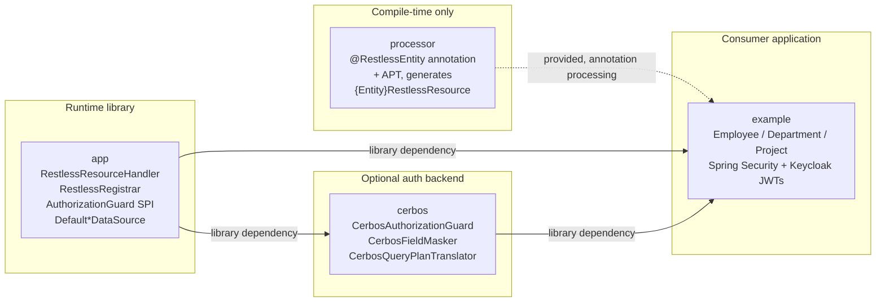
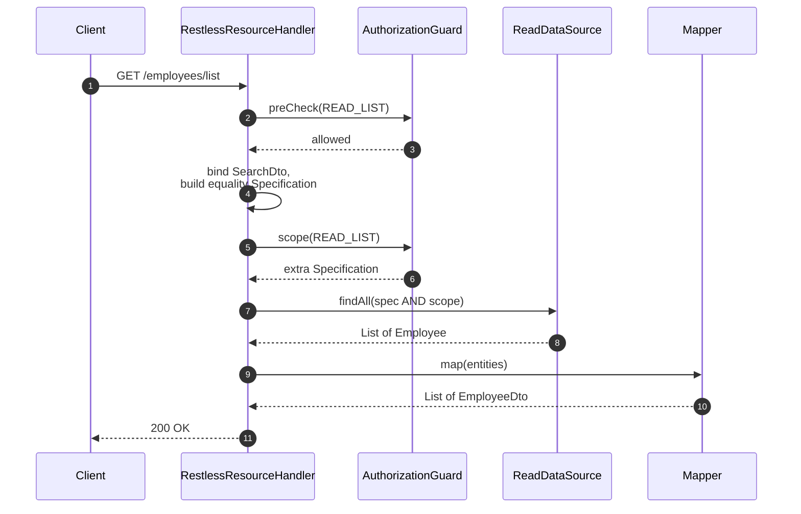
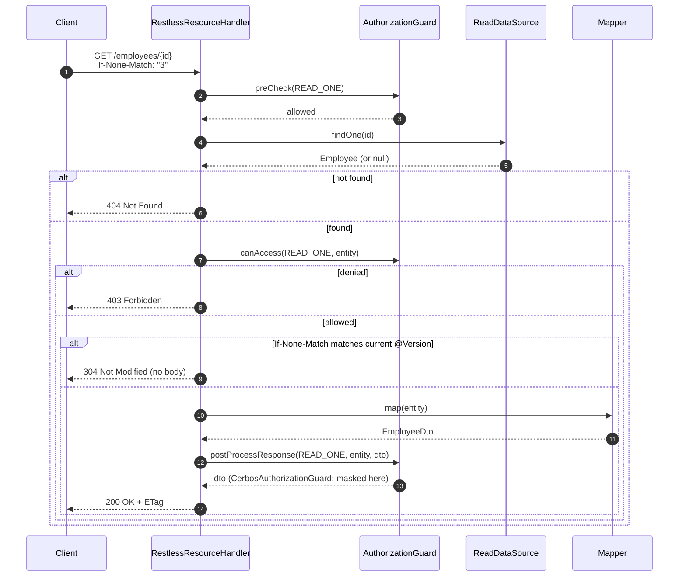
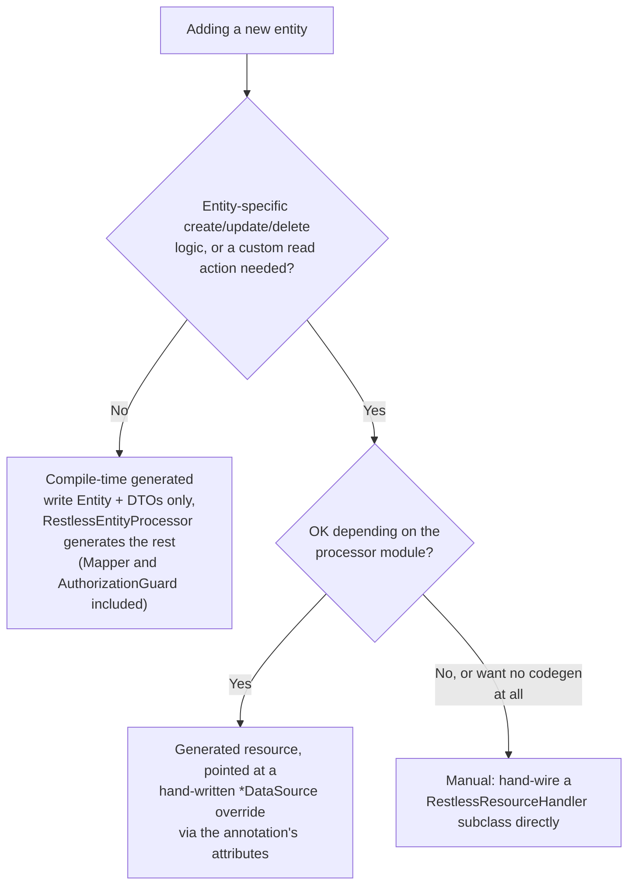
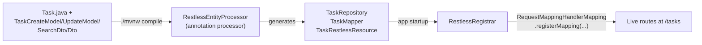
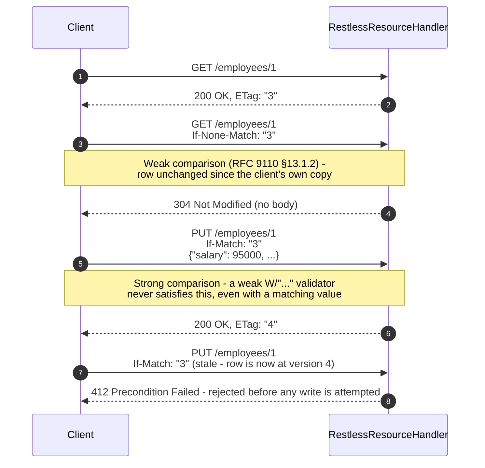
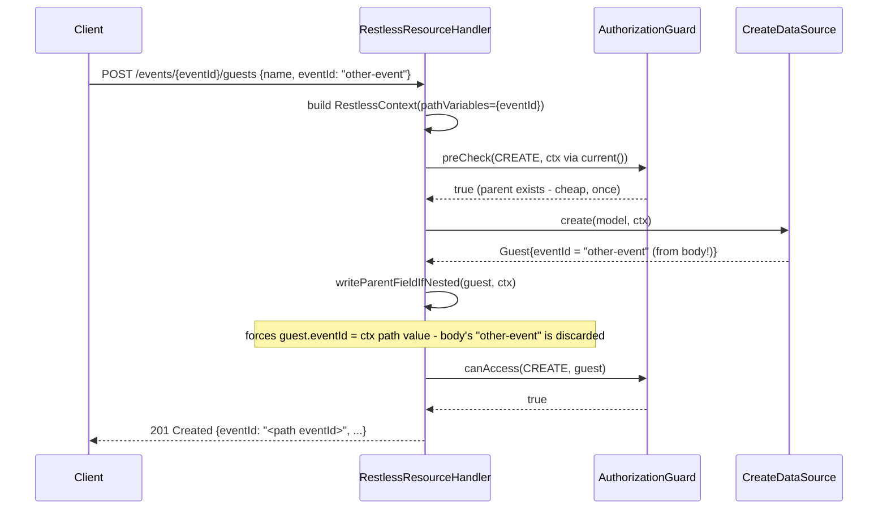
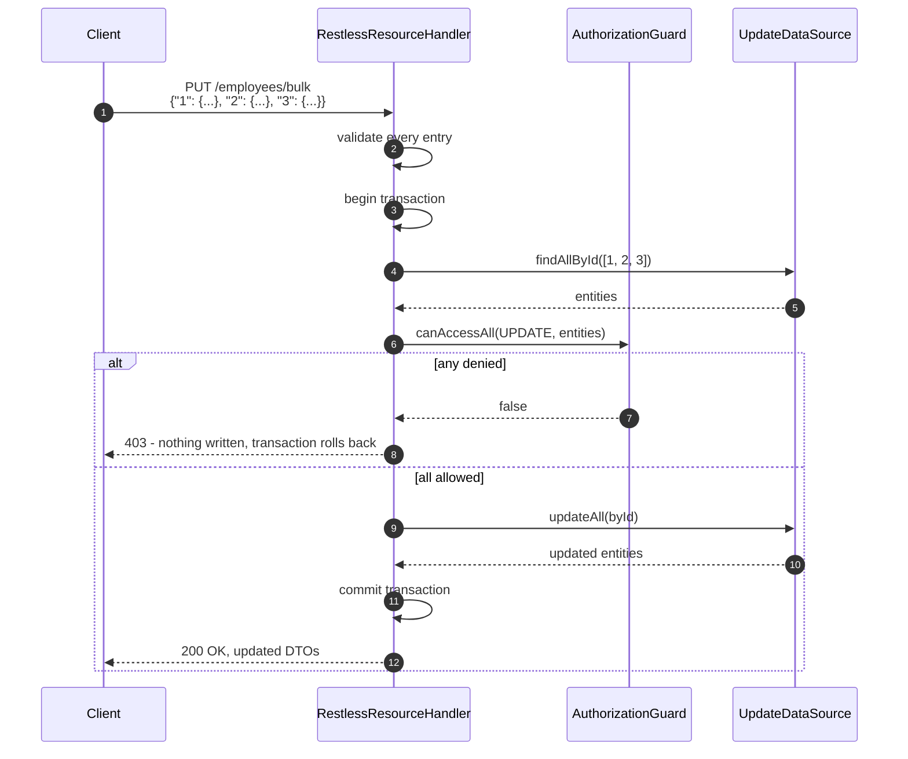
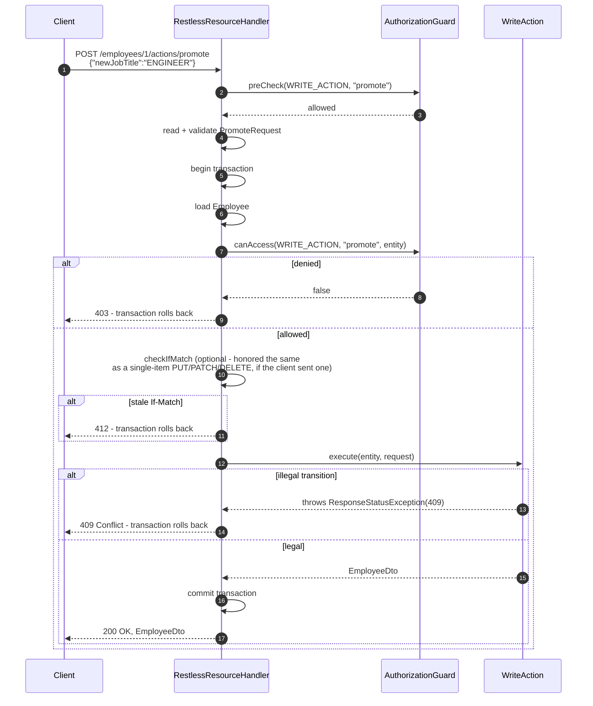

# spring-boot-restless — deep dive

> This document is the full, tutorial-depth walkthrough of the framework: every mechanism, every
> tier, every tutorial, with diagrams and worked examples. [`README.md`](../README.md) at the repo
> root is the concise, template-shaped entry point (badges, install snippets, quick start,
> customization cheat sheet); this document is where to come for the *why* behind each mechanism,
> the full three-tier decision framework, and a fully worked example of every tutorial-level
> feature (bulk operations, write commands, Cerbos-backed authorization, field masking, and the
> codeless tier end to end).


Annotation-driven REST CRUD for Spring Boot, built around DDD and volatility-based design:
each axis of change (persistence, mapping, HTTP wiring, authorization) is hidden behind its own
stable contract, so adding an entity means writing domain-meaningful code once and getting HTTP
for free — not hand-subclassing controllers or hand-writing plumbing classes. The actual point
of removing that boilerplate is to make room for the thing worth writing by hand for every
action: fine-grained authorization.

**At a glance:**

- 🚀 **Zero-boilerplate CRUD, genuinely codeless** — an entity + four DTOs is the entire surface area; no hand-subclassed controllers, no repository interface, no mapper. See the [worked example](#worked-example-zero-hand-written-java-start-to-finish).
- 🧩 **Three levels of control** — fully generated, hand-wired-but-default, or fully manual, chosen per entity, not globally.
- 📦 **Bulk create/update/delete on every resource, unconditionally** — no opt-in, all-or-nothing per request, every target loaded and guard-checked in one batched call before anything is written. See [Tutorial: bulk operations](#tutorial-bulk-operations).
- 🧭 **Write commands for real transitions** — `promote`, `cancel`, `giveRaise`: named, intent-carrying mutations a full-replace `PUT` has no vocabulary to guard. See [Tutorial: write commands](#tutorial-write-commands-writeaction).
- 🔒 **Authorization is a first-class seam**, not an afterthought — `AuthorizationGuard`'s hook points (`preCheck`/`scope`/`canAccess`, plus a post-write check, a batched bulk check, and a response-shaping hook) sit on every route, framework-native and Spring-Security-agnostic.
- ⏱️ **Conditional requests built in** — a strong `ETag` on every single-entity response, `If-None-Match`/`If-Match` honored on reads/writes (`*`, comma-lists, strong comparison). See [Tutorial: conditional requests](#tutorial-conditional-requests-and-optimistic-concurrency).
- 🛡️ **Optional Cerbos backing** — policy-as-code (YAML) row-level scoping and field-level masking against a real PDP, demoed end-to-end with a real Keycloak IAM.
- ✋ **Mapping is never generated** — `Mapper<Entity, Dto>` stays hand-written on purpose, because response shape is exactly what authorization needs to control.

## Table of contents

- [Scope](#scope)
- [When to use spring-boot-restless (and when not)](#when-to-use-spring-boot-restless-and-when-not)
- [Prerequisites](#prerequisites)
- [Tech stack](#tech-stack)
- [Modules](#modules)
- [Architecture](#architecture)
- [How it works](#how-it-works)
- [Quickstart](#quickstart)
- [Tutorial: adding a new entity](#tutorial-adding-a-new-entity)
- [Tutorial: authorization with `AuthorizationGuard`](#tutorial-authorization-with-authorizationguard)
- [Tutorial: Cerbos-backed authorization](#tutorial-cerbos-backed-authorization)
- [Tutorial: hiding fields with `@CerbosHiddenField`](#tutorial-hiding-fields-with-cerboshiddenfield)
- [Tutorial: conditional requests and optimistic concurrency](#tutorial-conditional-requests-and-optimistic-concurrency)
- [Tutorial: nested (parent-scoped) resources and `RestlessContext`](#tutorial-nested-parent-scoped-resources-and-restlesscontext)
- [Tutorial: bulk operations](#tutorial-bulk-operations)
- [Tutorial: write commands (`WriteAction`)](#tutorial-write-commands-writeaction)
- [Tutorial: ownership, denials and server-set fields](#tutorial-ownership-denials-and-server-set-fields)
- [Tutorial: actions, files and lifecycle hooks](#tutorial-actions-files-and-lifecycle-hooks)
- [Tutorial: model and response shape](#tutorial-model-and-response-shape)
- [Running the full demo: Docker Compose + Keycloak](#running-the-full-demo-docker-compose--keycloak)
- [Resilience and observability](#resilience-and-observability)
- [API completeness](#api-completeness)
- [Customization cheat sheet](#customization-cheat-sheet)
- [Project status](#project-status)
- [Versioning and API stability](../README.md#versioning-and-api-stability)

## Scope

This is **not** a Spring Data REST replacement or a full-blown low-code framework — it
deliberately keeps three things out of its own hands, because they're exactly where an app's
actual business rules live:

- **Response shape.** The DTO itself is always hand-written — a generated default would silently
  expose whatever fields an entity happens to have, which is the one surface fine-grained
  authorization needs to control. `Mapper<Entity, Dto>`'s *implementation* doesn't have to be:
  `RestlessEntityProcessor` can generate one (an explicit `dto.setX(source.getX())` per matched
  field — not reflection) once the DTO's shape is already decided, since copying an
  already-authored shape doesn't reintroduce the risk a generated *shape* would — see
  [Tutorial: adding a new entity](#tutorial-adding-a-new-entity).
- **Authorization.** Opt-in per resource, never mandatory boilerplate, and never tied to one
  auth stack — see [`AuthorizationGuard`](#tutorial-authorization-with-authorizationguard). The
  `cerbos` module is one concrete backing for it (policy-as-code via a real PDP), not the only
  one it's designed for.
- **Anything the filter DSL, or a hand-written `Specification`, can't already express.**
  Search filtering defaults to equality on whichever `SearchDto` fields are populated, plus nine
  operator suffixes (`Gte`/`Lte`/`Gt`/`Lt`/`Like`/`ILike`/`StartsWith`/`Ne`/`In` — see
  [API completeness](#api-completeness)) for ranges/partial-match/membership with zero extra code,
  and steps out of the way (override,
  or add a named custom read action) the moment even that's not enough — boolean OR/nesting,
  joins, cross-field logic.

Everything else — wiring an entity's CRUD verbs to Spring MVC routes, the repository, the
create/update/delete plumbing — is boilerplate the library is happy to generate or default away.
See [Modules](#modules) for the three ways to add an entity, from fully generated to fully
hand-wired.

## When to use spring-boot-restless (and when not)

**A good fit:**

- An app with several to dozens of JPA entities that each need the same shape of REST surface
  (CRUD + search + paging), where the engineering effort should go into authorization and the
  handful of entities with real business rules — not into re-writing near-identical
  `@RestController` classes by hand for the ones that don't need any.
- Internal tools, admin backends, and B2B/multi-tenant services where "who can see/change which
  row, and which fields" is itself a first-class requirement — `AuthorizationGuard`'s hook
  points and the optional Cerbos backing exist specifically for this (see
  [Tutorial: authorization](#tutorial-authorization-with-authorizationguard)).
- A service that wants to grow incrementally: start every entity on the codeless tier (see
  [Tutorial: adding a new entity](#tutorial-adding-a-new-entity)), and move only the ones that
  turn out to need real domain logic up to a hand-written `*DataSource` override or a fully manual
  resource. Nothing forces an all-or-nothing choice per app — `example` mixes all three tiers.
- A team that wants generated OpenAPI/Swagger docs, RFC 9457 error responses, optimistic
  concurrency, and soft delete without hand-rolling any of them per entity — see
  [API completeness](#api-completeness).

**Not a good fit:**

- **A single aggregate with almost entirely custom logic and no meaningful CRUD surface** — a
  pricing-calculation service with one endpoint, say. The boilerplate this framework removes
  doesn't exist there to begin with, so there's nothing to save; a plain `@RestController` is
  simpler and more honest about what the service actually does.
- **Non-relational persistence.** Every `*DataSource`/`Repository` here is JPA/
  `Specification`-shaped (`SpecificationRepository<E, K>`) — there's no MongoDB/DynamoDB/etc.
  backing today.
- **Hypermedia/HATEOAS APIs, GraphQL, or gRPC surfaces.** The framework's whole shape is plain
  REST/JSON over Spring MVC; it doesn't generate a GraphQL schema or HAL links.
- **An API whose response shape should be auto-derived straight from the entity.** This is
  deliberate (see [Scope](#scope) above), not a missing feature — if what's actually wanted is
  "expose whatever the entity has, no DTO to maintain," a lower-control tool (or Spring Data REST
  itself) fits that shape better. This framework exists specifically because that shape becomes
  wrong the moment authorization has to control what's visible.
- **A write path that's fundamentally event-sourced or CQRS with a separate write model.** Write
  commands (`WriteAction`, see the [tutorial](#tutorial-write-commands-writeaction) below) close
  part of this gap — a named mutation instead of a field-level `PUT` — but there's no event bus,
  outbox, or projection machinery here; see the root [README.md's Design Rationale
  section](../README.md#design-rationale)'s "what this doesn't try to solve" note for the closest
  thing to a roadmap on this front.

## Prerequisites

- **Java 25** and **Maven 3.9+** (a wrapper — `./mvnw` — is included, so a local Maven install
  isn't strictly required) — needed to build the full reactor, since `example` (what every
  tutorial below walks through) targets `--release 25`. The shipped library itself
  (`app`/`processor`/`cerbos`/`spring-boot-restless-test`) builds down to Java 17: `./mvnw -pl
  processor,app,cerbos,spring-boot-restless-test -am verify` works with just a 17+ toolchain.
- **Docker** and **Docker Compose**, only if you want to run the `example` module's Cerbos +
  Keycloak-backed demo (`/employees/**`) against real infrastructure instead of just the
  automated test suite. Nothing else in the reactor needs Docker — every module's own `mvn test`
  either needs no external service at all, or starts one itself via Testcontainers.
- No other IDP, database, or message broker needed — `example` runs against an in-memory H2
  database and Testcontainers-managed containers for its automated tests.

## Tech stack

| Concern | What's used |
|---|---|
| Language / build | Java 17+ for the shipped library, Java 25 to build the full reactor (`example` targets `--release 25`); Maven (multi-module reactor) |
| Framework | Spring Boot 4.1.1 (Spring MVC, Spring Data JPA) |
| Compile-time codegen | A hand-written `javax.annotation.processing.Processor` (`processor` module) |
| Authorization backend (optional) | [Cerbos](https://www.cerbos.dev/) via `cerbos-sdk-java`, gRPC |
| Auth mechanism (demo) | Spring Security + OAuth2 Resource Server (JWT Bearer) |
| Identity provider (demo) | [Keycloak](https://www.keycloak.org/), via Docker Compose |
| Persistence (demo) | H2 (in-memory) |
| Boilerplate reduction | Lombok |
| API versioning | Spring Framework 7's own (`RequestMappingInfo.Builder.version(...)`) |
| Health/observability (optional) | Spring Boot Actuator (`CerbosHealthIndicator`, `cerbos` module) |
| Testing | JUnit 5, Spring Boot Test / MockMvc, Testcontainers, AssertJ |

## Modules

- **`processor`** — the `@RestlessEntity` annotation and the compile-time processor that
  generates a `{Entity}RestlessResource` glue class from it (see below). A separately-built
  artifact from `app` on purpose: an annotation processor can't process its own compilation unit.
- **`app`** — the framework itself (`RestlessResourceHandler`, `RestlessRegistrar`, the
  `Default*DataSource` classes, `AuthorizationGuard`, ...) and nothing else — a library, not a
  runnable application. Ships no entities and no `@SpringBootApplication` class; it's
  self-tested against small, generically-named, test-scoped fixtures (`Gadget`/`Gizmo`/
  `Sprocket`/`Doohickey` under `app/src/test/.../fixtures/`) that never leave the test jar, so the
  framework stays independently verifiable without depending on `example` existing or staying in
  sync. `Doohickey` is the live proof of the compile-time-generated tier's newest capabilities —
  a generated default `Mapper`, an annotation-wired `AuthorizationGuard`, and API versioning
  (`version = "1"`, real `RequestMappingInfo`-level routing, not just a stored string) — all with
  nothing but the entity, its DTOs, and one small guard bean hand-written — see
  [Tutorial: adding a new entity](#tutorial-adding-a-new-entity).
- **`cerbos`** — optional [Cerbos](https://www.cerbos.dev/)-backed `AuthorizationGuard`
  implementation, plus opt-in field-level masking (`@CerbosHiddenField`). A separate module (not
  a package inside `app`) so consumers who don't want Cerbos never pull in `cerbos-sdk-java` or
  Spring Security transitively. See the [Cerbos](#tutorial-cerbos-backed-authorization) and
  [field-masking](#tutorial-hiding-fields-with-cerboshiddenfield) tutorials below.
- **`example`** — a standalone runnable Spring Boot application that consumes `app`, `processor`,
  and `cerbos` as a real external project would (see `ExampleApplication`), demonstrating
  realistic usage with the original `Employee`/`Department`/`Project` entities under its own
  `ro.cristivoicu.springbootrestless.example` package, including a real Cerbos PDP and Keycloak
  IAM wired up via the root `docker-compose.yml`. See [`example/README.md`](../example/README.md) for
  a feature-by-feature map of this specific app (every framework capability, which entity
  demonstrates it, and a curl example) - this document stays scoped to the framework itself.

## Architecture

Module boundaries follow the dependency edges below — `processor` is an annotation-processor-only
(`provided`-scope) dependency at compile time, never a runtime one; `cerbos` is a separate module
so consumers who don't want it never pull in `cerbos-sdk-java` or Spring Security transitively.



## How it works

A `RestlessResourceHandler<E, K>` composes an entity's four `*DataSource` classes (create, read,
update, delete — each its own volatility, independently pluggable) plus its `Mapper`s and
`Specification` builder, and declares concrete, shared handler methods (`create`, `findOne`,
`findList`, `findPage`, `findPageOverview`, `findPageSelect`, `update`, `deleteById`,
`deleteAll`, plus one `customRead` per declared named action). At startup, `RestlessRegistrar`
finds every bean annotated `@RestlessResource`, resolves its entity/id/DTO types via reflection,
and registers each handler method as a live Spring MVC route
(`RequestMappingHandlerMapping.registerMapping`) — the same mechanism Spring Data REST uses.

Two representative request flows, both funneling through the same `AuthorizationGuard` hook
points described in the [`AuthorizationGuard` tutorial](#tutorial-authorization-with-authorizationguard)
below — `preCheck` gates every action before any work happens, then either `scope` (list/page
reads) or `canAccess` (single-entity reads/updates/deletes) narrows it further:

**List/page read — `scope()` narrows the query:**



**Single-entity action — `canAccess()` checks the loaded row, conditional `GET` short-circuits
once it's confirmed visible:**



**Defaulted away** (still overridable per entity when the default isn't enough):

- **Create/Update/Delete/Read** — `DefaultCreateDataSource`/`DefaultUpdateDataSource`/
  `DefaultDeleteDataSource`/`DefaultReadDataSource` (`datasource/defaults/`) copy DTO fields onto
  the entity via `BeanUtils.copyProperties` (create/update) or plain-delegate to the repository
  (read/delete) — read logic turned out to have no entity-specific behavior in practice, only
  the search *filter* does (see below).
- **Search filtering** — `getSpecification()` defaults to an equality predicate on whichever
  `SearchDto` fields are populated (skipping `null`/blank). Override it for anything a plain
  equality match can't express, or add a named **custom read action**
  (`getCustomReadActions()`, its own `SearchDto` + query logic, exposed at
  `GET {basePath}/actions/{name}`) alongside the default.
- **The `{Entity}RestlessResource` glue class itself** — see
  [Tutorial: adding a new entity](#tutorial-adding-a-new-entity) below.

**Deliberately not defaulted:** `Mapper<Entity, Dto>` and `AuthorizationGuard<E>` — see
[Scope](#scope) above for why.

## Quickstart

From the repo root:

```bash
# Build every module and install it into the local repo (needed once, so example's
# dependency on the cerbos module resolves).
./mvnw install

# Run the full test suite across the reactor (needs Docker running — a few classes
# start a real Cerbos PDP via Testcontainers).
./mvnw test

# Run the example app on its own (defaults to port 8080; H2 in-memory, no external
# services needed for the /employees, /departments, /projects routes).
cd example && ../mvnw spring-boot:run
```

The `/employees/**` routes are the exception — they're wired to a real
`CerbosAuthorizationGuard` and require a live Cerbos PDP (and, for real JWTs rather than
`MockMvc`'s test helpers, a real IdP) to answer authorization checks at all. See
[Running the full demo](#running-the-full-demo-docker-compose--keycloak) below to exercise those
routes for real instead of just through the automated test suite.

## Tutorial: adding a new entity

Three approaches exist. Authorization is no longer a reason on its own to leave the
compile-time-generated tier — `authorizationGuard` (below) can wire a real guard into a generated
resource too — so what actually forces a manual resource is entity-specific CUD logic or a custom
read action. A *generic* guard implementation shared across entities (`CerbosAuthorizationGuard<E>`
— everything in `example` is exactly this case) needs one small named delegating bean per entity
first (see `authorizationGuard`'s note below) — real, but a one-time cost per entity, not a reason
to stay manual on its own: `Project` pays it (`ProjectAuthorizationGuardBean`) and still lives on
the generated tier. `Department` still stays manual for now — same delegating-bean move would work
for it too, just not done yet. `app`'s own test-only `Doohickey` fixture (see
[Modules](#modules) for why entity-specific test fixtures live in `app` at all) shows the
delegate-free case — its guard is hand-written *for* `Doohickey` specifically, not generic.



### Simplest — compile-time generated (`Doohickey`, `Project`)

Write the entity + DTOs, following the naming convention; everything else is generated at
compile time by `RestlessEntityProcessor` (see `target/generated-sources/annotations` after a
build) — Repository, Mapper, resource, guard wiring included:

1. **Entity** — `@Entity` with a no-arg constructor, annotated `@RestlessEntity(basePath = "...")`.
2. **DTOs** — `{Entity}CreateModel`, `{Entity}UpdateModel`, `{Entity}SearchDto`, `{Entity}Dto`,
   all in the same package, named exactly `{Entity}{Suffix}`. Response *shape* is the one thing
   that's always hand-written here — see `Mapper`'s javadoc — everything else about it is optional.

That's it — a missing `{Entity}Repository` **and now a missing `{Entity}Mapper`** are both
generated: a reflective `BeanUtils.copyProperties(entity, dto)`, matching fields by name onto the
DTO you already wrote. Mark a DTO field `@RestlessMapperExclude` to keep the generated mapper from
touching it at all (it's left at its Java default, e.g. `null`) — for a field a blind copy
genuinely shouldn't populate, not for per-caller access control (that's a different, runtime
concern — see [`@CerbosHiddenField`](#tutorial-hiding-fields-with-cerboshiddenfield), which this
isn't a substitute for).

#### Worked example: zero hand-written Java, start to finish

This tier is the framework's headline case: for an entity that needs nothing entity-specific, the
*only* code written by hand is the entity and its four DTOs — five small files, no controller, no
repository interface, no service class, no mapper. A complete `Task` entity, `/tasks` REST
resource included:

```java
@Entity
@Getter @Setter @NoArgsConstructor @AllArgsConstructor
// allowAll = true only because this worked example wires no guard yet - see the authorization
// tutorial below; RestlessRegistrar otherwise refuses to start a resource with no real guard.
@RestlessEntity(basePath = "/tasks", allowAll = true)
public class Task {

    @Id
    @GeneratedValue(strategy = GenerationType.IDENTITY)
    private Long id;

    private String title;
    private boolean done;
}
```

```java
// TaskCreateModel.java
public class TaskCreateModel implements CreateModel {
    @NotBlank private String title;
    private boolean done;
    // + Lombok @Getter @Setter
}

// TaskUpdateModel.java - same shape as CreateModel here, doesn't have to be in general.
public class TaskUpdateModel implements UpdateModel {
    @NotBlank private String title;
    private boolean done;
}

// TaskSearchDto.java - plain-equality filter on title, zero extra code (see the filter DSL
// below for range/partial-match/membership operators on top of this).
public class TaskSearchDto extends AbstractSearchDto {
    private String title;
}

// TaskDto.java - response shape, the one thing always hand-written on every tier (see Scope).
public class TaskDto implements EntityDto {
    private Long id;
    private String title;
    private boolean done;
}
```

Five files, same package, following the naming convention — nothing else to write. `./mvnw compile`
runs `RestlessEntityProcessor`, which generates `TaskRepository`, a `TaskMapper`, and
`TaskRestlessResource`; at application startup `RestlessRegistrar` finds it and registers every
route below, live, against a real JPA repository:



| Verb | Route | What it does |
|---|---|---|
| `POST` | `/tasks` | create one — `201 Created` + `Location` |
| `POST` | `/tasks/bulk` | [bulk create](#tutorial-bulk-operations) — all-or-nothing |
| `GET` | `/tasks/{id}` | read one |
| `GET` | `/tasks/list` | read all matching the filter (capped by `restless.list.max-size`) |
| `GET` | `/tasks` | paged read |
| `GET` | `/tasks/overview` | paged read, overview projection |
| `GET` | `/tasks/select/async` | paged read, select projection |
| `PUT` | `/tasks/{id}` | full replace |
| `PUT` | `/tasks/bulk` | [bulk update](#tutorial-bulk-operations), keyed by id |
| `DELETE` | `/tasks/{id}` | delete one |
| `POST` | `/tasks/bulk-delete` | [bulk delete](#tutorial-bulk-operations) |
| `GET` | `/tasks?titleLike=foo&sort=title,asc` | filter DSL + multi-field sort, zero extra code |

Also live with no extra code at all: bean validation on the DTOs (`@NotBlank` above already 400s a
blank title), RFC 9457 `application/problem+json` error responses, and — once
`springdoc-openapi-starter-webmvc-ui` is on the classpath — a fully documented `/v3/api-docs` and
`/swagger-ui.html` for these exact routes.

**Not live yet, each one attribute or a small class away — never a rewrite:**

- Authorization — set `authorizationGuard = ...` (and drop `allowAll = true`).
- `PATCH` — set `patchDataSource = ...`.
- Optimistic concurrency — add a `@jakarta.persistence.Version` field to `Task`.
- Soft delete — implement `SoftDeletable`, `deleteDataSource = DefaultSoftDeleteDataSource.class`.
- Auditing (`createdDate`/`lastModifiedDate`) — extend `AbstractAuditableEntity`.
- API versioning — `version = "1"`.

**Genuinely not available on this tier** — named custom read actions, write commands, and named
views have no `@RestlessEntity` attribute at all (see its own javadoc): reaching for one of these
steps `Task` up to the "generated resource, hand-written `*DataSource` override" or fully manual
tier for that one entity — see the decision flowchart above and
[Tutorial: bulk operations](#tutorial-bulk-operations) /
[Tutorial: write commands](#tutorial-write-commands-writeaction) below for what those look like
once you need them.

For logic a generated default can't express, hand-write a class and point the annotation at it
instead of relying on the naming convention — every attribute defaults to "use the convention/
generated default":

```java
@RestlessEntity(basePath = "/widgets", createDataSource = WidgetCreateDataSource.class,
        authorizationGuard = WidgetAuthorizationGuard.class)
```

`createModel`/`updateModel`/`searchDto`/`dto`/`mapper` work the same way for DTOs/mappers that
don't follow the naming convention — the generated resource injects the hand-written class as a
constructor parameter, exactly like a hand-written resource bean would. `authorizationGuard` does
too: point it at a hand-written `AuthorizationGuard<Entity>` `@Component` and the generated
resource overrides `getAuthorizationGuard()` to return it, exactly like `Doohickey`'s
`DoohickeyAuthorizationGuard` — leave it unset and `RestlessRegistrar` refuses to start up at all
(see the next tutorial's fail-fast note) unless `allowAll = true` says that's genuinely intended.
One real limit worth knowing: `Class<?>` attributes name one concrete class, not a parameterized type, so a *generic*
guard meant to back more than one entity (`CerbosAuthorizationGuard<E>` — see
[Cerbos-backed authorization](#tutorial-cerbos-backed-authorization) — is exactly this case) needs
a small named `@Component` per entity that implements `AuthorizationGuard<Entity>` and delegates
to it, rather than pointing this attribute at the generic class itself.

**API versioning** (Spring Framework's own — `@RequestMapping(version = ...)`, backing Spring
Boot 4): `@RestlessEntity(version = "1")` forwards verbatim onto the generated resource's own
`@RestlessResource(version = "1")`, and every route `RestlessRegistrar` registers for it carries
that version via `RequestMappingInfo.Builder.version(...)` — real routing, not just a stored
string; `Doohickey` declares `version = "1"` for exactly this proof (see
`DynamicRouteVersionTest`). Left unset (the default), a resource's routes carry no version
constraint at all, exactly like an unversioned `@RequestMapping`. This only declares *which*
version a resource belongs to — *how* a request's version is resolved (header, path segment,
query param, media type parameter) is an app-wide `ApiVersionConfigurer` concern, same as any
hand-written `@RequestMapping(version = ...)` controller needs; see
`SpringBootRestlessApplication`'s `apiVersioningConfigurer()` bean (`app`'s own test config) for a
worked example, header-based. One real gotcha it also documents: `detectSupportedVersions(true)`
won't see a version a `@RestlessEntity`/`@RestlessResource` declares — that auto-detection scans
ordinary `@RequestMapping` beans during `RequestMappingHandlerMapping`'s own startup pass, before
`RestlessRegistrar` has dynamically registered anything at all. List a resource's versions
explicitly via `addSupportedVersions(...)` instead.

**Selecting which routes get registered**: `RestlessResourceHandler#getEnabledOperations`
defaults to every fixed route (`ALL_OPERATIONS`); `@RestlessEntity(operations = ...)` forwards the
same choice onto the generated resource, overriding `getEnabledOperations()` for you when it's
anything less than everything — e.g. a read-only resource:

```java
@RestlessEntity(basePath = "/cogs",
        operations = {RestlessOperation.READ_ONE, RestlessOperation.READ_LIST, RestlessOperation.READ_PAGE})
```

`RestlessRegistrar` filters `RestlessRegistrar.ROUTES` against the enabled set before registering
anything, so a disabled operation's routes aren't just guarded off — they're never registered at
all (the app fixture's `Cog`/`CogGeneratedResourceTest` proves this: `POST`/`PUT`/`DELETE` against
`/cogs` come back `405`, the same as any other method Spring never mapped). `PATCH` and named
custom read actions aren't part of this set — they're already independently opt-in via
`patchDataSource`/custom read actions, so there's nothing here to additionally gate for them. One
real limit: unlike a hand-wired resource overriding `getEnabledOperations()` directly, disabling an
operation here doesn't relax the naming-convention requirement on its DTO — `createModel`/
`updateModel` still have to resolve to something even with `CREATE`/`UPDATE` excluded, since this
attribute governs routing, not DTO resolution. A resource that should need no `{Entity}CreateModel`
at all belongs on the manual tier instead.

`Project` is the worked example of that delegating-bean case: `ProjectAuthorizationGuardBean`
wraps a `CerbosAuthorizationGuard<Project>` (row-scoped by department for non-managers, see
[Tutorial: Cerbos-backed authorization](#tutorial-cerbos-backed-authorization) below), and
`@RestlessEntity(createDataSource = ProjectCreateDataSource.class, authorizationGuard =
ProjectAuthorizationGuardBean.class)` on `Project` itself wires both hand-written pieces in.
Nothing else about `Project` is hand-written any more — no `ProjectRestlessResource`, no
`ProjectRepository`, no `ProjectMapper` (its DTO's fields already matched the entity's own by
name, so the generated one needed no `@RestlessMapperExclude` either).

### Manual — runtime defaults, no codegen (`Department`)

Same generated-default CUD behavior, wired by hand instead of by the processor — useful for
understanding what the generated code actually does, avoiding the `processor` module dependency,
or avoiding a delegating wrapper bean for a generic guard implementation (the move `Project` above
makes instead):

1. **Entity + Repository + DTOs + Mapper** — same as above, plus
   `{Entity}Repository extends SpecificationRepository<{Entity}, Long>` by hand.
2. **Resource bean** — `{Entity}RestlessResource extends RestlessResourceHandler<{Entity}, Long>`,
   `@Component @RestlessResource(basePath = "...")`, constructing the four `Default*DataSource`
   instances directly in its constructor, and overriding `getAuthorizationGuard()`.

Every verb is a `Default*DataSource`; the guard is role-only, no row-scoping — see
`policies/department.yaml`.

### Manual, with entity-specific logic (`Employee`)

Same "manual, no codegen" branch as `Department` above, taken to its other extreme: instead of
four `Default*DataSource` instances, `EmployeeRestlessResource` constructs hand-written
`Employee*DataSource` classes for entity-specific create/update/delete logic, adds a named custom
read action (`getCustomReadActions()` — a suffix `LIKE` on email domain, something the default
equality filter can't express), and wires a real `CerbosAuthorizationGuard`. Every verb still
funnels through the one dynamically-registered `RestlessResourceHandler` at `/employees` — nothing
here needs a hand-written `@RestController` or a second base path; that's exactly the boilerplate
this framework exists to remove, business-specific CRUD logic included.

## Tutorial: authorization with `AuthorizationGuard`

`AuthorizationGuard<E>` (`app`, `authorization/`) is the framework-native hook — no Spring
Security dependency, since the base library has none: implementations are handed the raw
`HttpServletRequest` and read whatever your own auth stack already populated (a
`userPrincipal`, a header, a `SecurityContext`, ...). It's opt-in per resource
(`RestlessResourceHandler.getAuthorizationGuard()`), with hook points
checked at different points in each action's control flow. **A resource that never overrides
`getAuthorizationGuard()` at all won't start up** — `RestlessRegistrar` fails fast at startup with
an `IllegalStateException` naming the resource, unless `@RestlessResource(allowAll = true)` (or
`@RestlessEntity(allowAll = true)`) says the resource is genuinely meant to be unauthorized. This
doesn't change what an actual guard does once configured — it only turns "nobody wired one up" from
a silently wide-open route into a startup failure:

```java
public interface AuthorizationGuard<E> {

    // Coarse, before any work: "can this principal even attempt this action at all".
    // Denial short-circuits with 403 before touching the database.
    default boolean preCheck(Action action, String customActionName, HttpServletRequest request);

    // Row-level restriction for read actions: an extra Specification ANDed onto whatever
    // filter the action would otherwise use. null means unrestricted.
    default Specification<E> scope(Action action, String customActionName, HttpServletRequest request);

    // Per-instance check once a specific entity has been loaded (single read/update/delete):
    // "can this principal act on THIS row specifically".
    default boolean canAccess(Action action, HttpServletRequest request, E entity);
}
```

Three more hooks exist, each defaulting to delegating to one of the above — every existing guard
keeps working unchanged unless it opts in by overriding one:

- **`canAccessAfterWrite(action, customActionName, request, after)`** — a post-image check on
  `update`/`patch`, run *after* the write, inside the same transaction as the pre-image
  `canAccess` check. Catches a transition the pre-image check alone can't see: a client who
  legitimately owns a row reassigning it to someone else's account. Defaults to
  `canAccess(action, customActionName, request, after)`.
- **`canAccessAll(action, request, entities)`** — a batched pre-image check for `updateBulk`/
  `deleteAll`, called once against every fetched target instead of looping `canAccess` per row.
  Defaults to looping `canAccess` (same end result, just named/exposed); override to batch
  against a real policy engine in one round trip instead of N — `CerbosAuthorizationGuard` does,
  via one `client.batch(...)` RPC.
- **`postProcessResponse(action, customActionName, request, entity, dto)`** — runs right after
  `Mapper.map(...)` on every single-entity response (`create`/`findOne`/`namedView`/`update`/
  `patch`). Defaults to returning `dto` unchanged. This is the seam `CerbosAuthorizationGuard`
  uses to automatically mask `@CerbosHiddenField` fields (see
  [Tutorial: hiding fields](#tutorial-hiding-fields-with-cerboshiddenfield) below) — a hand-rolled
  guard for a non-Cerbos auth stack can use the same hook for its own field-level response
  shaping, without `app` itself knowing anything about Cerbos.

Wire one in by overriding `getAuthorizationGuard()` on a `RestlessResourceHandler` subclass and
returning your own implementation — it can be as simple as a header check, or as involved as the
Cerbos-backed one below. `AuthorizationGuard.allowAll()` (the default) is a shared, reference-
comparable no-op — implement none of the hooks and every action is unconditionally allowed.

## Tutorial: Cerbos-backed authorization

The `cerbos` module's `CerbosAuthorizationGuard<E>` implements `AuthorizationGuard<E>` against a
real [Cerbos](https://www.cerbos.dev/) PDP instead of hand-rolled guard logic, so authorization
rules live as policy-as-code (YAML, hot-reloadable, testable independently of the app) rather
than Java `if`s. It maps the core hook points onto Cerbos's own API:

- `preCheck` / `canAccess` → `CerbosBlockingClient.check(...)` (coarse and per-instance checks).
- `canAccessAll` → one batched `CerbosBlockingClient.batch(...)` RPC instead of N individual
  `check()` calls, for bulk update/delete.
- `scope` → `CerbosBlockingClient.plan(...)`, translated from Cerbos's query-plan protobuf AST
  into a JPA `Specification` by `CerbosQueryPlanTranslator`. An operator/shape the translator
  doesn't recognize is never silently under-restricted: the translator itself always throws on
  it, and `scope()` catches that and fails **closed** (an always-deny `Specification`, logged at
  WARN) rather than surfacing an unhandled 500.

The full round trip for a `bob-manager` list request (see [Running the full demo](#running-the-full-demo-docker-compose--keycloak)
below for the real curl-able version), combining row-level `scope` with field-level masking:

```mermaid
sequenceDiagram
    autonumber
    participant C as Client
    participant G as CerbosAuthorizationGuard
    participant PDP as Cerbos PDP
    participant Mp as EmployeeMapper
    participant Mk as CerbosFieldMasker

    C->>G: findList (JWT: role=manager,<br/>scopedLastName=Hopper)
    G->>PDP: check(principal, synthetic resource, read_list)
    PDP-->>G: EFFECT_ALLOW
    G->>PDP: plan(principal, "employee", read_list)
    PDP-->>G: query-plan AST
    G->>G: CerbosQueryPlanTranslator -><br/>Specification&lt;Employee&gt;
    Note over G,C: lastName = 'Hopper' ANDed<br/>onto the search filter
    G-->>C: rows where lastName = Hopper only

    Mp->>Mk: maskAll(dtos, action="view")
    Mk->>PDP: batched check + output (per row)
    PDP-->>Mk: hidden fields: ["salary"]<br/>(no canViewSalary claim)
    Mk-->>Mp: dtos with salary = null
```

### 1. Add the dependency

```xml
<dependency>
    <groupId>io.github.cristivoicu</groupId>
    <artifactId>spring-boot-restless-cerbos</artifactId>
    <version>0.0.1</version>
</dependency>
```

Or import the BOM once and drop the version from every `spring-boot-restless*` dependency you
declare (`spring-boot-restless`, `spring-boot-restless-cerbos`, `spring-boot-restless-test`):

```xml
<dependencyManagement>
    <dependencies>
        <dependency>
            <groupId>io.github.cristivoicu</groupId>
            <artifactId>spring-boot-restless-dependencies</artifactId>
            <version>0.0.1</version>
            <type>pom</type>
            <scope>import</scope>
        </dependency>
    </dependencies>
</dependencyManagement>
```

### 2. Write a resource policy

One YAML file per resource kind (see `example/src/main/resources/policies/employee.yaml` for the
full worked example, including row-scoping and field masking):

```yaml
apiVersion: api.cerbos.dev/v1
resourcePolicy:
  version: default
  resource: employee
  rules:
    - actions: ["*"]
      effect: EFFECT_ALLOW
      roles: ["admin"]

    - actions: [read_one, read_list, update, delete_one]
      effect: EFFECT_ALLOW
      roles: ["manager"]
      condition:
        match:
          expr: >
            !has(request.resource.attr.lastName) ||
            request.resource.attr.lastName == request.principal.attr.scopedLastName
```

The `!has(...) ||` guard matters: `preCheck()` runs against a synthetic, attribute-less
resource (no entity has been loaded yet), so a bare equality condition would deny every attempt
outright before `scope()`/`canAccess()` — which always run with real attributes — ever get a
chance to do the actual per-row check.

### 3. Wire the guard into a resource

```java
@Override
protected AuthorizationGuard<Employee> getAuthorizationGuard() {
    return new CerbosAuthorizationGuard<>(cerbosClient, "employee", Employee::getId,
            employee -> Map.of("lastName", AttributeValue.stringValue(employee.getLastName())));
}
```

The last argument is a `CerbosResourceAttributesMapper<E>` — the entity-to-Cerbos-attributes
function used for `canAccess`/`scope`. Use `CerbosResourceAttributesMapper.reflective(Employee.class)`
instead of a hand-written lambda to expose every POJO field automatically, or `.none()` for a
policy that never needs resource attributes at all.

### 4. Resolve the principal from Spring Security

`CerbosPrincipalResolver` builds a Cerbos `Principal` from whatever
`SecurityContextHolder`/`Authentication` your own auth stack already populated — it special-cases
`JwtAuthenticationToken` (the type `spring-boot-starter-oauth2-resource-server` produces) to
expose the JWT's claims as principal attributes automatically, which is how
`scopedLastName`/`canViewSalary` above end up available to policy conditions. No code needed here
beyond having Spring Security populate the security context as usual.

### 5. Principal attributes that aren't JWT claims

Sometimes the attribute a condition needs isn't something the IdP was configured to issue at all
— "which department does this user belong to," resolved from that user's own row in your own
database, say, rather than a Keycloak custom attribute. `CerbosAuthorizationGuard`'s six-argument
constructor takes a `principalAttributesExtender` — a `Function<HttpServletRequest,
Map<String, AttributeValue>>` called after `CerbosPrincipalResolver` builds the JWT-derived
principal, merged on top of it additively:

```java
public ProjectAuthorizationGuardBean(CerbosBlockingClient cerbosClient, EmployeeRepository employeeRepository) {
    this.employeeRepository = employeeRepository;
    this.delegate = new CerbosAuthorizationGuard<>(cerbosClient, "project", Project::getId,
            project -> Map.of("departmentCode", AttributeValue.stringValue(project.getDepartmentCode())),
            CerbosActionNaming.DEFAULT,
            this::ownDepartmentAttribute); // looks up the caller's own Employee row
}
```

`example`'s `ProjectAuthorizationGuardBean` uses exactly this to back `policies/project.yaml`: a
non-manager can only read projects in their own department, where "their own department" comes
from looking up the authenticated principal's own `Employee` row (matched by the JWT's `email`
claim) rather than a claim Keycloak issues directly — see its javadoc for the full lookup and why
the condition guards both sides with `has()` (an employee whose department can't be resolved
correctly sees nothing, rather than the check erroring).

## Tutorial: hiding fields with `@CerbosHiddenField`

Row-level access (`preCheck`/`canAccess`/`scope`) answers "can this principal see/modify this row
at all" — it's a yes/no per row. `@CerbosHiddenField` + `CerbosFieldMasker` answer a finer
question on top of that: *which individual fields* of an already-visible row should this
principal not see.

**Automatic for every single-entity response.** `CerbosAuthorizationGuard` overrides
`postProcessResponse` (see [Tutorial: authorization](#tutorial-authorization-with-authorizationguard)
above) to call `CerbosFieldMasker.mask` right after `Mapper.map(...)` on `create`/`findOne`/
`namedView`/`update`/`patch`, on its own — no hand-written `Mapper` needs to call it itself.
Masking is idempotent, so a `Mapper` that already calls it by hand (`EmployeeMapper` below does,
as a worked example of the lower-level mechanism) keeps working unaffected, just redundantly. It
skips the Cerbos `check()` RPC entirely when the DTO type carries no `@CerbosHiddenField` field at
all, and falls back to masking *every* `@CerbosHiddenField` field (fail closed), not none, if the
PDP can't be reached.

**Still a manual call for list/page responses** — `postProcessResponse` only runs on a
single-entity path, so `findList`/`findPage*`/a custom read action still need to call
`CerbosFieldMasker.maskAll` themselves (one batched RPC for the whole page, not one `check()` per
row) — `EmployeeMapper#map(List)` below does exactly this.

It uses Cerbos's **output** feature: a policy rule can attach an arbitrary CEL-computed value to
its decision, evaluated only when that rule activates. Model "which fields to hide" as a CEL list
of field-key strings:

```yaml
    - actions: ["view"]
      effect: EFFECT_ALLOW
      roles: ["manager"]
      output:
        when:
          ruleActivated: |-
            request.principal.attr.canViewSalary == true ? [] : ["salary"]
```

Annotate the DTO field to hide:

```java
public class EmployeeDto implements EntityDto {
    ...
    @CerbosHiddenField
    private BigDecimal salary;
}
```

The single-entity call below now happens automatically (see above) — shown here because
`EmployeeMapper` still calls it explicitly too, which is harmless (idempotent) and doubles as a
worked example of what `postProcessResponse` does under the hood. The list call is still required:

```java
// Single entity — CerbosAuthorizationGuard.postProcessResponse already does this on its own;
// calling it again here is redundant but harmless:
CerbosFieldMasker.mask(cerbosClient, principal, resource, "view", dto);

// A list — one batched RPC via client.batch(...) instead of N - still a manual call, every time:
CerbosFieldMasker.maskAll(cerbosClient, principal, "employee", "view", dtos,
        EmployeeDto::getId, CerbosResourceAttributesMapper.none());
```

If the checked action has no matching policy rule for a principal at all, nothing gets masked —
this is a *refinement* layered on top of row-level access already granted, not a replacement for
it. Always pair a masking rule (`view` above) with every role/attribute combination that should
reach the mapper at all. See `EmployeeMapper`/`EmployeeDto`/`policies/employee.yaml` in `example`
for the complete worked example (masks `salary` for managers without a `canViewSalary` claim,
leaves it alone for admins and for managers who have it).

## Tutorial: conditional requests and optimistic concurrency

`@jakarta.persistence.Version` already gets an entity automatic `409`-on-stale-write protection
(`RestlessExceptionHandler` maps JPA's `OptimisticLockException`). On top of that, every
single-entity response and every single-item write honors HTTP's own conditional-request
machinery (RFC 9110 §13) — a strong `ETag` derived straight from the `@Version` value, so a
client never has to compute or guess one:

```java
public class Employee {
    @Id
    private Long id;

    @Version
    private Long version;
    // ...
}
```

Nothing else to write — `RestlessResourceHandler` emits the `ETag` and honors
`If-None-Match`/`If-Match` the moment a `@Version` field exists. An entity with none simply never
emits an `ETag` and silently skips every precondition check, so adding this to an existing entity
is purely additive.



- **`If-None-Match`** (`GET` only) accepts a single value, `*`, or a comma-separated list, under
  *weak* comparison — a `W/"..."`-prefixed candidate is unwrapped and compared, not excluded,
  since RFC 9110 requires weak comparison here.
- **`If-Match`** (single-item `PUT`/`PATCH`/`DELETE`, and optionally a write action) accepts the
  same shapes under *strong* comparison instead — a `W/"..."`-prefixed candidate is excluded from
  the candidate set entirely, since a weak validator can never satisfy a strong-comparison
  precondition. `*` always satisfies it (the row merely needs to exist). Checked *inside* the same
  transaction as the write itself, before anything is written — a stale value is a clean `412`,
  never a silent overwrite and never a write that partially lands before failing.
- **A write action** (`WriteAction`, see [below](#tutorial-write-commands-writeaction)) honors
  `If-Match` the same way, optionally — unchanged, no-op-when-absent behavior for an action that
  never asks for one.
- **A soft-deleted row** (see [below](#api-completeness)) is always a `404` to a write, regardless
  of any `If-Match` header sent — there's no version to compare a precondition against for a row
  that, from a write's point of view, no longer exists.

See `PreconditionSupport` (`app` module) for the implementation, and `ConditionalRequestsTest`/
`WriteActionIfMatchTest` (`app`'s own `Widget`/`Racer` fixtures) for the full behavioral proof.

## Tutorial: nested (parent-scoped) resources and `RestlessContext`

Driven by a real consumer integration: an events app needed `/api/events/{eventId}/guests`, but
the framework had no way to mount a resource under a parent's own path variable, and no way for
a data source to see the request at all (so entity-specific create logic couldn't read `eventId`
either). Two additions fix both gaps.

### `RestlessContext`

A per-request object, built right before `checkPreCheck` runs, carrying:

- `pathVariables()` / `pathVariable(name, Class)` — every resolved path variable, the typed
  accessor converting via the app's own `ConversionService` (a `400` on failure, not an unhandled
  exception).
- `request()` — the `HttpServletRequest` itself.
- `authentication()` — the current Spring Security `Authentication`, typed `Object` (not
  `Authentication`) since `app` has no *mandatory* Spring Security dependency — it's an
  `optional=true` compile dependency purely so this field can exist; cast it yourself when your
  app actually has Spring Security on the classpath. `null` otherwise, or when nothing's
  authenticated.
- `action()` / `customActionName()` — which `AuthorizationGuard.Action` (and, for a named
  action/view, which name) this request is being checked against.

Every `*DataSource` verb gained a context-aware overload (`create(C, RestlessContext)`,
`update(K, U, RestlessContext)`, `findOne(K, RestlessContext)`, ...), each defaulting to the
existing non-context method — `RestlessResourceHandler` always calls the context-aware form, so
every hand-written data source that never overrides it keeps working completely unchanged:

```java
public class GuestCreateDataSource extends CreateDataSource<Guest, UUID, GuestCreateModel> {
    @Override
    public Guest create(GuestCreateModel model, RestlessContext ctx) {
        UUID eventId = ctx.pathVariable("eventId", UUID.class);
        // ... entity-specific create logic that genuinely needs the request ...
    }
}
```

It's also reachable anywhere via the static `RestlessContext.current()` — a nesting-safe
thread-local, installed for the duration of each handler method and restored (not cleared) across
a `@RestlessEmbed` call into a different resource mid-request. This is how a guard reaches it,
since `AuthorizationGuard`'s own hook methods can't grow a new parameter without breaking every
existing implementation:

```java
@Override
public boolean preCheck(Action action, String customActionName, HttpServletRequest request) {
    UUID eventId = RestlessContext.current().pathVariable("eventId", UUID.class);
    return eventId != null && eventRepository.existsById(eventId); // cheap, once per request
}
```

### `@RestlessParent`

```java
@RestlessEntity(basePath = "/events/{eventId}/guests",
        parent = @RestlessParent(variable = "eventId", field = "eventId"))
public class Guest {
    @Id private UUID id;
    private UUID eventId;      // flat scalar FK form
    private String name;
}
```

`field` names either a flat scalar column (above) or one dotted `association.idProperty` segment
for a real `@ManyToOne`/`@OneToOne` (`field = "event.id"` against `private Event event`) — both
resolved purely via reflection (no `EntityManager`/second repository lookup): the association
form writes a *shallow* instance of the target type with just its id field set, the same
"reference without a full load" shape `EntityManager.getReference(...)` gives.



Full semantics (all enforced by `RestlessResourceHandler`, none needing a hand-written override):

1. **Routing** — every fixed/bulk/PATCH/named-action route registers under the templated path.
   `RestlessRegistrar`'s duplicate-basePath check normalizes every `{variable}` segment first, so
   `/a/{x}/b` and `/a/{y}/b` collide as the same route regardless of what either resource calls
   its own variable.
2. **Create** (single + bulk) — the parent field is forced to the path's value *after* the create
   model is applied; a body-supplied value for the same field (as in the diagram above) is always
   discarded, never honored.
3. **Reads** — a `parentField = :pathValue` predicate is auto-ANDed onto the specification,
   *before* the guard's own `scope()`.
4. **Single-row routes** (`GET`/`PUT`/`PATCH`/`DELETE`/a named action) for a row under a
   *different* parent `404` — checked inside the same transaction, before `canAccess`, so a
   caller can't distinguish "wrong parent" from "never existed". **Bulk** update/delete: even one
   foreign-parent target fails the *whole* batch with `404`, nothing written.
5. **Update/patch can never move a row** to a different parent — protected like `@Id`, forcibly
   reset after every write regardless of what the data source did with a body-supplied value.
6. **An unconvertible path value is a clean `400`**, via the app's own `ConversionService`.
7. **Both parent-field forms are supported** — a flat scalar column, or one dotted
   `association.idProperty` segment. The processor validates `field` at compile time for the
   generated tier (exists, isn't a type a path variable could never convert to, e.g. a
   `Collection`); a runtime check in `RestlessResourceHandler#init` backstops both tiers
   (`IllegalStateException` at startup if `variable` doesn't actually appear in `basePath`).
8. **A guard can cheaply authorize the parent once per request** via `RestlessContext` in its own
   `preCheck` (see above) — cheaper than letting every action fall through to the per-row
   404-on-mismatch check, which only runs once a row has already been loaded.
9. **OpenAPI documents the parent path parameter** (with the right schema type, from
   `ResourceMetadata#parentIdType()`) on every route of a nested resource.
10. **`@RestlessEmbed` and soft delete keep working unchanged** on a nested resource.

See `example`'s `Task` (`/projects/{projectId}/tasks`, `field = "project.id"` — the dotted
association form, plus `TaskAuthorizationGuardBean` demonstrating item 8) and `app`'s `Ticket`
fixture (`/boards/{boardId}/tickets`, a flat scalar `boardId` — the backend-nunti-shaped form) for
full end-to-end proofs.

### Migrating a flat resource to nested

A resource that used to take the parent id from the body/query string (`POST /guests` with
`eventId` in the create model, `GET /guests?eventId=...`) moves to the templated path instead:

1. Drop the parent-id field from the create/update models and search DTO — it's never read from
   the body again once `parent` is set.
2. Change `basePath` to the templated form and add `parent = @RestlessParent(...)`.
3. Point every client at `/events/{eventId}/guests` instead of `/guests?eventId=...`.
4. Delete anything that only existed to inject/validate the parent id by hand — a
   `GuestCreateDataSource` whose only job was copying a body `eventId` onto the entity, or an
   `OwnedByEventGuard` whose only job was the same per-row ownership check
   `RestlessResourceHandler` now runs automatically, can usually go away entirely.
5. If the guard also checked that the caller owns the parent, replace it with
   `@RestlessOwnedBy(path = "eventId", via = Event.class, ownerField = "ownerId")` - see
   [Tutorial: ownership](#tutorial-ownership-denials-and-server-set-fields).

## Tutorial: bulk operations

Every resource — any tier, generated or hand-wired — gets three bulk routes for free, since bulk
create/update/delete are default methods riding on the same `CreateDataSource`/`UpdateDataSource`/
`DeleteDataSource` every resource already has (see [API completeness](#api-completeness)). No
attribute, no annotation, nothing to opt into — the only way to remove them is excluding `CREATE`/
`UPDATE`/`DELETE_ALL` from `operations`/`getEnabledOperations()` entirely, which removes their
single-item counterpart too (`createBulk` shares the `CREATE` action with `create`, so the two
can't be independently gated).

| Verb | Route | Body | Response |
|---|---|---|---|
| `POST` | `{basePath}/bulk` | JSON array of `CreateModel` | `200`, array of created DTOs |
| `PUT` | `{basePath}/bulk` | JSON object keyed by id — `{"1": {...}, "2": {...}}`, each value an `UpdateModel` | `200`, array of updated DTOs |
| `POST` | `{basePath}/bulk-delete` | `{"ids": ["1", "2", "3"]}` | `204 No Content` |

(Bulk delete is `POST .../bulk-delete`, not `DELETE {basePath}` with a body — RFC 9110 gives a
`DELETE` request body no defined semantics, and proxies/CDNs/`fetch()` are known to drop it; see
the root [README.md's Changelog section](../CHANGELOG.md)'s "Changed" entries for when
this moved.)

### All-or-nothing, not best-effort

Every bulk route wraps its actual database write in one real transaction
(`RestlessResourceHandler#inTransaction`) — item 9,999 of a 10,000-row batch failing rolls the
whole batch back, rather than leaving the first 9,998 committed. Bulk update and bulk delete
additionally **fail fast before writing anything**: every targeted row is loaded in one
`findAllById` query and `canAccess`-checked in one batched `canAccessAll` call, and only once that
one call clears every row does any write happen at all —
`AuthorizationGuard.canAccessAll` defaults to looping `canAccess` one row at a time (so every
existing guard keeps working unchanged), but `CerbosAuthorizationGuard` overrides it with a
single batched PDP RPC instead of N:



Bulk create is the one exception with no pre-write guard loop: `preCheck(CREATE, ...)` is checked
once, coarsely, before any item is created (same as single `create`) — there's no `canAccess` step
because none of the rows exist yet for a per-instance check to run against.

### Overriding the bulk strategy

`CreateDataSource#createAll`/`UpdateDataSource#updateAll` default to a plain loop calling the
single-item `create`/`update` once per element — a hand-written `*DataSource` with entity-specific
single-item logic already gets correct (if not maximally efficient) bulk behavior for free.
Override `createAll`/`updateAll` directly for a genuinely different bulk strategy (a single batched
`saveAll(...)` call, say) when per-row overhead actually matters at your batch sizes.
`ProjectAssignmentCreateDataSource` overrides `createAll(List)` to check every row before saving
any. The handler calls the context-aware `createAll(List, RestlessContext)`, which hands off to an
overridden `createAll(List)`; before 0.0.1 it silently skipped such an override.

### Partial bulk create: keep the good rows

For imports where some rows are expected to be bad - a user-uploaded CSV, a sync from a system
with dirty data - set `bulkMode = PARTIAL` (`@RestlessEntity`/`@RestlessResource`):

```java
@RestlessEntity(basePath = "/notebooks/{notebookId}/notes", ...,
        bulkMode = RestlessBulkMode.PARTIAL, bulkDedupe = NoteTextKey.class)
public class Note { ... }

@Component
public class NoteTextKey implements RestlessDedupeKey<Note, NoteCreateModel> {
    public Object keyOfModel(NoteCreateModel model) { return normalize(model.getText()); }
    public Object keyOfExisting(Note existing) { return normalize(existing.getText()); }
}
```

`POST {basePath}/bulk` then answers `200` with a `RestlessBulkResult`:

```json
{"created": 2, "skipped": 2, "errors": [{"index": 1, "message": "text: must not be blank"}], "items": [...]}
```

- Every row is created in its **own** transaction (`REQUIRES_NEW`). A row that fails validation,
  that its data source rejects, or that the database refuses is rolled back alone and reported by
  its 0-based `index`.
- With a `RestlessDedupeKey`, a row whose key matches a row the caller can already see (under the
  same nested parent) or an earlier row of the batch is skipped and counted. `?dedupe=false` turns
  this off for one request. Return `null` from either method for "never a duplicate".
- **An authorization denial is never "a bad row".** It aborts the request; rows already created
  before it stay, since each of them passed the same checks.
- Because rows commit one by one, a `@Transactional` test can't observe them rolled back - test
  partial bulk without a test-wide transaction.

### When to reach for it

- Seeding or importing a known-good batch (CSV import, migration script, an admin "add these ten
  rows" action) — one request, one transaction, one guard pass, instead of N round trips.
- A UI that lets a caller edit several rows at once and submit together (a bulk status change, a
  bulk reassignment) — see [Tutorial: write commands](#tutorial-write-commands-writeaction) below
  for when the mutation isn't a plain field-level replace, though.

### When not to

- **Very large, possibly-partially-bad batches from an untrusted or unreliable source** (a
  user-uploaded CSV with typos) in the default mode — because it's all-or-nothing, one bad row
  aborts the entire batch. Use [`bulkMode = PARTIAL`](#partial-bulk-create-keep-the-good-rows)
  for those instead.
- **A transition that isn't "replace these fields" at all.** Bulk update is still a full-replace
  `PUT` semantically, so the same illegal-transition risk plain `update()` has applies per row; a
  bulk business-rule mutation belongs on a write command instead (no `BulkWriteAction` exists yet
  — see the root [README.md's Design Rationale section](../README.md#design-rationale)'s "what
  this doesn't try to solve" note).
- **Streaming/very-high-volume ingestion.** Every id in a bulk update is individually loaded and
  checked before the write — fine for hundreds to a few thousand rows per request, not designed as
  a bulk-ETL pipeline.

`example`'s `ProjectAssignment` (`/project-assignments/bulk`) is the worked, real-entity example —
see [its section in `example/README.md`](../example/README.md#projectassignment--bulk-create-at-scale-restricted-operations).

## Tutorial: write commands (`WriteAction`)

CRUD's fixed verbs (`create`/`update`/`patch`/`delete`) are shaped around *fields*, not
*transitions* — a full-replace `PUT` can set `jobTitle` to any value at all, including an illegal
one (`TERMINATED` → `PROMOTED`), because "replace these fields" has no vocabulary for "this is
only a legal move from certain prior states." A **write command** is the framework's answer: a
named, intent-carrying mutation — `promote`, `cancel`, `archive`, `giveRaise` — where the server,
not the client, decides what's legal.

```
POST {basePath}/{id}/actions/{name}
```

(`POST`, not `PUT`/`PATCH`: a command isn't idempotent by HTTP's definition in general — calling
`promote` twice may or may not be a no-op, depending on the action's own domain logic — so `POST`
is the honest default.)

### Shape

`WriteAction<E, Req, Resp>` mirrors `ReadAction`'s shape deliberately, so nothing new has to be
learned if a [custom read action](#how-it-works) has already been added:

```java
public interface WriteAction<E, Req extends WriteActionRequest, Resp> {

    Class<Req> getRequestType();

    Class<Resp> getResponseType();

    // Runs against an already-loaded, already-guard-checked entity and a validated request body,
    // inside one real transaction alongside the load/guard-check that preceded it.
    Resp execute(E entity, Req request) throws Exception;
}
```

Declared per resource via `getCustomWriteActions()` — empty by default, so this is a no-op for
every resource that doesn't add one:

```java
@Override
public Map<String, WriteAction<Employee, ?, ?>> getCustomWriteActions() {
    return Map.of(
            "promote", new WriteAction<Employee, PromoteRequest, EmployeeDto>() {
                @Override
                public Class<PromoteRequest> getRequestType() { return PromoteRequest.class; }

                @Override
                public Class<EmployeeDto> getResponseType() { return EmployeeDto.class; }

                @Override
                public EmployeeDto execute(Employee entity, PromoteRequest request) {
                    JobTitle newTitle = request.getNewJobTitle();
                    if (!newTitle.isPromotionFrom(entity.getJobTitle())) {
                        throw new ResponseStatusException(HttpStatus.CONFLICT,
                                "'" + newTitle + "' is not a promotion from '" + entity.getJobTitle() + "'");
                    }
                    entity.setJobTitle(newTitle);
                    return mapper.map(repository.save(entity));
                }
            }
    );
}
```

`PromoteRequest` is a plain bean-validated POJO implementing the empty `WriteActionRequest` marker
interface (same idiom `CreateModel`/`UpdateModel` already use) — `@NotNull private JobTitle
newJobTitle;` here, nothing else needed for Jackson binding or bean validation to work unchanged.

On the generated tier, a write action is a Spring bean named with `@RestlessActionName` and listed
on the entity - no hand-wired resource needed:

```java
@Component
@RestlessActionName("stamp")
public class NotebookStampAction implements WriteAction<Notebook, NotebookStampAction.Request, NotebookDto> {
    public static class Request implements WriteActionRequest {
    }
    ...
    public NotebookDto execute(Notebook notebook, Request request) {
        notebook.setTitle(notebook.getTitle() + " ✓");
        return mapper.map(notebook);
    }
}

@RestlessEntity(basePath = "/notebooks", writeActions = NotebookStampAction.class, ...)
public class Notebook { ... }
```

`readActions` and `views` work the same way. A missing or duplicate `@RestlessActionName` fails
startup.

### Request flow



Illegal-transition prevention needs no new framework machinery at all: `execute` just throws a
`ResponseStatusException` with whatever status fits (`409` for "against the rules," `400` for
"malformed" — kept deliberately distinct, see `giveRaise`'s cap in `example` below), and it
propagates out through the same transaction-rollback-plus-`RestlessExceptionHandler` handling a
guard denial inside `deleteAll`/`updateBulk` already uses.

### What a write action bypasses, on purpose

A write action skips `Mapper` entirely, both directions: `execute`'s `Req`/`Resp` are whatever
shape the action author decides, not bound to `Mapper<Entity, Dto>`'s in/out contract at all — the
same "response shape is always hand-written" boundary `Mapper` itself already states, just applied
to a mutation instead of a read. Nothing stops `execute` from calling the resource's own `Mapper`
internally to build `Resp` (`EmployeeRestlessResource`'s four actions all do, returning the same
masked `EmployeeDto` `update()` returns) — that's just an implementation detail, not something the
interface prescribes.

### When to reach for it

- A transition with real invariants a full-replace `PUT` can't guard (`promote`'s career-ladder
  check, a `cancel` action's "only legal from PENDING" rule).
- A business-rule cap or computation the *current row's own state* determines, not just the
  request body — `giveRaise`'s 20%-per-raise cap depends on the request percentage *and* the
  entity's current salary together, something a bean-validation annotation on the request DTO
  alone can never express.
- Append-only mutation of a collection the update model deliberately never exposes at all
  (`addCertification`/`recordAchievement` in `example` — `EmployeeUpdateModel` has no
  `certifications`/`achievements` field, so a full-replace `PUT` structurally cannot touch them;
  the write command is the *only* way to add one).

### When not to

- **A plain field-level replace with no invariant to protect** — that's what `PUT`/`PATCH` already
  are; a write action wrapping a bare setter call is needless ceremony.
- **Bulk.** There's no `BulkWriteAction` yet — one write action call is one entity, one command
  (see [Tutorial: bulk operations](#tutorial-bulk-operations) above for the closest existing
  bulk-write mechanism, and the root [README.md's Design Rationale section](../README.md#design-rationale)'s
  "Bulk vs. single-item" note for the deferred design).
- **On the compile-time-generated tier.** `@RestlessEntity` has no attribute for write actions
  today (only the hand-wired tier can declare `getCustomWriteActions()`) — an entity that needs one
  belongs on the "generated resource + hand-written override" or fully manual tier for at least
  that one verb; see [Tutorial: adding a new entity](#tutorial-adding-a-new-entity).

`example`'s `Employee` is the full worked example — four actions
(`promote`/`giveRaise`/`addCertification`/`recordAchievement`), each enforcing exactly one
invariant the others don't — see
[its Write commands section](../example/README.md#write-commands--employee) for the curl walkthrough
and the root [README.md's Design Rationale section](../README.md#design-rationale) for the full
design rationale.

## Tutorial: ownership, denials and server-set fields

Most user-facing data has one rule before any other: *a user manages only what they own*. Written
as an `AuthorizationGuard`, that's a `scope()` predicate, a `canAccess()` check, a parent lookup
for nested rows, and a data source that copies the owner from the token instead of the body - per
entity, with the same bugs waiting in each copy. In spring-boot-restless it's annotations.

### Direct ownership

The row carries its owner:

```java
@Entity
@RestlessEntity(basePath = "/notebooks", denyAs = RestlessDenial.NOT_FOUND)
@RestlessOwnedBy(field = "ownerUsername")
public class Notebook {
    @Id @GeneratedValue(strategy = GenerationType.IDENTITY)
    private Long id;

    private String title;

    @RestlessImmutable(onUpdate = RestlessImmutable.OnChange.REJECT)
    private String code;

    @RestlessFromPrincipal
    @Column(nullable = false)
    private String ownerUsername;
}
```

What each piece does:

| Piece | Effect |
|---|---|
| `@RestlessOwnedBy(field = "ownerUsername")` | `GET` list/page/overview only ever contain rows with `ownerUsername = <caller>` (in SQL, not filtered after loading). Every single-row route checks the loaded row. Bulk update/delete check every target. |
| `@RestlessFromPrincipal` | On create, the field is set from the caller **before** the `INSERT` (so `NOT NULL` works) and again after any data source runs. Update/patch can never change it. A create/update/patch model with a field of the same name is a compile error. Create with no principal is a `401`. |
| `@RestlessImmutable(onUpdate = REJECT)` | Set on create, never changed after. An update/patch body sending a different non-null value gets a `400` naming the field; resending the stored value, or leaving it out, is fine. `IGNORE` drops the change silently. `DEFAULT` follows `restless.immutable.on-update` (itself `ignore`). |
| `denyAs = RestlessDenial.NOT_FOUND` | A denied caller gets exactly the `404` a missing id gets, on every route - so ids of other people's rows can't be probed. `FORBIDDEN` (`403`) is the default; `restless.authorization.deny-as` changes it globally. |

### Ownership via a parent

The row belongs to a parent that carries the owner. Usually that's a nested resource:

```java
@RestlessEntity(basePath = "/notebooks/{notebookId}/notes",
        parent = @RestlessParent(variable = "notebookId", field = "notebookId"),
        denyAs = RestlessDenial.NOT_FOUND)
@RestlessOwnedBy(path = "notebookId", via = Notebook.class, ownerField = "ownerUsername")
public class Note {
    ...
    @Column(nullable = false)
    private Long notebookId;
}
```

- Lists are scoped with a subquery: `notebookId IN (SELECT id FROM Notebook WHERE ownerUsername = :caller)`.
- When the link field is also the nested parent field (as here), the guard checks the notebook in
  the path **once**, in `preCheck` - someone else's notebook is denied before anything is read or
  parsed, and ownership of each parent is looked up at most once per request.
- A create pointing at someone else's parent is checked on the freshly created row, inside its
  transaction, and rolled back.

Paths may take one association hop (`"event.id"`, `"owner.id"`), and owner/id fields may live on a
`@MappedSuperclass`. Paths are checked by the annotation processor and again when the guard is
built at startup, so a typo never becomes a guard that matches nothing - or everything.
`@RestlessOwnedBy` replaces `authorizationGuard = ...`; setting both is a compile error.

### Who is "the caller"

Everything above compares against `RestlessContext.principalId()`, produced by the
`RestlessPrincipalIdResolver` bean. The default is the authenticated principal's name (the JWT
`sub` on a resource server, the username with form login); an anonymous authentication counts as
no principal, and no principal owns nothing. When owner columns hold something else - a local user
id provisioned from the token - register your own:

```java
@Bean
RestlessPrincipalIdResolver principalIdResolver(CurrentUserService users) {
    return context -> context.authentication() == null ? null : users.require().getId();
}
```

The value is converted to each owner field's type with the application's `ConversionService`, so
a `String` subject can back a `UUID` column.

### Hand-wired resources

The same guard is available without the annotation, from the `RestlessOwnershipGuards` bean:

```java
@Override
protected AuthorizationGuard<Event> getAuthorizationGuard() {
    return ownershipGuards.owned(Event.class, "ownerId");
    // or: ownershipGuards.ownedVia(Guest.class, "eventId", Event.class, "ownerId");
}
```

`denyAs` is also an attribute of `@RestlessResource`; `@RestlessFromPrincipal` and
`@RestlessImmutable` are read from the entity on every tier.

### Proving it in a test

`spring-boot-restless-test`'s `RestlessOwnershipContract` runs the whole owner/stranger matrix
against one resource: the owner creates a row, then the stranger must be denied `GET`/`PUT`/
`DELETE` and bulk delete on it, must not see it in lists, and (nested) must not be able to create
under the owner's parent - with nothing written.

```java
RestlessOwnershipContract.of(mockMvc, "/notebooks/{notebookId}/notes")
        .pathVariable("notebookId", alicesNotebook)
        .owner(user("alice")).stranger(user("bob"))
        .createBody("{\"text\":\"Private\"}")
        .updateBody("{\"text\":\"Changed\"}")
        .verify(); // denialStatus defaults to 404; .denialStatus(FORBIDDEN) for denyAs = FORBIDDEN
```

Run it outside a test-wide `@Transactional`, or the "nothing was written" step can't fail.
`example`'s `NotebookOwnershipTest` and `PhaseFiveFeaturesTest` are the worked examples.

## Tutorial: actions, files and lifecycle hooks

Four additions that used to require a hand-wired resource or a separate `@RestController`, all
declared on `@RestlessEntity` (bean classes) or overridden on `RestlessResourceHandler`, and all
running after the resource's normal authorization.

### Collection actions

`GET {basePath}/actions/{name}` - a read over the whole collection that isn't a page of rows: a
count, a summary, an export, a download link.

```java
@Component
@RestlessActionName("total-size")
public class AttachmentTotalSizeAction implements CollectionAction<Attachment> {
    private final AttachmentRepository repository;
    ...
    @Override
    public Object execute(Specification<Attachment> visibleRows, RestlessContext context) {
        var rows = repository.findAll(visibleRows);
        return Map.of("count", rows.size(), "bytes", rows.stream().mapToLong(Attachment::getSize).sum());
    }
}
```

`visibleRows` is the nested-parent filter, the guard's `scope()` and the soft-delete filter already
ANDed together - query through it and nothing the caller can't list leaks into the result. The
action runs in a read-only transaction and is authorized as `CUSTOM_READ` with its name; names are
shared with `readActions`, and a clash fails startup. Return any JSON value or a `RestlessBinary`.

### Binary responses

Return a `RestlessBinary` from a named view, a write action or a collection action to send bytes
instead of JSON:

```java
@Component
@RestlessActionName("content")
public class AttachmentContentView implements Mapper<Attachment, RestlessBinary> {
    @Override
    public RestlessBinary map(Attachment source) {
        return RestlessBinary.of(source.getContentType(), source.getData())
                .filename(source.getFilename())
                .inline(); // default is a download (Content-Disposition: attachment)
    }
}
```

`RestlessBinary.of(type, writer)` streams from a callback - use it for anything large or generated
on the fly; `of(type, byte[])` and `of(type, Resource)` cover the rest. The body is written inside
the route's transaction, so it can read lazy associations.

### Multipart create

`multipartCreate = true` makes `POST {basePath}` also accept `multipart/form-data`. Form fields and
file parts are bound onto the create model by name, then validated exactly like a JSON body:

```java
public class AttachmentCreateModel implements CreateModel {
    @NotNull
    private MultipartFile file;
}
```

```bash
curl -X POST -H "Authorization: Bearer $TOKEN" -F file=@report.pdf \
  http://localhost:8081/notebooks/1/attachments
```

A resource without `multipartCreate` answers a multipart request with `415`. The OpenAPI document
lists both media types. What to do with the file - store the bytes, push it to object storage - is
the create data source's job (`AttachmentCreateDataSource` in `example`).

### Lifecycle hooks

A `RestlessLifecycleHook<E>` runs code around writes without replacing a data source:

```java
@Component
public class NotebookAuditHook implements RestlessLifecycleHook<Notebook> {
    @Override
    public void afterCreate(Notebook created, RestlessContext context) { ... }

    @Override
    public void beforeDelete(Notebook existing, RestlessContext context) { ... }
}
```

| Method | When |
|---|---|
| `afterCreate` | After the row was created and authorized, before the flush. Parent and principal fields are already set. |
| `beforeUpdate` | Before the update/patch data source runs, on the stored row. |
| `afterUpdate` | After the update/patch was applied and authorized, before the flush. |
| `beforeDelete` | Before the delete - the last moment related data is still there. |
| `afterDelete` | After the delete was flushed; the entity is detached. |

Hooks run inside the write's transaction and only for rows the caller was allowed to touch; an
exception rolls the write back. Bulk routes call them once per row. Side effects outside the
database (deleting a stored file, sending a message) can't be rolled back with the transaction, so
do them last. Hand-wired resources override `getLifecycleHooks()`.

## Tutorial: model and response shape

Smaller options for when a domain doesn't match the defaults.

### Polymorphic create

A `SINGLE_TABLE`/`JOINED` entity hierarchy behind one resource: give the create model a Jackson
type hierarchy, and mark each subtype with the entity subclass it builds.

```java
@Entity @Inheritance(strategy = InheritanceType.SINGLE_TABLE) @DiscriminatorColumn(name = "kind")
@RestlessEntity(basePath = "/shapes", createModel = ShapeModel.class, updateModel = ShapeModel.class, ...)
public abstract class Shape { ... }

@JsonTypeInfo(use = JsonTypeInfo.Id.NAME, property = "kind")
@JsonSubTypes({@JsonSubTypes.Type(value = CircleModel.class, name = "circle"),
               @JsonSubTypes.Type(value = SquareModel.class, name = "square")})
public abstract class ShapeModel implements CreateModel, UpdateModel { ... }

@RestlessSubtype(Circle.class)
public class CircleModel extends ShapeModel { private Double radius; }
```

`DefaultCreateDataSource` instantiates the subclass named by `@RestlessSubtype` (found on the
model's class or a superclass). A subtype that doesn't extend the resource's entity type is a `500`
with a clear message, never a row of the wrong kind.

### One model for create and update

Restless validates create bodies with `Default` + `RestlessValidationGroups.OnCreate`, update
bodies with `Default` + `OnUpdate`, patch bodies with `Default` + `OnPatch`. A constraint without
`groups` applies everywhere, as before:

```java
@NotBlank(groups = RestlessValidationGroups.OnCreate.class) // required to create, optional to update
private String name;
```

### List or page by default

`GET {basePath}` returns a page envelope by default, with the bare array at `{basePath}/list`.
`collectionGet = RestlessCollectionGet.LIST` (or `restless.collection-get: list` for every
resource) swaps that: `GET {basePath}` is the array (still capped by `restless.list.max-size`),
pages move to `{basePath}/page`, and `/list` keeps working.

### The application's own error body

Register one `RestlessErrorBodyFactory` bean and every generated route answers with what it
returns (as `application/json`) instead of a `ProblemDetail`:

```java
@Bean
RestlessErrorBodyFactory apiErrors() {
    return (status, message, fieldErrors, request) ->
            ApiError.of(status.value(), message, request.getRequestURI());
}
```

Status codes, messages and the exception-to-status mapping stay the framework's.

### A repository somewhere else

The processor looks for `{Entity}Repository` in the entity's package. When repositories live
elsewhere, name it: `@RestlessEntity(repository = ShapeStore.class)`. It must extend
`SpecificationRepository<Entity, Id>`.

## Running the full demo: Docker Compose + Keycloak

`example`'s `/employees/**`, `/departments/**`, and `/projects/**` routes are all secured
end-to-end with real infrastructure: a real Cerbos PDP evaluating every policy under
`policies/`, and a real [Keycloak](https://www.keycloak.org/) realm issuing JWTs that
`SecurityConfig` validates against Keycloak's own OIDC discovery document
(`spring.security.oauth2.resourceserver.jwt.issuer-uri`) — no fixed demo secret, no fake tokens.

```bash
# Start Cerbos (loads example/src/main/resources/policies) and Keycloak (auto-imports
# docker/keycloak/restless-demo-realm.json) in the background.
docker compose up -d

# Build once so `example`'s dependency on the cerbos module resolves, then run the app
# on a different port than Keycloak's 8080.
./mvnw install
cd example && ../mvnw org.springframework.boot:spring-boot-maven-plugin:run \
    -Dspring-boot.run.arguments=--server.port=8081
```

Demo accounts (see `docker/keycloak/README.md` for the full table and how to mint a token):

| username | role | `scopedLastName` | `canViewSalary` |
|---|---|---|---|
| `alice-admin` | admin | — | — |
| `bob-manager` | manager | `Hopper` | `false` |
| `carol-manager` | manager | `Lovelace` | `true` |
| `dave-employee` | employee | — | — |

```bash
TOKEN=$(curl -s http://localhost:8080/realms/restless-demo/protocol/openid-connect/token \
  -d grant_type=password -d client_id=restless-example \
  -d username=carol-manager -d password=carol-manager-pw | jq -r .access_token)

curl -s -H "Authorization: Bearer $TOKEN" http://localhost:8081/employees/list | jq
```

`bob-manager` only sees employees whose `lastName` is `Hopper` (row-level `scope`), and always
gets `salary: null` on them (field-level masking — no `canViewSalary`); `carol-manager` sees the
same shape of row-scoping for `Lovelace` employees, with the real `salary` value; `alice-admin`
sees everything, unconditionally, salary included.

### Department-scoped project visibility

`dave-employee`'s `employee` role is scoped to their own department on `/projects`
(`policies/project.yaml`) — but "their own department" is resolved from their own `Employee`
row, not a JWT claim (see [step 5](#5-principal-attributes-that-arent-jwt-claims) above), so
that row needs to exist first, with a `departmentCode` and an `email` matching the token:

```bash
ADMIN_TOKEN=$(curl -s http://localhost:8080/realms/restless-demo/protocol/openid-connect/token \
  -d grant_type=password -d client_id=restless-example \
  -d username=alice-admin -d password=alice-admin-pw | jq -r .access_token)

# dave-employee's own record - email must match the Keycloak user's email exactly.
curl -s -H "Authorization: Bearer $ADMIN_TOKEN" -H "Content-Type: application/json" \
  -d '{"firstName":"Dave","lastName":"Employee","email":"dave@restless-demo.example","departmentCode":"ENG"}' \
  http://localhost:8081/employees

# One project per department.
curl -s -H "Authorization: Bearer $ADMIN_TOKEN" -H "Content-Type: application/json" \
  -d '{"name":"Apollo","departmentCode":"ENG"}' http://localhost:8081/projects
curl -s -H "Authorization: Bearer $ADMIN_TOKEN" -H "Content-Type: application/json" \
  -d '{"name":"Orion","departmentCode":"SALES"}' http://localhost:8081/projects

DAVE_TOKEN=$(curl -s http://localhost:8080/realms/restless-demo/protocol/openid-connect/token \
  -d grant_type=password -d client_id=restless-example \
  -d username=dave-employee -d password=dave-employee-pw | jq -r .access_token)

curl -s -H "Authorization: Bearer $DAVE_TOKEN" http://localhost:8081/projects | jq
```

`dave-employee` sees only `Apollo` (`ENG`, their own department); `bob-manager`/`carol-manager`
and `alice-admin` would see both projects, unconditionally — `policies/project.yaml` never scopes
`manager` by department at all, only `employee`.

```bash
docker compose down   # when you're done
```

## Resilience and observability

`CerbosAuthorizationGuard` fails **closed**, not open — a PDP that's slow past
`cerbos.client.timeout` (default `3s`, see `CerbosClientConfiguration`) or unreachable makes
`preCheck`/`canAccess` return `false` and `scope` return an always-deny `Specification`, logged at
WARN, rather than an unhandled 500 or (far worse) silently falling through to unrestricted access.
There's no fail-open switch by design: an authorization check that can't reach its policy source
has no basis to say yes. See `CerbosAuthorizationGuardFailClosedIT` (`cerbos` module) for the
PDP-dies-mid-test proof.

`CerbosHealthIndicator` (`cerbos` module, `@ConditionalOnClass` on Spring Boot Actuator's
`HealthIndicator` — only activates if the consumer already depends on `spring-boot-starter-actuator`
themselves) reports whether the PDP is actually reachable, independent of hitting a guarded route
to find out. `example` wires it in; `management.endpoint.health.show-details=always` in its
`application.properties` surfaces it on `/actuator/health` without needing a management-role
principal, since this demo has no such role modeled.

## API completeness

- **Nested (parent-scoped) resources and `RestlessContext`.** `@RestlessParent` mounts a resource
  under a parent's own path variable (`/events/{eventId}/guests`), with the parent field forced
  from the path on create, auto-ANDed onto every read filter, protected from being moved on
  update, and enforced as a 404-on-mismatch for both single-row and bulk writes. `RestlessContext`
  gives data sources/guards access to the resolved path variables, request, and `Authentication`
  without a new parameter on `AuthorizationGuard` itself. See
  [Tutorial: nested (parent-scoped) resources and `RestlessContext`](#tutorial-nested-parent-scoped-resources-and-restlesscontext)
  above for the full walkthrough.
- **`PATCH`** — entirely opt-in (`@RestlessEntity(patchDataSource = ...)` or a resource overriding
  `getPatchDataSource()`), unlike the four mandatory CUD verbs: no route gets registered at all
  until one is provided. `DefaultPatchDataSource` is the reflective default — copies whichever
  `{Entity}PatchModel` fields the client actually sent (`null` means "not sent", not "clear it";
  a full `PUT` is still how a client explicitly nulls a field). Checked against its own
  `Action.PATCH` — deliberately not inherited from `Action.UPDATE`, so granting full-replace
  access never silently also grants partial-update access. See `Doohickey`/`DoohickeyPatchTest`
  (`app` module) for the worked example.
- **Bulk create/update** — `POST`/`PUT {basePath}/bulk`, unconditional (every resource already has
  a `CreateDataSource`/`UpdateDataSource`). `createAll`/`updateAll` default methods loop the
  single-item verb, same spirit as `Mapper<E,D>.map(List<E>)`'s own default. Bulk update's body is
  a JSON object keyed by id (`{"1": {...}, "2": {...}}`); every entry is validated, and (with a
  guard configured) every target loaded in one `findAllById` query and `canAccess`-checked in one
  batched `canAccessAll` call, before anything is written — the same fail-fast-before-mutating
  pattern bulk delete already used. See
  [Tutorial: bulk operations](#tutorial-bulk-operations) above for the full walkthrough.
- **Multi-field sort** — `AbstractSearchDto`'s `sort` is a repeatable query param
  (`?sort=lastName,asc&sort=firstName,asc`), Spring Data's own convention; a single occurrence
  (`?sort=lastName,asc`) works identically - `RestlessResourceHandler` reads `sort`'s raw request
  parameter values itself (`bindSortDirectly`) rather than leaving it to the generic
  `ServletRequestDataBinder`/`ConversionService` path, which otherwise silently comma-splits a
  single occurrence into two broken, direction-less entries (see this method's own javadoc for
  the full mechanism - a real bug the backend-nunti integration surfaced). A leading `-` is also
  accepted as shorthand for descending (`?sort=-lastName`). An unresolvable direction or a
  property that isn't an actual field on the entity both become a clean 400 (via
  `RestlessResourceHandler#pageableOf`) before any query runs, instead of Hibernate's own later
  and less clear failure.
- **Filter DSL** — a `SearchDto` field whose name ends in a recognized operator suffix
  (`Gte`/`Lte`/`Gt`/`Lt`/`Like`/`ILike`/`StartsWith`/`Ne`/`In`) filters with that operator instead
  of plain equality — `ageGte` filters `age >= value`, wire format camelCase (`?ageGte=30`),
  reflected over by the same default `getSpecification()` an unsuffixed field already was, zero
  extra code. `Like` does a contains-match (`%value%`); `ILike` the same, case-insensitively;
  `StartsWith` a prefix-match (`value%`, no leading wildcard, so it can use a B-tree index -
  checked first, longest-suffix-first, so `nameILike` isn't mistaken for plain `Like` on a base
  property named `nameI`); all three escape a literal `%`/`_`/`\` in the search term before
  building the pattern. `In` binds a repeatable query param onto a `List`/`Collection`-typed
  field, the same mechanism `sort` itself already uses. A suffixed field whose base property
  doesn't exist on
  the entity is silently ignored (a `SearchDto`-author mistake, not client input); one whose base
  property exists but doesn't support the operator's type throws `IllegalStateException` (wrong on
  every request, so it's not a 400). `RestlessSpecifications` is a small fluent builder for the
  hand-written-override escape hatch this steps out of the way to (see `GadgetRestlessResource`'s
  own `getSpecification()`/custom read action for a builder-based rewrite, and
  `EmployeeRestlessResource`'s for a builder combining equality with a range in one override) — see
  the root [README.md's Design Rationale section](../README.md#design-rationale) for the full
  design and `example`'s own
  [Filter DSL section](../example/README.md#filter-dsl--project-employee) for a worked, real-entity
  example.
- **Write commands** — `WriteAction<E, Req, Resp>` / `getCustomWriteActions()` (mirroring named
  custom read actions): an intent-carrying mutation (`POST {basePath}/{id}/actions/{name}`) beyond
  the fixed create/update/patch/delete verbs, for a transition a full-replace `PUT` has no
  vocabulary to guard — the server, not the client, decides what's legal. Runs inside a real
  transaction (load, guard-check, then `execute`); `execute` returns whatever shape its author
  decides, bypassing `Mapper` entirely, the same "response shape is always hand-written" boundary
  `Mapper` itself already states. See [Tutorial: write commands](#tutorial-write-commands-writeaction)
  above for the full walkthrough, the root [README.md's Design Rationale section](../README.md#design-rationale)
  for the design, and `example`'s
  own [Write commands section](../example/README.md#write-commands--employee) — `promote`
  (illegal-transition prevention via a fixed career ladder), `giveRaise` (a business-rule cap a
  bean-validation annotation can't express), `addCertification`/`recordAchievement` (append-only
  mutation of a collection the update model deliberately never exposes at all).
- **One error response contract, RFC 9457** — `RestlessExceptionHandler` (`app` module, `@RestControllerAdvice`
  at `Ordered.LOWEST_PRECEDENCE` — a consumer's own handler for the same exception type still
  wins) gives every route this framework registers, generated or hand-wired, the same
  `application/problem+json` body (`org.springframework.http.ProblemDetail`): the standard
  `type`/`title`/`status`/`detail`/`instance` members, plus two extensions every response carries
  — `timestamp`, and `errors` (field-level validation messages, present only on a validation
  failure). Before this existed, "the same error shape either way" (`ErrorResponseParityTest`'s
  whole premise) meant "the same shape Spring Boot's own defaults happened to produce" —
  undocumented and not this framework's to version.
- **Default Swagger/OpenAPI documentation.** `OpenApiDiscoveryTest` (`example` module, formerly
  `OpenApiDiscoverySpikeTest`) confirmed springdoc-openapi's usual `@RestController` scanning sees
  hand-written routes (`/employees`) but *not* routes `RestlessRegistrar` registers dynamically —
  including `/projects`, even though it's compile-time generated, since the generated class is
  still a plain `@Component`, not a `@RestController`. `RestlessOpenApiCustomizer` (`app` module)
  fixes this for real: a springdoc `GlobalOpenApiCustomizer` that walks every registered
  `RestlessResourceHandler` and describes its actual routes — fixed CRUD/bulk (filtered by
  `getEnabledOperations()`, so a disabled operation is genuinely undocumented, not just
  unreachable), named custom read actions, the opt-in `PATCH` route — with real request/response
  schemas (via `swagger-core`'s `ModelConverters`, the same machinery springdoc itself uses) and
  query parameters for search filters and paging. `app` compiles against springdoc as an
  `optional` Maven dependency and the customizer is `@ConditionalOnClass`-gated, so a consumer
  with no springdoc on their classpath gets no bean at all, not a `ClassNotFoundException` — add
  `springdoc-openapi-starter-webmvc-ui` yourself (as `example`'s own `pom.xml` does) and
  `/v3/api-docs`/`/swagger-ui.html` just work, no extra configuration. The three page-read
  variants each document their own projection's actual response schema, and a versioned route's
  operations carry an `x-api-version` extension plus a summary suffix — see
  `RestlessOpenApiCustomizer`'s own javadoc for the residual limit (still no native OpenAPI axis
  for header-based versioning).
- **Conditional requests / optimistic concurrency.** Add `@jakarta.persistence.Version` to an
  entity and nothing else — `RestlessExceptionHandler` maps a stale concurrent write to 409
  automatically. Every single-entity response (`findOne`/a named view/`create`/`update`/`patch`)
  now carries a strong `ETag` derived from it; `GET` with a matching `If-None-Match` short-circuits
  to `304` with no body. Send the `ETag` value back as `If-Match` (a single value, `*`, or a
  comma-separated list of candidates) on a single-item `PUT`/`PATCH`/`DELETE`/write action for a
  `412` precondition check — strong comparison, so a weak `W/"..."` validator never satisfies it;
  silently skipped for an entity with no `@Version` field or a request with no header. See
  `PreconditionSupport`.
- **Soft delete.** Implement `SoftDeletable` on an entity and point `deleteDataSource` at
  `DefaultSoftDeleteDataSource` instead of the hard-deleting default — flags a `deleted` column
  instead of removing the row, and `RestlessResourceHandler` automatically excludes flagged rows
  from `findList`/`findPage*`/custom-read results. A write (`update`/`patch`/`deleteById`/a write
  action) on an already-flagged row always 404s. `findOne`/a named view still return it by id
  (same as today's default) unless `restless.soft-delete.include-in-single-read=false`, which
  404s it there too — see `RestlessResourceHandler#isSoftDeleted`'s own javadoc.
- **Auditing.** Extend `AbstractAuditableEntity` (`app`) for automatic `createdDate`/`lastModifiedDate`
  via Spring Data JPA's own auditing — add `@EnableJpaAuditing` on your own application, same as
  any Spring Data JPA app. See `Project` in `example` for the worked example.
- **Authorization-denial metrics.** Add `spring-boot-starter-actuator` and every `AuthorizationGuard`
  denial increments `restless.authorization.denials` (tagged `resource`/`action`/`hook`) via
  Micrometer — the one signal generic `http.server.requests` metrics can't provide. See
  `RestlessAuthorizationMetrics`.
- **Test support.** `spring-boot-restless-test` ships `RestlessErrorAssertions`/
  `RestlessPageAssertions` — MockMvc `ResultMatcher`s for the standard error and page-envelope
  shapes, for your own tests against your own Restless resources - plus `RestlessOwnershipContract`,
  which checks an owner/stranger contract across every route of a resource in one call (see
  [Tutorial: ownership](#tutorial-ownership-denials-and-server-set-fields)).
- **A BOM.** `spring-boot-restless-dependencies` — see the dependency step of
  [Tutorial: Cerbos-backed authorization](#tutorial-cerbos-backed-authorization) above.

## Customization cheat sheet

A quick "I want to..." index into everything above — every row works on any tier unless noted
otherwise:

| I want to... | Do this | See |
|---|---|---|
| Add a new entity with default CRUD | Write the entity + four DTOs, `@RestlessEntity(basePath = "...")` | [Tutorial: adding a new entity](#tutorial-adding-a-new-entity) |
| Add entity-specific create/update/delete/read logic | Point `createDataSource`/`readDataSource`/`updateDataSource`/`deleteDataSource` at a hand-written class, or hand-wire a full `RestlessResourceHandler` | [Tutorial: adding a new entity](#tutorial-adding-a-new-entity) |
| Control who can do what | Override `getAuthorizationGuard()` / set `authorizationGuard` | [Tutorial: authorization](#tutorial-authorization-with-authorizationguard) |
| Back authorization with policy-as-code | `CerbosAuthorizationGuard<E>` | [Tutorial: Cerbos-backed authorization](#tutorial-cerbos-backed-authorization) |
| Hide individual fields per caller | `@CerbosHiddenField` — masked automatically on single-entity responses; call `CerbosFieldMasker.maskAll` yourself for list/page responses | [Tutorial: hiding fields](#tutorial-hiding-fields-with-cerboshiddenfield) |
| Restrict which routes exist at all | `operations = {...}` / override `getEnabledOperations()` | [Tutorial: adding a new entity](#tutorial-adding-a-new-entity) |
| Add partial update | `patchDataSource = ...` / override `getPatchDataSource()` | [API completeness](#api-completeness) |
| Filter beyond plain equality | Suffix a `SearchDto` field (`Gte`/`Lte`/`Gt`/`Lt`/`Like`/`ILike`/`StartsWith`/`Ne`/`In`), or `RestlessSpecifications` in a hand-written `getSpecification()` override | [API completeness](#api-completeness), [README.md's Design Rationale](../README.md#design-rationale) |
| Add a filtered read beyond what `SearchDto` can express | `readActions = ...` / `getCustomReadActions()` | [How it works](#how-it-works) |
| Add a summary/export/download over the caller's rows | `collectionActions = ...` / `getCollectionActions()` | [Tutorial: actions, files and hooks](#tutorial-actions-files-and-lifecycle-hooks) |
| Add a domain-meaningful mutation ("promote", "cancel") | `writeActions = ...` / `getCustomWriteActions()` | [Tutorial: write commands](#tutorial-write-commands-writeaction) |
| Expose a different response shape of the same entity | `views = ...` / `getNamedViews()` | `EmployeeRestlessResource`'s `contact` view, `Attachment`'s `content` view |
| Return a PDF, image or ZIP | Return `RestlessBinary` from a view or action | [Tutorial: actions, files and hooks](#tutorial-actions-files-and-lifecycle-hooks) |
| Accept file uploads on create | `multipartCreate = true` / `acceptsMultipartCreate()` | [Tutorial: actions, files and hooks](#tutorial-actions-files-and-lifecycle-hooks) |
| Run side effects around writes | `hooks = ...` / `getLifecycleHooks()` | [Tutorial: actions, files and hooks](#tutorial-actions-files-and-lifecycle-hooks) |
| Let users manage only their own rows | `@RestlessOwnedBy` / `RestlessOwnershipGuards` | [Tutorial: ownership](#tutorial-ownership-denials-and-server-set-fields) |
| Answer a denial like a missing row | `denyAs = NOT_FOUND` / `restless.authorization.deny-as` | [Tutorial: ownership](#tutorial-ownership-denials-and-server-set-fields) |
| Fill a field from the caller / make it write-once | `@RestlessFromPrincipal` / `@RestlessImmutable` | [Tutorial: ownership](#tutorial-ownership-denials-and-server-set-fields) |
| Create/update/delete many rows in one request | `POST`/`PUT {basePath}/bulk`, `POST {basePath}/bulk-delete` — unconditional, no opt-in | [Tutorial: bulk operations](#tutorial-bulk-operations) |
| Keep the good rows of a bulk create | `bulkMode = PARTIAL`, `bulkDedupe = ...` | [Partial bulk create](#partial-bulk-create-keep-the-good-rows) |
| Polymorphic create, shared create/update model, list-by-default, own error body, repository elsewhere | `@RestlessSubtype`, `RestlessValidationGroups`, `collectionGet = LIST`, `RestlessErrorBodyFactory`, `repository = ...` | [Tutorial: model and response shape](#tutorial-model-and-response-shape) |
| Sort by more than one field | Repeatable `?sort=field,direction` query param | [API completeness](#api-completeness) |
| Add optimistic concurrency + conditional requests | `@jakarta.persistence.Version` on the entity (`ETag`/`If-None-Match`/`If-Match` are automatic once added) | [Tutorial: conditional requests](#tutorial-conditional-requests-and-optimistic-concurrency) |
| Soft-delete instead of hard-delete | Implement `SoftDeletable`, `deleteDataSource = DefaultSoftDeleteDataSource` | [API completeness](#api-completeness) |
| Keep a soft-deleted row readable/unreadable by id | `restless.soft-delete.include-in-single-read` (default `true`) | [API completeness](#api-completeness) |
| Add `createdDate`/`lastModifiedDate` | Extend `AbstractAuditableEntity` + `@EnableJpaAuditing` | [API completeness](#api-completeness) |
| Version an API | `version = "..."` on `@RestlessEntity`/`@RestlessResource` | [Tutorial: adding a new entity](#tutorial-adding-a-new-entity) |
| Expand a related resource inline | `@RestlessEmbed` on a DTO field, `?expand=name` | `RestlessEmbedResolver` |
| Cap an unbounded `GET .../list` | `restless.list.max-size` (default 10,000) | [API completeness](#api-completeness) |
| Require a fresh row before writing | `If-Match` header (needs `@Version` on the entity) | [Tutorial: conditional requests](#tutorial-conditional-requests-and-optimistic-concurrency) |

## Project status

Working proof of the runtime-registration mechanism, the compile-time generator (now including a
generated default `Mapper` and annotation-wired `AuthorizationGuard`), the library/example split,
and a real Cerbos + Keycloak-backed authorization demo. Every entity `example` exposes now carries
a real `CerbosAuthorizationGuard` backed by its own policy (`employee`/`department`/`project`) —
row-level scoping (by JWT claim for `employee.yaml`, by a principal attribute resolved from
another entity's own row for `project.yaml`, see
[step 5](#5-principal-attributes-that-arent-jwt-claims)) and field-level masking both; `Project`
carries it while staying fully compile-time generated, via the delegating-bean pattern
`authorizationGuard` needs for a generic guard implementation (see
[Tutorial: adding a new entity](#tutorial-adding-a-new-entity)). The full reactor's `mvn test` is
green, including every Testcontainers-backed class (a live Cerbos PDP is started automatically for
those): `app`'s own suite (`app/src/test/.../fixtures/`, `.../registry/`) proves the framework
mechanism in isolation via `Gadget`/`Gizmo`/`Sprocket`/`Doohickey` and dozens of other small,
purpose-built fixtures — the generated default `Mapper`, `@RestlessMapperExclude`, an
annotation-wired guard, API versioning, an opt-in `PATCH` route, conditional requests
(`ETag`/`If-Match`/`If-None-Match`), soft-delete write rejection, and batched bulk guard checks,
among others; `cerbos`'s suite proves the query-plan translator (including null-literal
`eq`/`ne` and enum/`UUID`/`java.time` coercion), the field masker (including the automatic
single-entity masking hook), the guard's hook points (including fail-closed behavior against a
killed PDP and against an unsupported query-plan shape), the health indicator, and
`principalAttributesExtender`'s once-per-request caching, all against a real PDP; `example`'s
suite proves the same mechanism through realistic, business-named usage — full route coverage,
cross-resource isolation, duplicate-`basePath` detection, error-response parity against a
hand-written baseline, default-CUD end-to-end behavior (against both H2 and a real PostgreSQL
Testcontainer), custom read actions, write commands (`promote`/`giveRaise`/
`addCertification`/`recordAchievement` on `Employee`), the filter DSL (both the fully-automatic
path on `Project` and the `RestlessSpecifications`-in-a-hand-written-override path on `Employee`),
bulk create/update, multi-field sort, the many-to-many `ProjectAssignment` bridge resource
(bulk-add at scale, transactional rollback on a bad row, pagination), default OpenAPI document
generation, every guard's row-scoping and (for Employee) field-masking scenarios, and - on
`Notebook`/`Note`/`Attachment`/`Shape` - declarative ownership (direct and via a parent,
`denyAs = NOT_FOUND`, the `RestlessOwnershipContract` kit), principal-set and immutable fields,
collection actions, generated-tier write actions and hooks, multipart upload with a binary view,
partial bulk with deduplication, list-by-default collections, polymorphic create, validation
groups and a custom error body. Almost 300 tests across the reactor, released as `0.0.1`.
